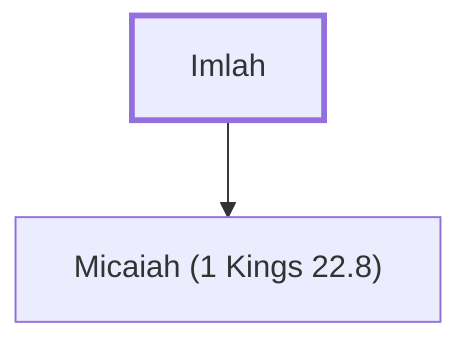

# Imlah

Father of the prophet Micaiah.

**Original-language names:** יִמְלָה (H3229)

## When

- **Placed around:** [[connections/timeline/9th century BC|897 BC]] *(Ussher: the median date of the passages naming them)*

## Family

- **Children:** [[connections/people/Micaiah (1 Kings 22.8)|Micaiah (1 Kings 22.8)]]

**Family group:** [[connections/genealogy/Family of Imlah|Family of Imlah]], generation 1

## Appears in

[[connections/chapters/11-1-kings/1 Kings 22|1 Kings 22 (2)]] · [[connections/chapters/14-2-chronicles/2 Chronicles 18|2 Chronicles 18 (2)]]

## Appears in the same verse as

[[connections/people/Israel|Israel (4)]] · [[connections/people/Micaiah (1 Kings 22.8)|Micaiah (1 Kings 22.8) (4)]] · [[connections/people/Jehoshaphat (1 Kings 15.24)|Jehoshaphat (1 Kings 15.24) (2)]]
