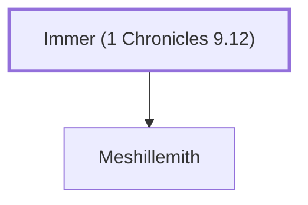

# Immer (1 Chronicles 9.12)

A priestly family in post-exilic Jerusalem.

**Original-language names:** אִמֵּר (H0564)

## When

- **Placed around:** [[connections/timeline/5th century BC|445 BC]] *(Ussher: the median date of the passages naming them)*

## Family

- **Children:** [[connections/people/Meshillemith|Meshillemith]]
- **Tribe or nation:** Tribe of Levi

**Family group:** [[connections/genealogy/Family of Immer (1 Chronicles 9.12)|Family of Immer (1 Chronicles 9.12)]], generation 1

## Appears in

[[connections/chapters/13-1-chronicles/1 Chronicles 9|1 Chronicles 9]] · [[connections/chapters/16-nehemiah/Nehemiah 11|Nehemiah 11]]

## Appears in the same verse as

[[connections/people/Adiel (1 Chronicles 9.12)|Adiel (1 Chronicles 9.12) (2)]] · [[connections/people/Maasai|Maasai (2)]] · [[connections/people/Meshillemith|Meshillemith (2)]] · [[connections/people/Meshullam (1 Chronicles 9.12)|Meshullam (1 Chronicles 9.12) (2)]] · [[connections/people/Adaiah (1 Chronicles 9.12)|Adaiah (1 Chronicles 9.12)]] · [[connections/people/Jahzerah|Jahzerah]] · [[connections/people/Jeroham (1 Chronicles 9.12)|Jeroham (1 Chronicles 9.12)]] · [[connections/people/Malchijah (1 Chronicles 9.12)|Malchijah (1 Chronicles 9.12)]] · [[connections/people/Pashhur (1 Chronicles 9.12)|Pashhur (1 Chronicles 9.12)]]
