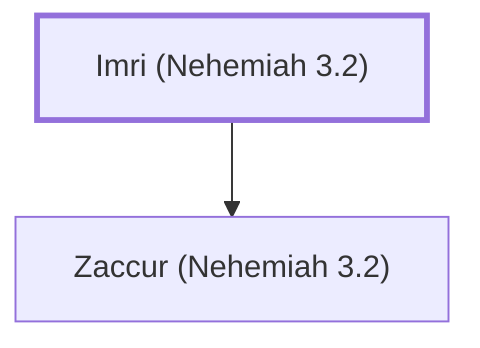

# Imri (Nehemiah 3.2)

Father of Zaccur, helped rebuild Jerusalem's wall.

**Original-language names:** אִמְרִי (H0566)

## When

- **Placed around:** [[connections/timeline/5th century BC|445 BC]] *(Ussher: the median date of the passages naming them)*

## Family

- **Children:** [[connections/people/Zaccur (Nehemiah 3.2)|Zaccur (Nehemiah 3.2)]]

**Family group:** [[connections/genealogy/Family of Imri (Nehemiah 3.2)|Family of Imri (Nehemiah 3.2)]], generation 1

## Appears in

[[connections/chapters/16-nehemiah/Nehemiah 3|Nehemiah 3]]

## Appears in the same verse as

[[connections/people/Zaccur (Nehemiah 3.2)|Zaccur (Nehemiah 3.2)]] · [[connections/places/Jericho|Jericho]]
