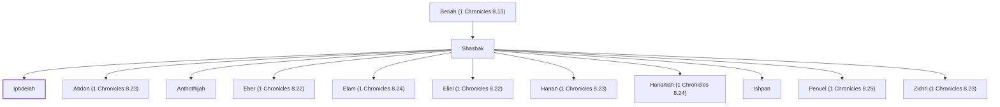

# Iphdeiah

Descendant of Benjamin through Shashak.

**Original-language names:** יִפְדְּיָה (H3301)

## Family

- **Father:** [[connections/people/Shashak|Shashak]]
- **Brothers and sisters:** [[connections/people/Abdon (1 Chronicles 8.23)|Abdon (1 Chronicles 8.23)]], [[connections/people/Anthothijah|Anthothijah]], [[connections/people/Eber (1 Chronicles 8.22)|Eber (1 Chronicles 8.22)]], [[connections/people/Elam (1 Chronicles 8.24)|Elam (1 Chronicles 8.24)]], [[connections/people/Eliel (1 Chronicles 8.22)|Eliel (1 Chronicles 8.22)]], [[connections/people/Hanan (1 Chronicles 8.23)|Hanan (1 Chronicles 8.23)]], [[connections/people/Hananiah (1 Chronicles 8.24)|Hananiah (1 Chronicles 8.24)]], [[connections/people/Ishpan|Ishpan]], [[connections/people/Penuel (1 Chronicles 8.25)|Penuel (1 Chronicles 8.25)]], [[connections/people/Zichri (1 Chronicles 8.23)|Zichri (1 Chronicles 8.23)]]
- **Tribe or nation:** Tribe of Benjamin

**Line of descent** (5 generations, father to son): [[connections/people/Shaharaim|Shaharaim]] → [[connections/people/Elpaal|Elpaal]] → [[connections/people/Beriah (1 Chronicles 8.13)|Beriah (1 Chronicles 8.13)]] → [[connections/people/Shashak|Shashak]] → **Iphdeiah**

**Family group:** [[connections/genealogy/Family of Shaharaim|Family of Shaharaim]], generation 5

## Appears in

[[connections/chapters/13-1-chronicles/1 Chronicles 8|1 Chronicles 8]]

## Appears in the same verse as

[[connections/people/Penuel (1 Chronicles 8.25)|Penuel (1 Chronicles 8.25)]] · [[connections/people/Shashak|Shashak]]
