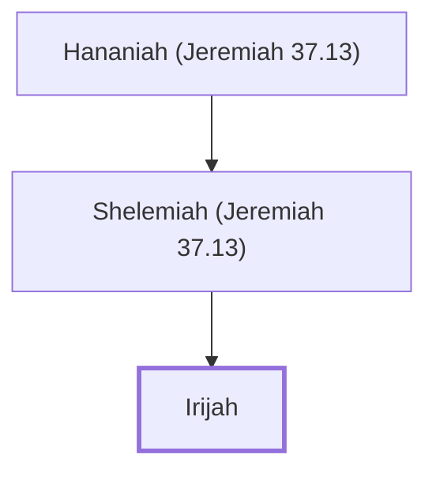

# Irijah

Captain who arrested Jeremiah for desertion.

**Original-language names:** יִרְאִיָּיה (H3376)

## When

- **Placed around:** [[connections/timeline/6th century BC|598 BC]] *(Ussher: the median date of the passages naming them)*

## Family

- **Father:** [[connections/people/Shelemiah (Jeremiah 37.13)|Shelemiah (Jeremiah 37.13)]]

**Line of descent** (3 generations, father to son): [[connections/people/Hananiah (Jeremiah 37.13)|Hananiah (Jeremiah 37.13)]] → [[connections/people/Shelemiah (Jeremiah 37.13)|Shelemiah (Jeremiah 37.13)]] → **Irijah**

**Family group:** [[connections/genealogy/Family of Hananiah (Jeremiah 37.13)|Family of Hananiah (Jeremiah 37.13)]], generation 3

## Appears in

[[connections/chapters/24-jeremiah/Jeremiah 37|Jeremiah 37 (2)]]

## Appears in the same verse as

[[connections/people/Jeremiah (2 Chronicles 35.25)|Jeremiah (2 Chronicles 35.25) (2)]] · [[connections/places/Chaldea|Chaldea (2)]] · [[connections/people/Hananiah (Jeremiah 37.13)|Hananiah (Jeremiah 37.13)]] · [[connections/people/Shelemiah (Jeremiah 37.13)|Shelemiah (Jeremiah 37.13)]] · [[connections/places/Benjamin Gate (Jeremiah 20.2)|Benjamin Gate (Jeremiah 20.2)]]
