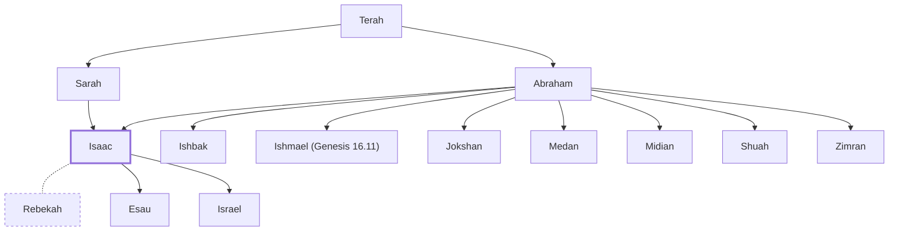

# Isaac

Son of Abraham; father of Jacob and Esau.

**Original-language names:** יִצְחָק (H3327) · יִשְׂחָק (H3446) · Ἰσαάκ (G2464)

## When

- **Lived:** [[connections/timeline/19th century BC|1896 BC]] – [[connections/timeline/18th century BC|1716 BC]] *(Jones)*
- **Placed around:** [[connections/timeline/18th century BC|1739 BC]] *(Ussher: the median date of the passages naming them)*

## Family

- **Father:** [[connections/people/Abraham|Abraham]]
- **Mother:** [[connections/people/Sarah|Sarah]]
- **Brothers and sisters:** [[connections/people/Ishbak|Ishbak]], [[connections/people/Ishmael (Genesis 16.11)|Ishmael (Genesis 16.11)]], [[connections/people/Jokshan|Jokshan]], [[connections/people/Medan|Medan]], [[connections/people/Midian|Midian]], [[connections/people/Shuah|Shuah]], [[connections/people/Zimran|Zimran]]
- **Spouses:** [[connections/people/Rebekah|Rebekah]]
- **Children:** [[connections/people/Esau|Esau]], [[connections/people/Israel|Israel]]
- **Tribe or nation:** Early Patriarch

**Line of descent** (22 generations, father to son): [[connections/people/Adam|Adam]] → [[connections/people/Seth|Seth]] → [[connections/people/Enosh|Enosh]] → [[connections/people/Kenan|Kenan]] → [[connections/people/Mahalalel (Genesis 5.12)|Mahalalel (Genesis 5.12)]] → [[connections/people/Jared|Jared]] → [[connections/people/Enoch (Genesis 5.18)|Enoch (Genesis 5.18)]] → [[connections/people/Methuselah|Methuselah]] → [[connections/people/Lamech (Genesis 5.25)|Lamech (Genesis 5.25)]] → [[connections/people/Noah (Genesis 5.29)|Noah (Genesis 5.29)]] → [[connections/people/Shem|Shem]] → [[connections/people/Arpachshad|Arpachshad]] → [[connections/people/Cainan|Cainan]] → [[connections/people/Shelah (Genesis 10.24)|Shelah (Genesis 10.24)]] → [[connections/people/Eber (Genesis 10.21)|Eber (Genesis 10.21)]] → [[connections/people/Peleg|Peleg]] → [[connections/people/Reu|Reu]] → [[connections/people/Serug|Serug]] → [[connections/people/Nahor (Genesis 11.22)|Nahor (Genesis 11.22)]] → [[connections/people/Terah|Terah]] → [[connections/people/Abraham|Abraham]] → **Isaac**

**Family group:** [[connections/genealogy/Family of Adam|Family of Adam]], generation 22

## Events

- [[connections/timeline/19th century BC|1896 BC]] · [[connections/events/Birth of Isaac|Birth of Isaac]]
- [[connections/timeline/19th century BC|1896 BC]] · [[connections/events/Lifetime of Isaac|Lifetime of Isaac]]
- [[connections/timeline/19th century BC|1856 BC]] · [[connections/events/Isaac Marries Rebekah|Isaac Marries Rebekah]]
- [[connections/timeline/19th century BC|1836 BC]] · [[connections/events/Birth of Jacob and Esau|Birth of Jacob and Esau]]
- [[connections/timeline/18th century BC|1716 BC]] · [[connections/events/Death of Isaac|Death of Isaac]]

## Appears in

[[connections/chapters/01-genesis/Genesis 17|Genesis 17 (2)]] · [[connections/chapters/01-genesis/Genesis 21|Genesis 21 (6)]] · [[connections/chapters/01-genesis/Genesis 22|Genesis 22 (5)]] · [[connections/chapters/01-genesis/Genesis 24|Genesis 24 (7)]] · [[connections/chapters/01-genesis/Genesis 25|Genesis 25 (9)]] · [[connections/chapters/01-genesis/Genesis 26|Genesis 26 (15)]] · [[connections/chapters/01-genesis/Genesis 27|Genesis 27 (12)]] · [[connections/chapters/01-genesis/Genesis 28|Genesis 28 (5)]] · [[connections/chapters/01-genesis/Genesis 31|Genesis 31 (3)]] · [[connections/chapters/01-genesis/Genesis 32|Genesis 32]] · [[connections/chapters/01-genesis/Genesis 35|Genesis 35 (4)]] · [[connections/chapters/01-genesis/Genesis 46|Genesis 46]] · [[connections/chapters/01-genesis/Genesis 48|Genesis 48 (2)]] · [[connections/chapters/01-genesis/Genesis 49|Genesis 49]] · [[connections/chapters/01-genesis/Genesis 50|Genesis 50]] · [[connections/chapters/02-exodus/Exodus 2|Exodus 2]] · [[connections/chapters/02-exodus/Exodus 3|Exodus 3 (3)]] · [[connections/chapters/02-exodus/Exodus 4|Exodus 4]] · [[connections/chapters/02-exodus/Exodus 6|Exodus 6 (2)]] · [[connections/chapters/02-exodus/Exodus 32|Exodus 32]] · [[connections/chapters/02-exodus/Exodus 33|Exodus 33]] · [[connections/chapters/03-leviticus/Leviticus 26|Leviticus 26]] · [[connections/chapters/04-numbers/Numbers 32|Numbers 32]] · [[connections/chapters/05-deuteronomy/Deuteronomy 1|Deuteronomy 1]] · [[connections/chapters/05-deuteronomy/Deuteronomy 6|Deuteronomy 6]] · [[connections/chapters/05-deuteronomy/Deuteronomy 9|Deuteronomy 9 (2)]] · [[connections/chapters/05-deuteronomy/Deuteronomy 29|Deuteronomy 29]] · [[connections/chapters/05-deuteronomy/Deuteronomy 30|Deuteronomy 30]] · [[connections/chapters/05-deuteronomy/Deuteronomy 34|Deuteronomy 34]] · [[connections/chapters/06-joshua/Joshua 24|Joshua 24 (2)]] · [[connections/chapters/11-1-kings/1 Kings 18|1 Kings 18]] · [[connections/chapters/12-2-kings/2 Kings 13|2 Kings 13]] · [[connections/chapters/13-1-chronicles/1 Chronicles 1|1 Chronicles 1 (2)]] · [[connections/chapters/13-1-chronicles/1 Chronicles 16|1 Chronicles 16]] · [[connections/chapters/13-1-chronicles/1 Chronicles 29|1 Chronicles 29]] · [[connections/chapters/14-2-chronicles/2 Chronicles 30|2 Chronicles 30]] · [[connections/chapters/19-psalms/Psalms 105|Psalms 105]] · [[connections/chapters/24-jeremiah/Jeremiah 33|Jeremiah 33]] · [[connections/chapters/30-amos/Amos 7|Amos 7 (2)]] · [[connections/chapters/40-matthew/Matthew 1|Matthew 1]] · [[connections/chapters/40-matthew/Matthew 8|Matthew 8]] · [[connections/chapters/40-matthew/Matthew 22|Matthew 22]] · [[connections/chapters/41-mark/Mark 12|Mark 12]] · [[connections/chapters/42-luke/Luke 3|Luke 3]] · [[connections/chapters/42-luke/Luke 13|Luke 13]] · [[connections/chapters/42-luke/Luke 20|Luke 20]] · [[connections/chapters/44-acts/Acts 3|Acts 3]] · [[connections/chapters/44-acts/Acts 7|Acts 7 (2)]] · [[connections/chapters/45-romans/Romans 9|Romans 9 (2)]] · [[connections/chapters/48-galatians/Galatians 4|Galatians 4]] · [[connections/chapters/58-hebrews/Hebrews 11|Hebrews 11 (4)]] · [[connections/chapters/59-james/James 2|James 2]]

## Appears in the same verse as

[[connections/people/Abraham|Abraham (66)]] · [[connections/people/Israel|Israel (54)]] · [[connections/people/Esau|Esau (16)]] · [[connections/people/Rebekah|Rebekah (12)]] · [[connections/people/Moses|Moses (6)]] · [[connections/people/Sarah|Sarah (6)]] · [[connections/places/Canaan|Canaan (5)]] · [[connections/people/Abimelech (Genesis 20.2)|Abimelech (Genesis 20.2) (4)]] · [[connections/places/Egypt|Egypt (4)]] · [[connections/places/Gerar|Gerar (4)]] · [[connections/places/Paddan|Paddan (4)]] · [[connections/people/Bethuel|Bethuel (2)]] · [[connections/people/Ishmael (Genesis 16.11)|Ishmael (Genesis 16.11) (2)]] · [[connections/people/Joseph (Genesis 30.24)|Joseph (Genesis 30.24) (2)]] · [[connections/people/Judah (Genesis 29.35)|Judah (Genesis 29.35) (2)]] · [[connections/people/Laban|Laban (2)]] · [[connections/places/Beer-lahai-roi|Beer-lahai-roi (2)]] · [[connections/places/Mamre|Mamre (2)]] · [[connections/people/David|David]] · [[connections/people/Elijah (1 Kings 17.1)|Elijah (1 Kings 17.1)]] · [[connections/people/Ephron|Ephron]] · [[connections/people/Heth|Heth]] · [[connections/people/Jeroboam (2 Kings 13.13)|Jeroboam (2 Kings 13.13)]] · [[connections/people/Jesus|Jesus]] · [[connections/people/Leah|Leah]] · [[connections/people/Nahor (Genesis 11.22)|Nahor (Genesis 11.22)]] · [[connections/people/Nahor (Genesis 11.26)|Nahor (Genesis 11.26)]] · [[connections/people/Pilate|Pilate]] · [[connections/people/Terah|Terah]] · [[connections/people/Zohar|Zohar]] · [[connections/places/Assyria|Assyria]] · [[connections/places/Beersheba|Beersheba]] · [[connections/places/Esek|Esek]] · [[connections/places/Euphrates|Euphrates]] · [[connections/places/Hebron|Hebron]] · [[connections/places/Machpelah|Machpelah]] · [[connections/places/Moriah Mount|Moriah Mount]] · [[connections/places/Negeb|Negeb]] · [[connections/places/Seir|Seir]]
