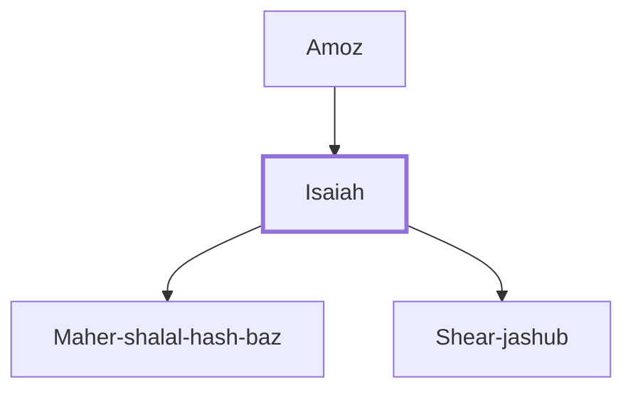

# Isaiah

Prophet during reigns of Uzziah, Jotham, Ahaz, Hezekiah.

**Original-language names:** יְשַׁעְיָ֫הוּ (H3470a) · Ἡσαΐας (G2268)

## When

- **Placed around:** [[connections/timeline/8th century BC|710 BC]] *(Ussher: the median date of the passages naming them)*

## Family

- **Father:** [[connections/people/Amoz|Amoz]]
- **Children:** [[connections/people/Maher-shalal-hash-baz|Maher-shalal-hash-baz]], [[connections/people/Shear-jashub|Shear-jashub]]

**Family group:** [[connections/genealogy/Family of Amoz|Family of Amoz]], generation 2

## Events

- [[connections/timeline/8th century BC|759 BC]] · [[connections/events/Prophecies of Isaiah|Prophecies of Isaiah]]

## Appears in

[[connections/chapters/12-2-kings/2 Kings 19|2 Kings 19 (4)]] · [[connections/chapters/12-2-kings/2 Kings 20|2 Kings 20 (9)]] · [[connections/chapters/14-2-chronicles/2 Chronicles 26|2 Chronicles 26]] · [[connections/chapters/14-2-chronicles/2 Chronicles 32|2 Chronicles 32 (2)]] · [[connections/chapters/23-isaiah/Isaiah 1|Isaiah 1]] · [[connections/chapters/23-isaiah/Isaiah 2|Isaiah 2]] · [[connections/chapters/23-isaiah/Isaiah 7|Isaiah 7]] · [[connections/chapters/23-isaiah/Isaiah 13|Isaiah 13]] · [[connections/chapters/23-isaiah/Isaiah 20|Isaiah 20 (2)]] · [[connections/chapters/23-isaiah/Isaiah 37|Isaiah 37 (4)]] · [[connections/chapters/23-isaiah/Isaiah 38|Isaiah 38 (3)]] · [[connections/chapters/23-isaiah/Isaiah 39|Isaiah 39 (3)]] · [[connections/chapters/40-matthew/Matthew 3|Matthew 3]] · [[connections/chapters/40-matthew/Matthew 4|Matthew 4]] · [[connections/chapters/40-matthew/Matthew 8|Matthew 8]] · [[connections/chapters/40-matthew/Matthew 12|Matthew 12]] · [[connections/chapters/40-matthew/Matthew 13|Matthew 13]] · [[connections/chapters/40-matthew/Matthew 15|Matthew 15]] · [[connections/chapters/41-mark/Mark 1|Mark 1]] · [[connections/chapters/41-mark/Mark 7|Mark 7]] · [[connections/chapters/42-luke/Luke 3|Luke 3]] · [[connections/chapters/42-luke/Luke 4|Luke 4]] · [[connections/chapters/43-john/John 1|John 1]] · [[connections/chapters/43-john/John 12|John 12 (3)]] · [[connections/chapters/44-acts/Acts 8|Acts 8 (2)]] · [[connections/chapters/44-acts/Acts 28|Acts 28]] · [[connections/chapters/45-romans/Romans 9|Romans 9 (2)]] · [[connections/chapters/45-romans/Romans 10|Romans 10 (2)]] · [[connections/chapters/45-romans/Romans 15|Romans 15]]

## Appears in the same verse as

[[connections/people/Hezekiah (2 Kings 16.20)|Hezekiah (2 Kings 16.20) (16)]] · [[connections/people/Amoz|Amoz (13)]] · [[connections/people/Israel|Israel (4)]] · [[connections/places/Assyria|Assyria (4)]] · [[connections/people/Ahaz (2 Kings 15.38)|Ahaz (2 Kings 15.38) (3)]] · [[connections/people/Judah (Genesis 29.35)|Judah (Genesis 29.35) (3)]] · [[connections/places/Babylon|Babylon (3)]] · [[connections/people/Eliakim (2 Kings 18.18)|Eliakim (2 Kings 18.18) (2)]] · [[connections/people/Sennacherib|Sennacherib (2)]] · [[connections/people/Shebna|Shebna (2)]] · [[connections/people/Uzziah (2 Kings 14.21)|Uzziah (2 Kings 14.21) (2)]] · [[connections/places/Jerusalem|Jerusalem (2)]] · [[connections/people/Jesse|Jesse]] · [[connections/people/Jotham (2 Kings 15.5)|Jotham (2 Kings 15.5)]] · [[connections/people/Paul|Paul]] · [[connections/people/Philip (Acts 6.5)|Philip (Acts 6.5)]] · [[connections/people/Shear-jashub|Shear-jashub]] · [[connections/places/Cush|Cush]] · [[connections/places/Egypt|Egypt]] · [[connections/places/Gomorrah|Gomorrah]] · [[connections/places/Sodom|Sodom]] · [[connections/places/Washer's Field|Washer's Field]]
