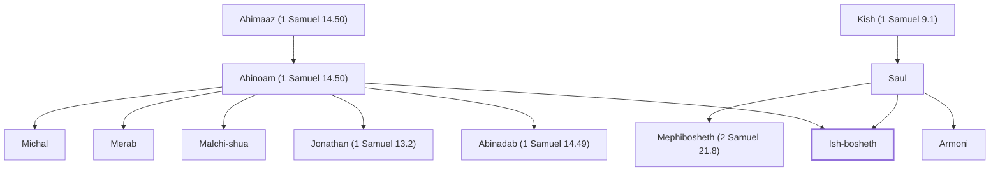

# Ish-bosheth

Son of Saul, king over Israel.

**Also called:** Eshbaal

**Original-language names:** אִישׁ־בֹ֫שֶׁת (H0378) · אֶשְׁבַּעַל (H0792)

## When

- **Placed around:** [[connections/timeline/11th century BC|1048 BC]] *(Ussher: the median date of the passages naming them)*

## Family

- **Father:** [[connections/people/Saul|Saul]]
- **Mother:** [[connections/people/Ahinoam (1 Samuel 14.50)|Ahinoam (1 Samuel 14.50) (uncertain)]]
- **Brothers and sisters:** [[connections/people/Abinadab (1 Samuel 14.49)|Abinadab (1 Samuel 14.49)]], [[connections/people/Armoni|Armoni]], [[connections/people/Jonathan (1 Samuel 13.2)|Jonathan (1 Samuel 13.2)]], [[connections/people/Malchi-shua|Malchi-shua]], [[connections/people/Mephibosheth (2 Samuel 21.8)|Mephibosheth (2 Samuel 21.8)]], [[connections/people/Merab|Merab]], [[connections/people/Michal|Michal]]
- **Tribe or nation:** Tribe of Benjamin

**Line of descent** (7 generations, father to son): [[connections/people/Aphiah|Aphiah]] → [[connections/people/Becorath|Becorath]] → [[connections/people/Zeror|Zeror]] → [[connections/people/Abiel|Abiel]] → [[connections/people/Kish (1 Samuel 9.1)|Kish (1 Samuel 9.1)]] → [[connections/people/Saul|Saul]] → **Ish-bosheth**

**Family group:** [[connections/genealogy/Family of Aphiah|Family of Aphiah]], generation 7

## Appears in

[[connections/chapters/10-2-samuel/2 Samuel 2|2 Samuel 2 (4)]] · [[connections/chapters/10-2-samuel/2 Samuel 3|2 Samuel 3 (3)]] · [[connections/chapters/10-2-samuel/2 Samuel 4|2 Samuel 4 (3)]] · [[connections/chapters/13-1-chronicles/1 Chronicles 8|1 Chronicles 8]] · [[connections/chapters/13-1-chronicles/1 Chronicles 9|1 Chronicles 9]]

## Appears in the same verse as

[[connections/people/Saul|Saul (9)]] · [[connections/people/David|David (6)]] · [[connections/people/Abner|Abner (4)]] · [[connections/people/Abiel|Abiel (2)]] · [[connections/people/Abinadab (1 Samuel 14.49)|Abinadab (1 Samuel 14.49) (2)]] · [[connections/people/Jonathan (1 Samuel 13.2)|Jonathan (1 Samuel 13.2) (2)]] · [[connections/people/Judah (Genesis 29.35)|Judah (Genesis 29.35) (2)]] · [[connections/people/Kish (1 Samuel 9.1)|Kish (1 Samuel 9.1) (2)]] · [[connections/people/Malchi-shua|Malchi-shua (2)]] · [[connections/people/Ner|Ner (2)]] · [[connections/places/Hebron|Hebron (2)]] · [[connections/places/Mahanaim|Mahanaim (2)]] · [[connections/people/Baanah (2 Samuel 4.2)|Baanah (2 Samuel 4.2)]] · [[connections/people/Benjamin (Genesis 35.18)|Benjamin (Genesis 35.18)]] · [[connections/people/Israel|Israel]] · [[connections/people/Laish|Laish]] · [[connections/people/Michal|Michal]] · [[connections/people/Palti (1 Samuel 25.44)|Palti (1 Samuel 25.44)]] · [[connections/people/Rechab (2 Samuel 4.2)|Rechab (2 Samuel 4.2)]] · [[connections/people/Rimmon|Rimmon]] · [[connections/places/Gibeon|Gibeon]]
