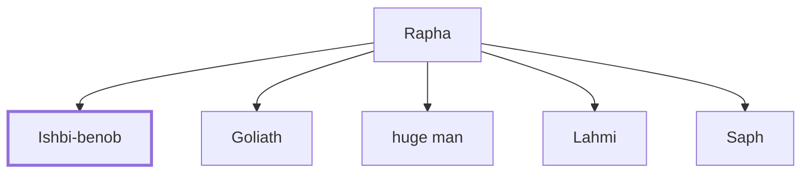

# Ishbi-benob

Philistine giant who fought against David's men.

**Original-language names:** יִשְׁבּוֹ בְּנֹב (H3430)

## When

- **Placed around:** [[connections/timeline/11th century BC|1018 BC]] *(Ussher: the median date of the passages naming them)*

## Family

- **Father:** [[connections/people/Rapha|Rapha]]
- **Brothers and sisters:** [[connections/people/Goliath|Goliath]], [[connections/people/huge man|huge man]], [[connections/people/Lahmi|Lahmi]], [[connections/people/Saph|Saph]]

**Family group:** [[connections/genealogy/Family of Rapha|Family of Rapha]], generation 2

## Appears in

[[connections/chapters/10-2-samuel/2 Samuel 21|2 Samuel 21]]

## Appears in the same verse as

[[connections/people/David|David]] · [[connections/people/Rapha|Rapha]]
