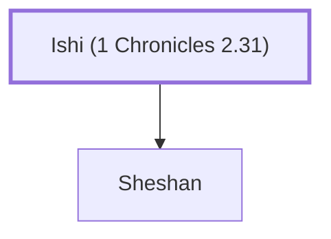

# Ishi (1 Chronicles 2.31)

Son of Appaim, descendant of Judah.

**Original-language names:** יִשְׁעִי (H3469)

## When

- **Placed around:** [[connections/timeline/15th century BC|1470 BC]] *(Ussher: the median date of the passages naming them)*

## Family

- **Children:** [[connections/people/Sheshan|Sheshan]]
- **Tribe or nation:** Tribe of Judah

**Family group:** [[connections/genealogy/Family of Ishi (1 Chronicles 2.31)|Family of Ishi (1 Chronicles 2.31)]], generation 1

## Appears in

[[connections/chapters/13-1-chronicles/1 Chronicles 2|1 Chronicles 2]]

## Appears in the same verse as

[[connections/people/Ahlai (1 Chronicles 2.31)|Ahlai (1 Chronicles 2.31)]] · [[connections/people/Sheshan|Sheshan]]
