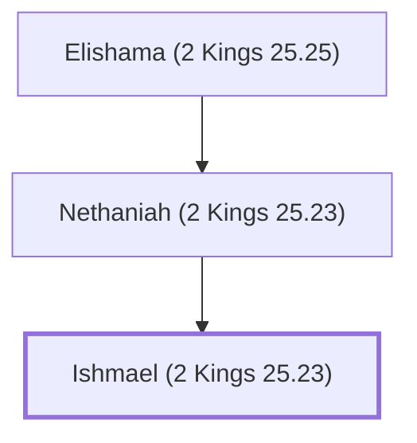

# Ishmael (2 Kings 25.23)

Assassinated Gedaliah the governor; led captives to Ammon.

**Original-language names:** יִשְׁמָעֵאל (H3458)

## When

- **Placed around:** [[connections/timeline/6th century BC|588 BC]] *(Ussher: the median date of the passages naming them)*

## Family

- **Father:** [[connections/people/Nethaniah (2 Kings 25.23)|Nethaniah (2 Kings 25.23)]]

**Line of descent** (3 generations, father to son): [[connections/people/Elishama (2 Kings 25.25)|Elishama (2 Kings 25.25)]] → [[connections/people/Nethaniah (2 Kings 25.23)|Nethaniah (2 Kings 25.23)]] → **Ishmael (2 Kings 25.23)**

**Family group:** [[connections/genealogy/Family of Elishama (2 Kings 25.25)|Family of Elishama (2 Kings 25.25)]], generation 3

## Appears in

[[connections/chapters/12-2-kings/2 Kings 25|2 Kings 25 (2)]] · [[connections/chapters/24-jeremiah/Jeremiah 40|Jeremiah 40 (4)]] · [[connections/chapters/24-jeremiah/Jeremiah 41|Jeremiah 41 (15)]]

## Appears in the same verse as

[[connections/people/Nethaniah (2 Kings 25.23)|Nethaniah (2 Kings 25.23) (16)]] · [[connections/people/Gedaliah (2 Kings 25.22)|Gedaliah (2 Kings 25.22) (14)]] · [[connections/places/Mizpah|Mizpah (10)]] · [[connections/people/Johanan (2 Kings 25.23)|Johanan (2 Kings 25.23) (9)]] · [[connections/people/Ahikam|Ahikam (8)]] · [[connections/people/Kareah|Kareah (8)]] · [[connections/places/Ammon|Ammon (3)]] · [[connections/places/Babylon|Babylon (3)]] · [[connections/places/Chaldea|Chaldea (3)]] · [[connections/people/Elishama (2 Kings 25.25)|Elishama (2 Kings 25.25) (2)]] · [[connections/people/Jezaniah|Jezaniah (2)]] · [[connections/people/Seraiah (2 Kings 25.23)|Seraiah (2 Kings 25.23) (2)]] · [[connections/people/Tanhumeth|Tanhumeth (2)]] · [[connections/places/Gibeon|Gibeon (2)]] · [[connections/people/Asa (1 Kings 15.8)|Asa (1 Kings 15.8)]] · [[connections/people/Baalis|Baalis]] · [[connections/people/Baasha|Baasha]] · [[connections/people/Ephai|Ephai]] · [[connections/people/Israel|Israel]] · [[connections/people/Jonathan (Jeremiah 40.8)|Jonathan (Jeremiah 40.8)]] · [[connections/people/Judah (Genesis 29.35)|Judah (Genesis 29.35)]] · [[connections/people/Nebuzaradan|Nebuzaradan]] · [[connections/people/Shaphan (2 Kings 22.3)|Shaphan (2 Kings 22.3)]]
