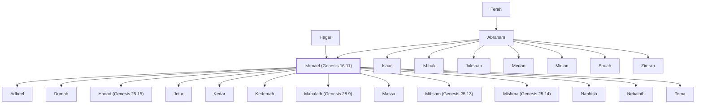

# Ishmael (Genesis 16.11)

Son of Abraham and Hagar; father of Arab tribes.

**Original-language names:** יִשְׁמָעֵאל (H3458)

## When

- **Lived:** [[connections/timeline/20th century BC|1910 BC]] – [[connections/timeline/18th century BC|1773 BC]] *(Jones)*
- **Placed around:** [[connections/timeline/19th century BC|1897 BC]] *(Ussher: the median date of the passages naming them)*

## Family

- **Father:** [[connections/people/Abraham|Abraham]]
- **Mother:** [[connections/people/Hagar|Hagar]]
- **Brothers and sisters:** [[connections/people/Isaac|Isaac]], [[connections/people/Ishbak|Ishbak]], [[connections/people/Jokshan|Jokshan]], [[connections/people/Medan|Medan]], [[connections/people/Midian|Midian]], [[connections/people/Shuah|Shuah]], [[connections/people/Zimran|Zimran]]
- **Children:** [[connections/people/Adbeel|Adbeel]], [[connections/people/Dumah|Dumah]], [[connections/people/Hadad (Genesis 25.15)|Hadad (Genesis 25.15)]], [[connections/people/Jetur|Jetur]], [[connections/people/Kedar|Kedar]], [[connections/people/Kedemah|Kedemah]], [[connections/people/Mahalath (Genesis 28.9)|Mahalath (Genesis 28.9)]], [[connections/people/Massa|Massa]], [[connections/people/Mibsam (Genesis 25.13)|Mibsam (Genesis 25.13)]], [[connections/people/Mishma (Genesis 25.14)|Mishma (Genesis 25.14)]], [[connections/people/Naphish|Naphish]], [[connections/people/Nebaioth|Nebaioth]], [[connections/people/Tema|Tema]]
- **Tribe or nation:** Arabia

**Line of descent** (22 generations, father to son): [[connections/people/Adam|Adam]] → [[connections/people/Seth|Seth]] → [[connections/people/Enosh|Enosh]] → [[connections/people/Kenan|Kenan]] → [[connections/people/Mahalalel (Genesis 5.12)|Mahalalel (Genesis 5.12)]] → [[connections/people/Jared|Jared]] → [[connections/people/Enoch (Genesis 5.18)|Enoch (Genesis 5.18)]] → [[connections/people/Methuselah|Methuselah]] → [[connections/people/Lamech (Genesis 5.25)|Lamech (Genesis 5.25)]] → [[connections/people/Noah (Genesis 5.29)|Noah (Genesis 5.29)]] → [[connections/people/Shem|Shem]] → [[connections/people/Arpachshad|Arpachshad]] → [[connections/people/Cainan|Cainan]] → [[connections/people/Shelah (Genesis 10.24)|Shelah (Genesis 10.24)]] → [[connections/people/Eber (Genesis 10.21)|Eber (Genesis 10.21)]] → [[connections/people/Peleg|Peleg]] → [[connections/people/Reu|Reu]] → [[connections/people/Serug|Serug]] → [[connections/people/Nahor (Genesis 11.22)|Nahor (Genesis 11.22)]] → [[connections/people/Terah|Terah]] → [[connections/people/Abraham|Abraham]] → **Ishmael (Genesis 16.11)**

**Family group:** [[connections/genealogy/Family of Adam|Family of Adam]], generation 22

## Events

- [[connections/timeline/20th century BC|1910 BC]] · [[connections/events/Birth of Ishmael|Birth of Ishmael]]
- [[connections/timeline/20th century BC|1910 BC]] · [[connections/events/Lifetime of Ishmael|Lifetime of Ishmael]]
- [[connections/timeline/18th century BC|1773 BC]] · [[connections/events/Death of Ishmael|Death of Ishmael]]

## Appears in

[[connections/chapters/01-genesis/Genesis 16|Genesis 16 (3)]] · [[connections/chapters/01-genesis/Genesis 17|Genesis 17 (5)]] · [[connections/chapters/01-genesis/Genesis 25|Genesis 25 (5)]] · [[connections/chapters/01-genesis/Genesis 28|Genesis 28]] · [[connections/chapters/01-genesis/Genesis 36|Genesis 36]] · [[connections/chapters/13-1-chronicles/1 Chronicles 1|1 Chronicles 1 (3)]]

## Appears in the same verse as

[[connections/people/Abraham|Abraham (8)]] · [[connections/people/Nebaioth|Nebaioth (4)]] · [[connections/people/Hagar|Hagar (3)]] · [[connections/people/Adbeel|Adbeel (2)]] · [[connections/people/Isaac|Isaac (2)]] · [[connections/people/Kedar|Kedar (2)]] · [[connections/people/Mahalath (Genesis 28.9)|Mahalath (Genesis 28.9) (2)]] · [[connections/people/Mibsam (Genesis 25.13)|Mibsam (Genesis 25.13) (2)]] · [[connections/people/Ephron|Ephron]] · [[connections/people/Esau|Esau]] · [[connections/people/Jetur|Jetur]] · [[connections/people/Kedemah|Kedemah]] · [[connections/people/Naphish|Naphish]] · [[connections/people/Sarah|Sarah]] · [[connections/people/Zohar|Zohar]] · [[connections/places/Machpelah|Machpelah]] · [[connections/places/Mamre|Mamre]]
