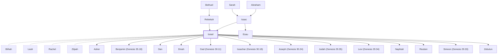

# Israel

Patriarch, son of Isaac, father of twelve tribes

**Also called:** Jacob, Jeshurun

**Original-language names:** יִשְׂרָאֵל (H3478) · יִשְׂרָאֵל (H3479) · יַעֲקֹב (H3290) · יְשֻׁרוּן (H3484) · Ἰσραήλ (G2474) · Ἰακώβ (G2384)

## When

- **Lived:** [[connections/timeline/19th century BC|1836 BC]] – [[connections/timeline/17th century BC|1689 BC]] *(Jones)*
- **Placed around:** [[connections/timeline/11th century BC|1023 BC]] *(Ussher: the median date of the passages naming them)*

## Family

- **Father:** [[connections/people/Isaac|Isaac]]
- **Mother:** [[connections/people/Rebekah|Rebekah]]
- **Brothers and sisters:** [[connections/people/Esau|Esau]]
- **Spouses:** [[connections/people/Bilhah|Bilhah]], [[connections/people/Leah|Leah]], [[connections/people/Rachel|Rachel]], [[connections/people/Zilpah|Zilpah]]
- **Children:** [[connections/people/Asher|Asher]], [[connections/people/Benjamin (Genesis 35.18)|Benjamin (Genesis 35.18)]], [[connections/people/Dan|Dan]], [[connections/people/Dinah|Dinah]], [[connections/people/Gad (Genesis 30.11)|Gad (Genesis 30.11)]], [[connections/people/Issachar (Genesis 30.18)|Issachar (Genesis 30.18)]], [[connections/people/Joseph (Genesis 30.24)|Joseph (Genesis 30.24)]], [[connections/people/Judah (Genesis 29.35)|Judah (Genesis 29.35)]], [[connections/people/Levi (Genesis 29.34)|Levi (Genesis 29.34)]], [[connections/people/Naphtali|Naphtali]], [[connections/people/Reuben|Reuben]], [[connections/people/Simeon (Genesis 29.33)|Simeon (Genesis 29.33)]], [[connections/people/Zebulun|Zebulun]]
- **Tribe or nation:** Early Patriarch

**Line of descent** (23 generations, father to son): [[connections/people/Adam|Adam]] → [[connections/people/Seth|Seth]] → [[connections/people/Enosh|Enosh]] → [[connections/people/Kenan|Kenan]] → [[connections/people/Mahalalel (Genesis 5.12)|Mahalalel (Genesis 5.12)]] → [[connections/people/Jared|Jared]] → [[connections/people/Enoch (Genesis 5.18)|Enoch (Genesis 5.18)]] → [[connections/people/Methuselah|Methuselah]] → [[connections/people/Lamech (Genesis 5.25)|Lamech (Genesis 5.25)]] → [[connections/people/Noah (Genesis 5.29)|Noah (Genesis 5.29)]] → [[connections/people/Shem|Shem]] → [[connections/people/Arpachshad|Arpachshad]] → [[connections/people/Cainan|Cainan]] → [[connections/people/Shelah (Genesis 10.24)|Shelah (Genesis 10.24)]] → [[connections/people/Eber (Genesis 10.21)|Eber (Genesis 10.21)]] → [[connections/people/Peleg|Peleg]] → [[connections/people/Reu|Reu]] → [[connections/people/Serug|Serug]] → [[connections/people/Nahor (Genesis 11.22)|Nahor (Genesis 11.22)]] → [[connections/people/Terah|Terah]] → [[connections/people/Abraham|Abraham]] → [[connections/people/Isaac|Isaac]] → **Israel**

**Family group:** [[connections/genealogy/Family of Adam|Family of Adam]], generation 23

## Events

- [[connections/timeline/19th century BC|1836 BC]] · [[connections/events/Birth of Jacob and Esau|Birth of Jacob and Esau]]
- [[connections/timeline/19th century BC|1836 BC]] · [[connections/events/Lifetime of Jacob|Lifetime of Jacob]]
- [[connections/timeline/18th century BC|1758 BC]] · [[connections/events/Birth of Reuben|Birth of Reuben]]
- [[connections/timeline/18th century BC|1757 BC]] · [[connections/events/Birth of Simeon|Birth of Simeon]]
- [[connections/timeline/18th century BC|1756 BC]] · [[connections/events/Birth of Levi|Birth of Levi]]
- [[connections/timeline/18th century BC|1755 BC]] · [[connections/events/Birth of Judah|Birth of Judah]]
- [[connections/timeline/18th century BC|1755 BC]] · [[connections/events/Birth of Dan|Birth of Dan]]
- [[connections/timeline/18th century BC|1754 BC]] · [[connections/events/Birth of Naphtali|Birth of Naphtali]]
- [[connections/timeline/18th century BC|1753 BC]] · [[connections/events/Birth of Gad|Birth of Gad]]
- [[connections/timeline/18th century BC|1752 BC]] · [[connections/events/Birth of Asher|Birth of Asher]]
- [[connections/timeline/18th century BC|1752 BC]] · [[connections/events/Birth of Issachar|Birth of Issachar]]
- [[connections/timeline/18th century BC|1751 BC]] · [[connections/events/Birth of Zebulon|Birth of Zebulon]]
- [[connections/timeline/18th century BC|1750 BC]] · [[connections/events/Birth of Dinah|Birth of Dinah]]
- [[connections/timeline/18th century BC|1745 BC]] · [[connections/events/Birth of Joseph|Birth of Joseph]]
- [[connections/timeline/18th century BC|1739 BC]] · [[connections/events/Rachel dies giving birth to Benjamin|Rachel dies giving birth to Benjamin]]
- [[connections/timeline/18th century BC|1728 BC]] · [[connections/events/Joseph sold to Egypt|Joseph sold to Egypt]]
- [[connections/timeline/18th century BC|1718 BC]] · [[connections/events/Joseph imprisoned|Joseph imprisoned]]
- [[connections/timeline/18th century BC|1708 BC]] · [[connections/events/7 years of famine|7 years of famine]]
- [[connections/timeline/18th century BC|1706 BC]] · [[connections/events/Joseph's brothers return to Egypt|Joseph's brothers return to Egypt]]
- [[connections/timeline/17th century BC|1689 BC]] · [[connections/events/Death of Jacob|Death of Jacob]]

## Appears in

[[connections/chapters/01-genesis/Genesis 25|Genesis 25 (8)]] · [[connections/chapters/01-genesis/Genesis 27|Genesis 27 (12)]] · [[connections/chapters/01-genesis/Genesis 28|Genesis 28 (8)]] · [[connections/chapters/01-genesis/Genesis 29|Genesis 29 (11)]] · [[connections/chapters/01-genesis/Genesis 30|Genesis 30 (18)]] · [[connections/chapters/01-genesis/Genesis 31|Genesis 31 (23)]] · [[connections/chapters/01-genesis/Genesis 32|Genesis 32 (16)]] · [[connections/chapters/01-genesis/Genesis 33|Genesis 33 (4)]] · [[connections/chapters/01-genesis/Genesis 34|Genesis 34 (10)]] · [[connections/chapters/01-genesis/Genesis 35|Genesis 35 (16)]] · [[connections/chapters/01-genesis/Genesis 36|Genesis 36 (2)]] · [[connections/chapters/01-genesis/Genesis 37|Genesis 37 (5)]] · [[connections/chapters/01-genesis/Genesis 42|Genesis 42 (5)]] · [[connections/chapters/01-genesis/Genesis 43|Genesis 43 (3)]] · [[connections/chapters/01-genesis/Genesis 45|Genesis 45 (4)]] · [[connections/chapters/01-genesis/Genesis 46|Genesis 46 (14)]] · [[connections/chapters/01-genesis/Genesis 47|Genesis 47 (8)]] · [[connections/chapters/01-genesis/Genesis 48|Genesis 48 (9)]] · [[connections/chapters/01-genesis/Genesis 49|Genesis 49 (7)]] · [[connections/chapters/01-genesis/Genesis 50|Genesis 50 (3)]] · [[connections/chapters/02-exodus/Exodus 1|Exodus 1 (6)]] · [[connections/chapters/02-exodus/Exodus 2|Exodus 2 (3)]] · [[connections/chapters/02-exodus/Exodus 3|Exodus 3 (9)]] · [[connections/chapters/02-exodus/Exodus 4|Exodus 4 (4)]] · [[connections/chapters/02-exodus/Exodus 5|Exodus 5 (5)]] · [[connections/chapters/02-exodus/Exodus 6|Exodus 6 (11)]] · [[connections/chapters/02-exodus/Exodus 7|Exodus 7 (3)]] · [[connections/chapters/02-exodus/Exodus 9|Exodus 9 (5)]] · [[connections/chapters/02-exodus/Exodus 10|Exodus 10 (2)]] · [[connections/chapters/02-exodus/Exodus 11|Exodus 11 (2)]] · [[connections/chapters/02-exodus/Exodus 12|Exodus 12 (15)]] · [[connections/chapters/02-exodus/Exodus 13|Exodus 13 (3)]] · [[connections/chapters/02-exodus/Exodus 14|Exodus 14 (14)]] · [[connections/chapters/02-exodus/Exodus 15|Exodus 15 (3)]] · [[connections/chapters/02-exodus/Exodus 16|Exodus 16 (11)]] · [[connections/chapters/02-exodus/Exodus 17|Exodus 17 (6)]] · [[connections/chapters/02-exodus/Exodus 18|Exodus 18 (5)]] · [[connections/chapters/02-exodus/Exodus 19|Exodus 19 (4)]] · [[connections/chapters/02-exodus/Exodus 20|Exodus 20]] · [[connections/chapters/02-exodus/Exodus 24|Exodus 24 (7)]] · [[connections/chapters/02-exodus/Exodus 25|Exodus 25 (2)]] · [[connections/chapters/02-exodus/Exodus 27|Exodus 27 (2)]] · [[connections/chapters/02-exodus/Exodus 28|Exodus 28 (8)]] · [[connections/chapters/02-exodus/Exodus 29|Exodus 29 (3)]] · [[connections/chapters/02-exodus/Exodus 30|Exodus 30 (3)]] · [[connections/chapters/02-exodus/Exodus 31|Exodus 31 (3)]] · [[connections/chapters/02-exodus/Exodus 32|Exodus 32 (5)]] · [[connections/chapters/02-exodus/Exodus 33|Exodus 33 (3)]] · [[connections/chapters/02-exodus/Exodus 34|Exodus 34 (6)]] · [[connections/chapters/02-exodus/Exodus 35|Exodus 35 (5)]] · [[connections/chapters/02-exodus/Exodus 36|Exodus 36]] · [[connections/chapters/02-exodus/Exodus 39|Exodus 39 (5)]] · [[connections/chapters/02-exodus/Exodus 40|Exodus 40 (2)]] · [[connections/chapters/03-leviticus/Leviticus 1|Leviticus 1]] · [[connections/chapters/03-leviticus/Leviticus 4|Leviticus 4 (2)]] · [[connections/chapters/03-leviticus/Leviticus 7|Leviticus 7 (5)]] · [[connections/chapters/03-leviticus/Leviticus 9|Leviticus 9 (2)]] · [[connections/chapters/03-leviticus/Leviticus 10|Leviticus 10 (3)]] · [[connections/chapters/03-leviticus/Leviticus 11|Leviticus 11]] · [[connections/chapters/03-leviticus/Leviticus 12|Leviticus 12]] · [[connections/chapters/03-leviticus/Leviticus 15|Leviticus 15 (2)]] · [[connections/chapters/03-leviticus/Leviticus 16|Leviticus 16 (6)]] · [[connections/chapters/03-leviticus/Leviticus 17|Leviticus 17 (8)]] · [[connections/chapters/03-leviticus/Leviticus 18|Leviticus 18]] · [[connections/chapters/03-leviticus/Leviticus 19|Leviticus 19]] · [[connections/chapters/03-leviticus/Leviticus 20|Leviticus 20]] · [[connections/chapters/03-leviticus/Leviticus 21|Leviticus 21]] · [[connections/chapters/03-leviticus/Leviticus 22|Leviticus 22 (5)]] · [[connections/chapters/03-leviticus/Leviticus 23|Leviticus 23 (7)]] · [[connections/chapters/03-leviticus/Leviticus 24|Leviticus 24 (5)]] · [[connections/chapters/03-leviticus/Leviticus 25|Leviticus 25 (4)]] · [[connections/chapters/03-leviticus/Leviticus 26|Leviticus 26 (2)]] · [[connections/chapters/03-leviticus/Leviticus 27|Leviticus 27 (2)]] · [[connections/chapters/04-numbers/Numbers 1|Numbers 1 (10)]] · [[connections/chapters/04-numbers/Numbers 2|Numbers 2 (4)]] · [[connections/chapters/04-numbers/Numbers 3|Numbers 3 (11)]] · [[connections/chapters/04-numbers/Numbers 4|Numbers 4]] · [[connections/chapters/04-numbers/Numbers 5|Numbers 5 (5)]] · [[connections/chapters/04-numbers/Numbers 6|Numbers 6 (3)]] · [[connections/chapters/04-numbers/Numbers 7|Numbers 7 (2)]] · [[connections/chapters/04-numbers/Numbers 8|Numbers 8 (10)]] · [[connections/chapters/04-numbers/Numbers 9|Numbers 9 (9)]] · [[connections/chapters/04-numbers/Numbers 10|Numbers 10 (5)]] · [[connections/chapters/04-numbers/Numbers 11|Numbers 11 (3)]] · [[connections/chapters/04-numbers/Numbers 13|Numbers 13 (5)]] · [[connections/chapters/04-numbers/Numbers 14|Numbers 14 (6)]] · [[connections/chapters/04-numbers/Numbers 15|Numbers 15 (7)]] · [[connections/chapters/04-numbers/Numbers 16|Numbers 16 (4)]] · [[connections/chapters/04-numbers/Numbers 17|Numbers 17 (8)]] · [[connections/chapters/04-numbers/Numbers 18|Numbers 18 (14)]] · [[connections/chapters/04-numbers/Numbers 19|Numbers 19 (4)]] · [[connections/chapters/04-numbers/Numbers 20|Numbers 20 (9)]] · [[connections/chapters/04-numbers/Numbers 21|Numbers 21 (11)]] · [[connections/chapters/04-numbers/Numbers 22|Numbers 22 (3)]] · [[connections/chapters/04-numbers/Numbers 23|Numbers 23 (4)]] · [[connections/chapters/04-numbers/Numbers 24|Numbers 24 (6)]] · [[connections/chapters/04-numbers/Numbers 25|Numbers 25 (8)]] · [[connections/chapters/04-numbers/Numbers 26|Numbers 26 (7)]] · [[connections/chapters/04-numbers/Numbers 27|Numbers 27 (5)]] · [[connections/chapters/04-numbers/Numbers 28|Numbers 28]] · [[connections/chapters/04-numbers/Numbers 30|Numbers 30 (2)]] · [[connections/chapters/04-numbers/Numbers 31|Numbers 31 (10)]] · [[connections/chapters/04-numbers/Numbers 32|Numbers 32 (10)]] · [[connections/chapters/04-numbers/Numbers 33|Numbers 33 (6)]] · [[connections/chapters/04-numbers/Numbers 34|Numbers 34 (3)]] · [[connections/chapters/04-numbers/Numbers 35|Numbers 35 (5)]] · [[connections/chapters/04-numbers/Numbers 36|Numbers 36 (9)]] · [[connections/chapters/05-deuteronomy/Deuteronomy 1|Deuteronomy 1 (4)]] · [[connections/chapters/05-deuteronomy/Deuteronomy 2|Deuteronomy 2]] · [[connections/chapters/05-deuteronomy/Deuteronomy 3|Deuteronomy 3]] · [[connections/chapters/05-deuteronomy/Deuteronomy 4|Deuteronomy 4 (4)]] · [[connections/chapters/05-deuteronomy/Deuteronomy 5|Deuteronomy 5]] · [[connections/chapters/05-deuteronomy/Deuteronomy 6|Deuteronomy 6 (3)]] · [[connections/chapters/05-deuteronomy/Deuteronomy 9|Deuteronomy 9 (3)]] · [[connections/chapters/05-deuteronomy/Deuteronomy 10|Deuteronomy 10 (2)]] · [[connections/chapters/05-deuteronomy/Deuteronomy 11|Deuteronomy 11]] · [[connections/chapters/05-deuteronomy/Deuteronomy 13|Deuteronomy 13]] · [[connections/chapters/05-deuteronomy/Deuteronomy 17|Deuteronomy 17 (3)]] · [[connections/chapters/05-deuteronomy/Deuteronomy 18|Deuteronomy 18 (2)]] · [[connections/chapters/05-deuteronomy/Deuteronomy 19|Deuteronomy 19]] · [[connections/chapters/05-deuteronomy/Deuteronomy 20|Deuteronomy 20]] · [[connections/chapters/05-deuteronomy/Deuteronomy 21|Deuteronomy 21 (2)]] · [[connections/chapters/05-deuteronomy/Deuteronomy 22|Deuteronomy 22 (3)]] · [[connections/chapters/05-deuteronomy/Deuteronomy 23|Deuteronomy 23]] · [[connections/chapters/05-deuteronomy/Deuteronomy 24|Deuteronomy 24]] · [[connections/chapters/05-deuteronomy/Deuteronomy 25|Deuteronomy 25 (3)]] · [[connections/chapters/05-deuteronomy/Deuteronomy 26|Deuteronomy 26]] · [[connections/chapters/05-deuteronomy/Deuteronomy 27|Deuteronomy 27 (3)]] · [[connections/chapters/05-deuteronomy/Deuteronomy 28|Deuteronomy 28]] · [[connections/chapters/05-deuteronomy/Deuteronomy 29|Deuteronomy 29 (4)]] · [[connections/chapters/05-deuteronomy/Deuteronomy 30|Deuteronomy 30]] · [[connections/chapters/05-deuteronomy/Deuteronomy 31|Deuteronomy 31 (8)]] · [[connections/chapters/05-deuteronomy/Deuteronomy 32|Deuteronomy 32 (7)]] · [[connections/chapters/05-deuteronomy/Deuteronomy 33|Deuteronomy 33 (8)]] · [[connections/chapters/05-deuteronomy/Deuteronomy 34|Deuteronomy 34 (5)]] · [[connections/chapters/06-joshua/Joshua 1|Joshua 1]] · [[connections/chapters/06-joshua/Joshua 2|Joshua 2]] · [[connections/chapters/06-joshua/Joshua 3|Joshua 3 (5)]] · [[connections/chapters/06-joshua/Joshua 4|Joshua 4 (8)]] · [[connections/chapters/06-joshua/Joshua 5|Joshua 5 (6)]] · [[connections/chapters/06-joshua/Joshua 6|Joshua 6 (4)]] · [[connections/chapters/06-joshua/Joshua 7|Joshua 7 (13)]] · [[connections/chapters/06-joshua/Joshua 8|Joshua 8 (13)]] · [[connections/chapters/06-joshua/Joshua 9|Joshua 9 (7)]] · [[connections/chapters/06-joshua/Joshua 10|Joshua 10 (20)]] · [[connections/chapters/06-joshua/Joshua 11|Joshua 11 (11)]] · [[connections/chapters/06-joshua/Joshua 12|Joshua 12 (3)]] · [[connections/chapters/06-joshua/Joshua 13|Joshua 13 (5)]] · [[connections/chapters/06-joshua/Joshua 14|Joshua 14 (4)]] · [[connections/chapters/06-joshua/Joshua 17|Joshua 17]] · [[connections/chapters/06-joshua/Joshua 18|Joshua 18 (4)]] · [[connections/chapters/06-joshua/Joshua 19|Joshua 19 (2)]] · [[connections/chapters/06-joshua/Joshua 20|Joshua 20 (2)]] · [[connections/chapters/06-joshua/Joshua 21|Joshua 21 (6)]] · [[connections/chapters/06-joshua/Joshua 22|Joshua 22 (15)]] · [[connections/chapters/06-joshua/Joshua 23|Joshua 23 (2)]] · [[connections/chapters/06-joshua/Joshua 24|Joshua 24 (7)]] · [[connections/chapters/07-judges/Judges 1|Judges 1 (2)]] · [[connections/chapters/07-judges/Judges 2|Judges 2 (8)]] · [[connections/chapters/07-judges/Judges 3|Judges 3 (15)]] · [[connections/chapters/07-judges/Judges 4|Judges 4 (7)]] · [[connections/chapters/07-judges/Judges 5|Judges 5 (7)]] · [[connections/chapters/07-judges/Judges 6|Judges 6 (11)]] · [[connections/chapters/07-judges/Judges 7|Judges 7 (5)]] · [[connections/chapters/07-judges/Judges 8|Judges 8 (6)]] · [[connections/chapters/07-judges/Judges 9|Judges 9 (2)]] · [[connections/chapters/07-judges/Judges 10|Judges 10 (12)]] · [[connections/chapters/07-judges/Judges 11|Judges 11 (16)]] · [[connections/chapters/07-judges/Judges 12|Judges 12 (6)]] · [[connections/chapters/07-judges/Judges 13|Judges 13 (2)]] · [[connections/chapters/07-judges/Judges 14|Judges 14]] · [[connections/chapters/07-judges/Judges 15|Judges 15]] · [[connections/chapters/07-judges/Judges 16|Judges 16]] · [[connections/chapters/07-judges/Judges 17|Judges 17]] · [[connections/chapters/07-judges/Judges 18|Judges 18 (3)]] · [[connections/chapters/07-judges/Judges 19|Judges 19 (4)]] · [[connections/chapters/07-judges/Judges 20|Judges 20 (34)]] · [[connections/chapters/07-judges/Judges 21|Judges 21 (10)]] · [[connections/chapters/08-ruth/Ruth 2|Ruth 2]] · [[connections/chapters/08-ruth/Ruth 4|Ruth 4 (3)]] · [[connections/chapters/09-1-samuel/1 Samuel 1|1 Samuel 1]] · [[connections/chapters/09-1-samuel/1 Samuel 2|1 Samuel 2 (6)]] · [[connections/chapters/09-1-samuel/1 Samuel 3|1 Samuel 3 (2)]] · [[connections/chapters/09-1-samuel/1 Samuel 4|1 Samuel 4 (9)]] · [[connections/chapters/09-1-samuel/1 Samuel 5|1 Samuel 5 (4)]] · [[connections/chapters/09-1-samuel/1 Samuel 6|1 Samuel 6 (2)]] · [[connections/chapters/09-1-samuel/1 Samuel 7|1 Samuel 7 (15)]] · [[connections/chapters/09-1-samuel/1 Samuel 8|1 Samuel 8 (3)]] · [[connections/chapters/09-1-samuel/1 Samuel 9|1 Samuel 9 (5)]] · [[connections/chapters/09-1-samuel/1 Samuel 10|1 Samuel 10 (2)]] · [[connections/chapters/09-1-samuel/1 Samuel 11|1 Samuel 11 (6)]] · [[connections/chapters/09-1-samuel/1 Samuel 12|1 Samuel 12 (2)]] · [[connections/chapters/09-1-samuel/1 Samuel 13|1 Samuel 13 (8)]] · [[connections/chapters/09-1-samuel/1 Samuel 14|1 Samuel 14 (13)]] · [[connections/chapters/09-1-samuel/1 Samuel 15|1 Samuel 15 (9)]] · [[connections/chapters/09-1-samuel/1 Samuel 16|1 Samuel 16]] · [[connections/chapters/09-1-samuel/1 Samuel 17|1 Samuel 17 (14)]] · [[connections/chapters/09-1-samuel/1 Samuel 18|1 Samuel 18 (3)]] · [[connections/chapters/09-1-samuel/1 Samuel 19|1 Samuel 19]] · [[connections/chapters/09-1-samuel/1 Samuel 20|1 Samuel 20]] · [[connections/chapters/09-1-samuel/1 Samuel 23|1 Samuel 23 (3)]] · [[connections/chapters/09-1-samuel/1 Samuel 24|1 Samuel 24 (3)]] · [[connections/chapters/09-1-samuel/1 Samuel 25|1 Samuel 25 (4)]] · [[connections/chapters/09-1-samuel/1 Samuel 26|1 Samuel 26 (3)]] · [[connections/chapters/09-1-samuel/1 Samuel 27|1 Samuel 27 (2)]] · [[connections/chapters/09-1-samuel/1 Samuel 28|1 Samuel 28 (4)]] · [[connections/chapters/09-1-samuel/1 Samuel 29|1 Samuel 29 (2)]] · [[connections/chapters/09-1-samuel/1 Samuel 30|1 Samuel 30]] · [[connections/chapters/09-1-samuel/1 Samuel 31|1 Samuel 31 (2)]] · [[connections/chapters/10-2-samuel/2 Samuel 1|2 Samuel 1 (4)]] · [[connections/chapters/10-2-samuel/2 Samuel 2|2 Samuel 2 (4)]] · [[connections/chapters/10-2-samuel/2 Samuel 3|2 Samuel 3 (8)]] · [[connections/chapters/10-2-samuel/2 Samuel 4|2 Samuel 4]] · [[connections/chapters/10-2-samuel/2 Samuel 5|2 Samuel 5 (6)]] · [[connections/chapters/10-2-samuel/2 Samuel 6|2 Samuel 6 (6)]] · [[connections/chapters/10-2-samuel/2 Samuel 7|2 Samuel 7 (9)]] · [[connections/chapters/10-2-samuel/2 Samuel 8|2 Samuel 8]] · [[connections/chapters/10-2-samuel/2 Samuel 10|2 Samuel 10 (5)]] · [[connections/chapters/10-2-samuel/2 Samuel 11|2 Samuel 11 (2)]] · [[connections/chapters/10-2-samuel/2 Samuel 12|2 Samuel 12 (3)]] · [[connections/chapters/10-2-samuel/2 Samuel 13|2 Samuel 13 (2)]] · [[connections/chapters/10-2-samuel/2 Samuel 14|2 Samuel 14]] · [[connections/chapters/10-2-samuel/2 Samuel 15|2 Samuel 15 (4)]] · [[connections/chapters/10-2-samuel/2 Samuel 16|2 Samuel 16 (5)]] · [[connections/chapters/10-2-samuel/2 Samuel 17|2 Samuel 17 (8)]] · [[connections/chapters/10-2-samuel/2 Samuel 18|2 Samuel 18 (4)]] · [[connections/chapters/10-2-samuel/2 Samuel 19|2 Samuel 19 (8)]] · [[connections/chapters/10-2-samuel/2 Samuel 20|2 Samuel 20 (5)]] · [[connections/chapters/10-2-samuel/2 Samuel 21|2 Samuel 21 (6)]] · [[connections/chapters/10-2-samuel/2 Samuel 23|2 Samuel 23 (3)]] · [[connections/chapters/10-2-samuel/2 Samuel 24|2 Samuel 24 (6)]] · [[connections/chapters/11-1-kings/1 Kings 1|1 Kings 1 (6)]] · [[connections/chapters/11-1-kings/1 Kings 2|1 Kings 2 (5)]] · [[connections/chapters/11-1-kings/1 Kings 3|1 Kings 3]] · [[connections/chapters/11-1-kings/1 Kings 4|1 Kings 4 (3)]] · [[connections/chapters/11-1-kings/1 Kings 5|1 Kings 5 (2)]] · [[connections/chapters/11-1-kings/1 Kings 6|1 Kings 6 (2)]] · [[connections/chapters/11-1-kings/1 Kings 8|1 Kings 8 (29)]] · [[connections/chapters/11-1-kings/1 Kings 9|1 Kings 9 (5)]] · [[connections/chapters/11-1-kings/1 Kings 10|1 Kings 10]] · [[connections/chapters/11-1-kings/1 Kings 11|1 Kings 11 (9)]] · [[connections/chapters/11-1-kings/1 Kings 12|1 Kings 12 (11)]] · [[connections/chapters/11-1-kings/1 Kings 14|1 Kings 14 (10)]] · [[connections/chapters/11-1-kings/1 Kings 15|1 Kings 15 (13)]] · [[connections/chapters/11-1-kings/1 Kings 16|1 Kings 16 (15)]] · [[connections/chapters/11-1-kings/1 Kings 17|1 Kings 17 (2)]] · [[connections/chapters/11-1-kings/1 Kings 18|1 Kings 18 (6)]] · [[connections/chapters/11-1-kings/1 Kings 19|1 Kings 19 (4)]] · [[connections/chapters/11-1-kings/1 Kings 20|1 Kings 20 (18)]] · [[connections/chapters/11-1-kings/1 Kings 21|1 Kings 21 (5)]] · [[connections/chapters/11-1-kings/1 Kings 22|1 Kings 22 (24)]] · [[connections/chapters/12-2-kings/2 Kings 1|2 Kings 1 (5)]] · [[connections/chapters/12-2-kings/2 Kings 2|2 Kings 2]] · [[connections/chapters/12-2-kings/2 Kings 3|2 Kings 3 (12)]] · [[connections/chapters/12-2-kings/2 Kings 5|2 Kings 5 (8)]] · [[connections/chapters/12-2-kings/2 Kings 6|2 Kings 6 (8)]] · [[connections/chapters/12-2-kings/2 Kings 7|2 Kings 7 (2)]] · [[connections/chapters/12-2-kings/2 Kings 8|2 Kings 8 (5)]] · [[connections/chapters/12-2-kings/2 Kings 9|2 Kings 9 (6)]] · [[connections/chapters/12-2-kings/2 Kings 10|2 Kings 10 (8)]] · [[connections/chapters/12-2-kings/2 Kings 13|2 Kings 13 (17)]] · [[connections/chapters/12-2-kings/2 Kings 14|2 Kings 14 (16)]] · [[connections/chapters/12-2-kings/2 Kings 15|2 Kings 15 (18)]] · [[connections/chapters/12-2-kings/2 Kings 16|2 Kings 16 (3)]] · [[connections/chapters/12-2-kings/2 Kings 17|2 Kings 17 (15)]] · [[connections/chapters/12-2-kings/2 Kings 18|2 Kings 18 (6)]] · [[connections/chapters/12-2-kings/2 Kings 19|2 Kings 19 (3)]] · [[connections/chapters/12-2-kings/2 Kings 21|2 Kings 21 (6)]] · [[connections/chapters/12-2-kings/2 Kings 22|2 Kings 22 (2)]] · [[connections/chapters/12-2-kings/2 Kings 23|2 Kings 23 (5)]] · [[connections/chapters/12-2-kings/2 Kings 24|2 Kings 24]] · [[connections/chapters/13-1-chronicles/1 Chronicles 1|1 Chronicles 1 (2)]] · [[connections/chapters/13-1-chronicles/1 Chronicles 2|1 Chronicles 2 (2)]] · [[connections/chapters/13-1-chronicles/1 Chronicles 4|1 Chronicles 4]] · [[connections/chapters/13-1-chronicles/1 Chronicles 5|1 Chronicles 5 (4)]] · [[connections/chapters/13-1-chronicles/1 Chronicles 6|1 Chronicles 6 (3)]] · [[connections/chapters/13-1-chronicles/1 Chronicles 7|1 Chronicles 7]] · [[connections/chapters/13-1-chronicles/1 Chronicles 9|1 Chronicles 9 (2)]] · [[connections/chapters/13-1-chronicles/1 Chronicles 10|1 Chronicles 10 (2)]] · [[connections/chapters/13-1-chronicles/1 Chronicles 11|1 Chronicles 11 (5)]] · [[connections/chapters/13-1-chronicles/1 Chronicles 12|1 Chronicles 12 (3)]] · [[connections/chapters/13-1-chronicles/1 Chronicles 13|1 Chronicles 13 (4)]] · [[connections/chapters/13-1-chronicles/1 Chronicles 14|1 Chronicles 14 (2)]] · [[connections/chapters/13-1-chronicles/1 Chronicles 15|1 Chronicles 15 (5)]] · [[connections/chapters/13-1-chronicles/1 Chronicles 16|1 Chronicles 16 (6)]] · [[connections/chapters/13-1-chronicles/1 Chronicles 17|1 Chronicles 17 (8)]] · [[connections/chapters/13-1-chronicles/1 Chronicles 18|1 Chronicles 18]] · [[connections/chapters/13-1-chronicles/1 Chronicles 19|1 Chronicles 19 (5)]] · [[connections/chapters/13-1-chronicles/1 Chronicles 20|1 Chronicles 20]] · [[connections/chapters/13-1-chronicles/1 Chronicles 21|1 Chronicles 21 (8)]] · [[connections/chapters/13-1-chronicles/1 Chronicles 22|1 Chronicles 22 (8)]] · [[connections/chapters/13-1-chronicles/1 Chronicles 23|1 Chronicles 23 (3)]] · [[connections/chapters/13-1-chronicles/1 Chronicles 24|1 Chronicles 24]] · [[connections/chapters/13-1-chronicles/1 Chronicles 26|1 Chronicles 26 (2)]] · [[connections/chapters/13-1-chronicles/1 Chronicles 27|1 Chronicles 27 (5)]] · [[connections/chapters/13-1-chronicles/1 Chronicles 28|1 Chronicles 28 (4)]] · [[connections/chapters/13-1-chronicles/1 Chronicles 29|1 Chronicles 29 (9)]] · [[connections/chapters/14-2-chronicles/2 Chronicles 1|2 Chronicles 1 (2)]] · [[connections/chapters/14-2-chronicles/2 Chronicles 2|2 Chronicles 2 (3)]] · [[connections/chapters/14-2-chronicles/2 Chronicles 5|2 Chronicles 5 (5)]] · [[connections/chapters/14-2-chronicles/2 Chronicles 6|2 Chronicles 6 (19)]] · [[connections/chapters/14-2-chronicles/2 Chronicles 7|2 Chronicles 7 (5)]] · [[connections/chapters/14-2-chronicles/2 Chronicles 8|2 Chronicles 8 (5)]] · [[connections/chapters/14-2-chronicles/2 Chronicles 9|2 Chronicles 9 (2)]] · [[connections/chapters/14-2-chronicles/2 Chronicles 10|2 Chronicles 10 (6)]] · [[connections/chapters/14-2-chronicles/2 Chronicles 11|2 Chronicles 11 (4)]] · [[connections/chapters/14-2-chronicles/2 Chronicles 12|2 Chronicles 12 (3)]] · [[connections/chapters/14-2-chronicles/2 Chronicles 13|2 Chronicles 13 (7)]] · [[connections/chapters/14-2-chronicles/2 Chronicles 15|2 Chronicles 15 (5)]] · [[connections/chapters/14-2-chronicles/2 Chronicles 16|2 Chronicles 16 (4)]] · [[connections/chapters/14-2-chronicles/2 Chronicles 17|2 Chronicles 17 (2)]] · [[connections/chapters/14-2-chronicles/2 Chronicles 18|2 Chronicles 18 (17)]] · [[connections/chapters/14-2-chronicles/2 Chronicles 19|2 Chronicles 19]] · [[connections/chapters/14-2-chronicles/2 Chronicles 20|2 Chronicles 20 (6)]] · [[connections/chapters/14-2-chronicles/2 Chronicles 21|2 Chronicles 21 (4)]] · [[connections/chapters/14-2-chronicles/2 Chronicles 22|2 Chronicles 22]] · [[connections/chapters/14-2-chronicles/2 Chronicles 23|2 Chronicles 23]] · [[connections/chapters/14-2-chronicles/2 Chronicles 24|2 Chronicles 24 (4)]] · [[connections/chapters/14-2-chronicles/2 Chronicles 25|2 Chronicles 25 (10)]] · [[connections/chapters/14-2-chronicles/2 Chronicles 27|2 Chronicles 27]] · [[connections/chapters/14-2-chronicles/2 Chronicles 28|2 Chronicles 28 (9)]] · [[connections/chapters/14-2-chronicles/2 Chronicles 29|2 Chronicles 29 (4)]] · [[connections/chapters/14-2-chronicles/2 Chronicles 30|2 Chronicles 30 (6)]] · [[connections/chapters/14-2-chronicles/2 Chronicles 31|2 Chronicles 31 (4)]] · [[connections/chapters/14-2-chronicles/2 Chronicles 32|2 Chronicles 32 (2)]] · [[connections/chapters/14-2-chronicles/2 Chronicles 33|2 Chronicles 33 (6)]] · [[connections/chapters/14-2-chronicles/2 Chronicles 34|2 Chronicles 34 (6)]] · [[connections/chapters/14-2-chronicles/2 Chronicles 35|2 Chronicles 35 (6)]] · [[connections/chapters/14-2-chronicles/2 Chronicles 36|2 Chronicles 36 (2)]] · [[connections/chapters/15-ezra/Ezra 1|Ezra 1]] · [[connections/chapters/15-ezra/Ezra 2|Ezra 2 (3)]] · [[connections/chapters/15-ezra/Ezra 3|Ezra 3 (4)]] · [[connections/chapters/15-ezra/Ezra 4|Ezra 4 (2)]] · [[connections/chapters/15-ezra/Ezra 5|Ezra 5 (2)]] · [[connections/chapters/15-ezra/Ezra 6|Ezra 6 (5)]] · [[connections/chapters/15-ezra/Ezra 7|Ezra 7 (7)]] · [[connections/chapters/15-ezra/Ezra 8|Ezra 8 (4)]] · [[connections/chapters/15-ezra/Ezra 9|Ezra 9 (3)]] · [[connections/chapters/15-ezra/Ezra 10|Ezra 10 (5)]] · [[connections/chapters/16-nehemiah/Nehemiah 1|Nehemiah 1]] · [[connections/chapters/16-nehemiah/Nehemiah 2|Nehemiah 2]] · [[connections/chapters/16-nehemiah/Nehemiah 7|Nehemiah 7 (3)]] · [[connections/chapters/16-nehemiah/Nehemiah 8|Nehemiah 8 (3)]] · [[connections/chapters/16-nehemiah/Nehemiah 9|Nehemiah 9 (2)]] · [[connections/chapters/16-nehemiah/Nehemiah 10|Nehemiah 10 (2)]] · [[connections/chapters/16-nehemiah/Nehemiah 11|Nehemiah 11 (2)]] · [[connections/chapters/16-nehemiah/Nehemiah 12|Nehemiah 12]] · [[connections/chapters/16-nehemiah/Nehemiah 13|Nehemiah 13 (4)]] · [[connections/chapters/19-psalms/Psalms 14|Psalms 14]] · [[connections/chapters/19-psalms/Psalms 20|Psalms 20]] · [[connections/chapters/19-psalms/Psalms 22|Psalms 22 (2)]] · [[connections/chapters/19-psalms/Psalms 24|Psalms 24]] · [[connections/chapters/19-psalms/Psalms 25|Psalms 25]] · [[connections/chapters/19-psalms/Psalms 41|Psalms 41]] · [[connections/chapters/19-psalms/Psalms 44|Psalms 44]] · [[connections/chapters/19-psalms/Psalms 46|Psalms 46 (2)]] · [[connections/chapters/19-psalms/Psalms 47|Psalms 47]] · [[connections/chapters/19-psalms/Psalms 50|Psalms 50]] · [[connections/chapters/19-psalms/Psalms 53|Psalms 53]] · [[connections/chapters/19-psalms/Psalms 59|Psalms 59 (2)]] · [[connections/chapters/19-psalms/Psalms 68|Psalms 68 (4)]] · [[connections/chapters/19-psalms/Psalms 69|Psalms 69]] · [[connections/chapters/19-psalms/Psalms 71|Psalms 71]] · [[connections/chapters/19-psalms/Psalms 72|Psalms 72]] · [[connections/chapters/19-psalms/Psalms 73|Psalms 73]] · [[connections/chapters/19-psalms/Psalms 75|Psalms 75]] · [[connections/chapters/19-psalms/Psalms 76|Psalms 76 (2)]] · [[connections/chapters/19-psalms/Psalms 77|Psalms 77]] · [[connections/chapters/19-psalms/Psalms 78|Psalms 78 (7)]] · [[connections/chapters/19-psalms/Psalms 79|Psalms 79]] · [[connections/chapters/19-psalms/Psalms 80|Psalms 80]] · [[connections/chapters/19-psalms/Psalms 81|Psalms 81 (5)]] · [[connections/chapters/19-psalms/Psalms 83|Psalms 83]] · [[connections/chapters/19-psalms/Psalms 84|Psalms 84]] · [[connections/chapters/19-psalms/Psalms 85|Psalms 85]] · [[connections/chapters/19-psalms/Psalms 87|Psalms 87]] · [[connections/chapters/19-psalms/Psalms 89|Psalms 89]] · [[connections/chapters/19-psalms/Psalms 94|Psalms 94]] · [[connections/chapters/19-psalms/Psalms 98|Psalms 98]] · [[connections/chapters/19-psalms/Psalms 99|Psalms 99]] · [[connections/chapters/19-psalms/Psalms 103|Psalms 103]] · [[connections/chapters/19-psalms/Psalms 105|Psalms 105 (3)]] · [[connections/chapters/19-psalms/Psalms 106|Psalms 106]] · [[connections/chapters/19-psalms/Psalms 114|Psalms 114 (3)]] · [[connections/chapters/19-psalms/Psalms 115|Psalms 115 (2)]] · [[connections/chapters/19-psalms/Psalms 118|Psalms 118]] · [[connections/chapters/19-psalms/Psalms 121|Psalms 121]] · [[connections/chapters/19-psalms/Psalms 122|Psalms 122]] · [[connections/chapters/19-psalms/Psalms 124|Psalms 124]] · [[connections/chapters/19-psalms/Psalms 125|Psalms 125]] · [[connections/chapters/19-psalms/Psalms 128|Psalms 128]] · [[connections/chapters/19-psalms/Psalms 129|Psalms 129]] · [[connections/chapters/19-psalms/Psalms 130|Psalms 130 (2)]] · [[connections/chapters/19-psalms/Psalms 131|Psalms 131]] · [[connections/chapters/19-psalms/Psalms 132|Psalms 132 (2)]] · [[connections/chapters/19-psalms/Psalms 135|Psalms 135 (3)]] · [[connections/chapters/19-psalms/Psalms 136|Psalms 136 (3)]] · [[connections/chapters/19-psalms/Psalms 146|Psalms 146]] · [[connections/chapters/19-psalms/Psalms 147|Psalms 147 (2)]] · [[connections/chapters/19-psalms/Psalms 148|Psalms 148]] · [[connections/chapters/19-psalms/Psalms 149|Psalms 149]] · [[connections/chapters/20-proverbs/Proverbs 1|Proverbs 1]] · [[connections/chapters/21-ecclesiastes/Ecclesiastes 1|Ecclesiastes 1]] · [[connections/chapters/22-song-of-songs/Song of Songs 3|Song of Songs 3]] · [[connections/chapters/23-isaiah/Isaiah 1|Isaiah 1 (3)]] · [[connections/chapters/23-isaiah/Isaiah 2|Isaiah 2 (3)]] · [[connections/chapters/23-isaiah/Isaiah 4|Isaiah 4]] · [[connections/chapters/23-isaiah/Isaiah 5|Isaiah 5 (3)]] · [[connections/chapters/23-isaiah/Isaiah 7|Isaiah 7]] · [[connections/chapters/23-isaiah/Isaiah 8|Isaiah 8 (3)]] · [[connections/chapters/23-isaiah/Isaiah 9|Isaiah 9 (3)]] · [[connections/chapters/23-isaiah/Isaiah 10|Isaiah 10 (4)]] · [[connections/chapters/23-isaiah/Isaiah 11|Isaiah 11 (2)]] · [[connections/chapters/23-isaiah/Isaiah 12|Isaiah 12]] · [[connections/chapters/23-isaiah/Isaiah 14|Isaiah 14 (2)]] · [[connections/chapters/23-isaiah/Isaiah 17|Isaiah 17 (5)]] · [[connections/chapters/23-isaiah/Isaiah 19|Isaiah 19 (2)]] · [[connections/chapters/23-isaiah/Isaiah 21|Isaiah 21 (2)]] · [[connections/chapters/23-isaiah/Isaiah 24|Isaiah 24]] · [[connections/chapters/23-isaiah/Isaiah 27|Isaiah 27 (3)]] · [[connections/chapters/23-isaiah/Isaiah 29|Isaiah 29 (3)]] · [[connections/chapters/23-isaiah/Isaiah 30|Isaiah 30 (4)]] · [[connections/chapters/23-isaiah/Isaiah 31|Isaiah 31 (2)]] · [[connections/chapters/23-isaiah/Isaiah 37|Isaiah 37 (3)]] · [[connections/chapters/23-isaiah/Isaiah 40|Isaiah 40]] · [[connections/chapters/23-isaiah/Isaiah 41|Isaiah 41 (6)]] · [[connections/chapters/23-isaiah/Isaiah 42|Isaiah 42]] · [[connections/chapters/23-isaiah/Isaiah 43|Isaiah 43 (6)]] · [[connections/chapters/23-isaiah/Isaiah 44|Isaiah 44 (6)]] · [[connections/chapters/23-isaiah/Isaiah 45|Isaiah 45 (7)]] · [[connections/chapters/23-isaiah/Isaiah 46|Isaiah 46 (2)]] · [[connections/chapters/23-isaiah/Isaiah 47|Isaiah 47]] · [[connections/chapters/23-isaiah/Isaiah 48|Isaiah 48 (5)]] · [[connections/chapters/23-isaiah/Isaiah 49|Isaiah 49 (5)]] · [[connections/chapters/23-isaiah/Isaiah 52|Isaiah 52]] · [[connections/chapters/23-isaiah/Isaiah 54|Isaiah 54]] · [[connections/chapters/23-isaiah/Isaiah 55|Isaiah 55]] · [[connections/chapters/23-isaiah/Isaiah 56|Isaiah 56]] · [[connections/chapters/23-isaiah/Isaiah 58|Isaiah 58 (2)]] · [[connections/chapters/23-isaiah/Isaiah 59|Isaiah 59]] · [[connections/chapters/23-isaiah/Isaiah 60|Isaiah 60 (3)]] · [[connections/chapters/23-isaiah/Isaiah 63|Isaiah 63 (2)]] · [[connections/chapters/23-isaiah/Isaiah 65|Isaiah 65]] · [[connections/chapters/23-isaiah/Isaiah 66|Isaiah 66]] · [[connections/chapters/24-jeremiah/Jeremiah 2|Jeremiah 2 (5)]] · [[connections/chapters/24-jeremiah/Jeremiah 3|Jeremiah 3 (8)]] · [[connections/chapters/24-jeremiah/Jeremiah 4|Jeremiah 4]] · [[connections/chapters/24-jeremiah/Jeremiah 5|Jeremiah 5 (3)]] · [[connections/chapters/24-jeremiah/Jeremiah 6|Jeremiah 6]] · [[connections/chapters/24-jeremiah/Jeremiah 7|Jeremiah 7 (3)]] · [[connections/chapters/24-jeremiah/Jeremiah 9|Jeremiah 9 (2)]] · [[connections/chapters/24-jeremiah/Jeremiah 10|Jeremiah 10 (3)]] · [[connections/chapters/24-jeremiah/Jeremiah 11|Jeremiah 11 (3)]] · [[connections/chapters/24-jeremiah/Jeremiah 12|Jeremiah 12]] · [[connections/chapters/24-jeremiah/Jeremiah 13|Jeremiah 13 (2)]] · [[connections/chapters/24-jeremiah/Jeremiah 14|Jeremiah 14]] · [[connections/chapters/24-jeremiah/Jeremiah 16|Jeremiah 16 (3)]] · [[connections/chapters/24-jeremiah/Jeremiah 17|Jeremiah 17]] · [[connections/chapters/24-jeremiah/Jeremiah 18|Jeremiah 18 (2)]] · [[connections/chapters/24-jeremiah/Jeremiah 19|Jeremiah 19 (2)]] · [[connections/chapters/24-jeremiah/Jeremiah 21|Jeremiah 21]] · [[connections/chapters/24-jeremiah/Jeremiah 23|Jeremiah 23 (5)]] · [[connections/chapters/24-jeremiah/Jeremiah 24|Jeremiah 24]] · [[connections/chapters/24-jeremiah/Jeremiah 25|Jeremiah 25 (2)]] · [[connections/chapters/24-jeremiah/Jeremiah 27|Jeremiah 27 (2)]] · [[connections/chapters/24-jeremiah/Jeremiah 28|Jeremiah 28 (2)]] · [[connections/chapters/24-jeremiah/Jeremiah 29|Jeremiah 29 (5)]] · [[connections/chapters/24-jeremiah/Jeremiah 30|Jeremiah 30 (6)]] · [[connections/chapters/24-jeremiah/Jeremiah 31|Jeremiah 31 (14)]] · [[connections/chapters/24-jeremiah/Jeremiah 32|Jeremiah 32 (7)]] · [[connections/chapters/24-jeremiah/Jeremiah 33|Jeremiah 33 (5)]] · [[connections/chapters/24-jeremiah/Jeremiah 34|Jeremiah 34 (2)]] · [[connections/chapters/24-jeremiah/Jeremiah 35|Jeremiah 35 (4)]] · [[connections/chapters/24-jeremiah/Jeremiah 36|Jeremiah 36]] · [[connections/chapters/24-jeremiah/Jeremiah 37|Jeremiah 37]] · [[connections/chapters/24-jeremiah/Jeremiah 38|Jeremiah 38]] · [[connections/chapters/24-jeremiah/Jeremiah 39|Jeremiah 39]] · [[connections/chapters/24-jeremiah/Jeremiah 41|Jeremiah 41]] · [[connections/chapters/24-jeremiah/Jeremiah 42|Jeremiah 42 (3)]] · [[connections/chapters/24-jeremiah/Jeremiah 43|Jeremiah 43]] · [[connections/chapters/24-jeremiah/Jeremiah 44|Jeremiah 44 (4)]] · [[connections/chapters/24-jeremiah/Jeremiah 45|Jeremiah 45]] · [[connections/chapters/24-jeremiah/Jeremiah 46|Jeremiah 46 (3)]] · [[connections/chapters/24-jeremiah/Jeremiah 48|Jeremiah 48 (3)]] · [[connections/chapters/24-jeremiah/Jeremiah 49|Jeremiah 49 (2)]] · [[connections/chapters/24-jeremiah/Jeremiah 50|Jeremiah 50 (7)]] · [[connections/chapters/24-jeremiah/Jeremiah 51|Jeremiah 51 (4)]] · [[connections/chapters/25-lamentations/Lamentations 1|Lamentations 1]] · [[connections/chapters/25-lamentations/Lamentations 2|Lamentations 2 (4)]] · [[connections/chapters/26-ezekiel/Ezekiel 2|Ezekiel 2]] · [[connections/chapters/26-ezekiel/Ezekiel 3|Ezekiel 3 (5)]] · [[connections/chapters/26-ezekiel/Ezekiel 4|Ezekiel 4 (4)]] · [[connections/chapters/26-ezekiel/Ezekiel 5|Ezekiel 5]] · [[connections/chapters/26-ezekiel/Ezekiel 6|Ezekiel 6 (4)]] · [[connections/chapters/26-ezekiel/Ezekiel 7|Ezekiel 7]] · [[connections/chapters/26-ezekiel/Ezekiel 8|Ezekiel 8 (5)]] · [[connections/chapters/26-ezekiel/Ezekiel 9|Ezekiel 9 (3)]] · [[connections/chapters/26-ezekiel/Ezekiel 10|Ezekiel 10 (2)]] · [[connections/chapters/26-ezekiel/Ezekiel 11|Ezekiel 11 (7)]] · [[connections/chapters/26-ezekiel/Ezekiel 12|Ezekiel 12 (8)]] · [[connections/chapters/26-ezekiel/Ezekiel 13|Ezekiel 13 (5)]] · [[connections/chapters/26-ezekiel/Ezekiel 14|Ezekiel 14 (7)]] · [[connections/chapters/26-ezekiel/Ezekiel 17|Ezekiel 17 (2)]] · [[connections/chapters/26-ezekiel/Ezekiel 18|Ezekiel 18 (8)]] · [[connections/chapters/26-ezekiel/Ezekiel 19|Ezekiel 19 (2)]] · [[connections/chapters/26-ezekiel/Ezekiel 20|Ezekiel 20 (12)]] · [[connections/chapters/26-ezekiel/Ezekiel 21|Ezekiel 21 (4)]] · [[connections/chapters/26-ezekiel/Ezekiel 22|Ezekiel 22 (2)]] · [[connections/chapters/26-ezekiel/Ezekiel 24|Ezekiel 24]] · [[connections/chapters/26-ezekiel/Ezekiel 25|Ezekiel 25 (3)]] · [[connections/chapters/26-ezekiel/Ezekiel 27|Ezekiel 27]] · [[connections/chapters/26-ezekiel/Ezekiel 28|Ezekiel 28 (2)]] · [[connections/chapters/26-ezekiel/Ezekiel 29|Ezekiel 29 (3)]] · [[connections/chapters/26-ezekiel/Ezekiel 33|Ezekiel 33 (6)]] · [[connections/chapters/26-ezekiel/Ezekiel 34|Ezekiel 34 (4)]] · [[connections/chapters/26-ezekiel/Ezekiel 35|Ezekiel 35 (3)]] · [[connections/chapters/26-ezekiel/Ezekiel 36|Ezekiel 36 (11)]] · [[connections/chapters/26-ezekiel/Ezekiel 37|Ezekiel 37 (8)]] · [[connections/chapters/26-ezekiel/Ezekiel 38|Ezekiel 38 (6)]] · [[connections/chapters/26-ezekiel/Ezekiel 39|Ezekiel 39 (11)]] · [[connections/chapters/26-ezekiel/Ezekiel 40|Ezekiel 40 (2)]] · [[connections/chapters/26-ezekiel/Ezekiel 43|Ezekiel 43 (3)]] · [[connections/chapters/26-ezekiel/Ezekiel 44|Ezekiel 44 (9)]] · [[connections/chapters/26-ezekiel/Ezekiel 45|Ezekiel 45 (6)]] · [[connections/chapters/26-ezekiel/Ezekiel 47|Ezekiel 47 (4)]] · [[connections/chapters/26-ezekiel/Ezekiel 48|Ezekiel 48 (4)]] · [[connections/chapters/27-daniel/Daniel 1|Daniel 1]] · [[connections/chapters/27-daniel/Daniel 9|Daniel 9 (3)]] · [[connections/chapters/28-hosea/Hosea 1|Hosea 1 (4)]] · [[connections/chapters/28-hosea/Hosea 2|Hosea 2 (2)]] · [[connections/chapters/28-hosea/Hosea 3|Hosea 3 (3)]] · [[connections/chapters/28-hosea/Hosea 4|Hosea 4 (3)]] · [[connections/chapters/28-hosea/Hosea 5|Hosea 5 (4)]] · [[connections/chapters/28-hosea/Hosea 6|Hosea 6]] · [[connections/chapters/28-hosea/Hosea 7|Hosea 7 (2)]] · [[connections/chapters/28-hosea/Hosea 8|Hosea 8 (5)]] · [[connections/chapters/28-hosea/Hosea 9|Hosea 9 (3)]] · [[connections/chapters/28-hosea/Hosea 10|Hosea 10 (6)]] · [[connections/chapters/28-hosea/Hosea 11|Hosea 11 (2)]] · [[connections/chapters/28-hosea/Hosea 12|Hosea 12 (4)]] · [[connections/chapters/28-hosea/Hosea 13|Hosea 13 (2)]] · [[connections/chapters/28-hosea/Hosea 14|Hosea 14 (2)]] · [[connections/chapters/29-joel/Joel 2|Joel 2]] · [[connections/chapters/29-joel/Joel 4|Joel 4 (2)]] · [[connections/chapters/30-amos/Amos 1|Amos 1]] · [[connections/chapters/30-amos/Amos 2|Amos 2 (2)]] · [[connections/chapters/30-amos/Amos 3|Amos 3 (4)]] · [[connections/chapters/30-amos/Amos 4|Amos 4 (2)]] · [[connections/chapters/30-amos/Amos 5|Amos 5 (5)]] · [[connections/chapters/30-amos/Amos 6|Amos 6 (3)]] · [[connections/chapters/30-amos/Amos 7|Amos 7 (9)]] · [[connections/chapters/30-amos/Amos 8|Amos 8 (2)]] · [[connections/chapters/30-amos/Amos 9|Amos 9 (4)]] · [[connections/chapters/31-obadiah/Obadiah 1|Obadiah 1 (4)]] · [[connections/chapters/33-micah/Micah 1|Micah 1 (4)]] · [[connections/chapters/33-micah/Micah 2|Micah 2 (2)]] · [[connections/chapters/33-micah/Micah 3|Micah 3 (3)]] · [[connections/chapters/33-micah/Micah 4|Micah 4 (2)]] · [[connections/chapters/33-micah/Micah 5|Micah 5 (4)]] · [[connections/chapters/33-micah/Micah 6|Micah 6]] · [[connections/chapters/33-micah/Micah 7|Micah 7]] · [[connections/chapters/34-nahum/Nahum 2|Nahum 2]] · [[connections/chapters/36-zephaniah/Zephaniah 2|Zephaniah 2]] · [[connections/chapters/36-zephaniah/Zephaniah 3|Zephaniah 3 (3)]] · [[connections/chapters/38-zechariah/Zechariah 2|Zechariah 2]] · [[connections/chapters/38-zechariah/Zechariah 8|Zechariah 8]] · [[connections/chapters/38-zechariah/Zechariah 9|Zechariah 9]] · [[connections/chapters/38-zechariah/Zechariah 11|Zechariah 11]] · [[connections/chapters/38-zechariah/Zechariah 12|Zechariah 12]] · [[connections/chapters/39-malachi/Malachi 1|Malachi 1 (3)]] · [[connections/chapters/39-malachi/Malachi 2|Malachi 2 (3)]] · [[connections/chapters/39-malachi/Malachi 3|Malachi 3 (2)]] · [[connections/chapters/40-matthew/Matthew 1|Matthew 1]] · [[connections/chapters/40-matthew/Matthew 2|Matthew 2 (3)]] · [[connections/chapters/40-matthew/Matthew 8|Matthew 8 (2)]] · [[connections/chapters/40-matthew/Matthew 9|Matthew 9]] · [[connections/chapters/40-matthew/Matthew 10|Matthew 10 (2)]] · [[connections/chapters/40-matthew/Matthew 15|Matthew 15 (2)]] · [[connections/chapters/40-matthew/Matthew 19|Matthew 19]] · [[connections/chapters/40-matthew/Matthew 22|Matthew 22]] · [[connections/chapters/40-matthew/Matthew 27|Matthew 27 (2)]] · [[connections/chapters/41-mark/Mark 12|Mark 12 (2)]] · [[connections/chapters/41-mark/Mark 15|Mark 15]] · [[connections/chapters/42-luke/Luke 1|Luke 1 (5)]] · [[connections/chapters/42-luke/Luke 2|Luke 2 (3)]] · [[connections/chapters/42-luke/Luke 3|Luke 3]] · [[connections/chapters/42-luke/Luke 4|Luke 4 (2)]] · [[connections/chapters/42-luke/Luke 7|Luke 7]] · [[connections/chapters/42-luke/Luke 13|Luke 13]] · [[connections/chapters/42-luke/Luke 20|Luke 20]] · [[connections/chapters/42-luke/Luke 22|Luke 22]] · [[connections/chapters/42-luke/Luke 24|Luke 24]] · [[connections/chapters/43-john/John 1|John 1 (2)]] · [[connections/chapters/43-john/John 3|John 3]] · [[connections/chapters/43-john/John 4|John 4 (3)]] · [[connections/chapters/43-john/John 12|John 12]] · [[connections/chapters/44-acts/Acts 1|Acts 1]] · [[connections/chapters/44-acts/Acts 2|Acts 2]] · [[connections/chapters/44-acts/Acts 3|Acts 3]] · [[connections/chapters/44-acts/Acts 4|Acts 4 (3)]] · [[connections/chapters/44-acts/Acts 5|Acts 5 (2)]] · [[connections/chapters/44-acts/Acts 7|Acts 7 (9)]] · [[connections/chapters/44-acts/Acts 9|Acts 9]] · [[connections/chapters/44-acts/Acts 10|Acts 10]] · [[connections/chapters/44-acts/Acts 13|Acts 13 (3)]] · [[connections/chapters/44-acts/Acts 28|Acts 28]] · [[connections/chapters/45-romans/Romans 9|Romans 9 (4)]] · [[connections/chapters/45-romans/Romans 10|Romans 10 (3)]] · [[connections/chapters/45-romans/Romans 11|Romans 11 (4)]] · [[connections/chapters/46-1-corinthians/1 Corinthians 10|1 Corinthians 10]] · [[connections/chapters/47-2-corinthians/2 Corinthians 3|2 Corinthians 3 (2)]] · [[connections/chapters/48-galatians/Galatians 6|Galatians 6]] · [[connections/chapters/49-ephesians/Ephesians 2|Ephesians 2]] · [[connections/chapters/50-philippians/Philippians 3|Philippians 3]] · [[connections/chapters/58-hebrews/Hebrews 8|Hebrews 8 (2)]] · [[connections/chapters/58-hebrews/Hebrews 11|Hebrews 11 (4)]] · [[connections/chapters/66-revelation/Revelation 2|Revelation 2]] · [[connections/chapters/66-revelation/Revelation 7|Revelation 7]] · [[connections/chapters/66-revelation/Revelation 21|Revelation 21]]

## Appears in the same verse as

[[connections/people/Judah (Genesis 29.35)|Judah (Genesis 29.35) (204)]] · [[connections/people/Moses|Moses (179)]] · [[connections/people/David|David (139)]] · [[connections/places/Egypt|Egypt (111)]] · [[connections/places/Jerusalem|Jerusalem (104)]] · [[connections/people/Joshua (Exodus 17.9)|Joshua (Exodus 17.9) (66)]] · [[connections/people/Aaron|Aaron (65)]] · [[connections/people/Isaac|Isaac (54)]] · [[connections/people/Solomon|Solomon (54)]] · [[connections/people/Saul|Saul (50)]] · [[connections/people/Abraham|Abraham (45)]] · [[connections/places/Syria|Syria (45)]] · [[connections/people/Benjamin (Genesis 35.18)|Benjamin (Genesis 35.18) (44)]] · [[connections/people/Joseph (Genesis 30.24)|Joseph (Genesis 30.24) (41)]] · [[connections/people/Jeroboam (1 Kings 11.26)|Jeroboam (1 Kings 11.26) (35)]] · [[connections/places/Samaria|Samaria (34)]] · [[connections/people/Ephraim|Ephraim (31)]] · [[connections/places/Jordan|Jordan (31)]] · [[connections/people/Esau|Esau (29)]] · [[connections/people/Jehoshaphat (1 Kings 15.24)|Jehoshaphat (1 Kings 15.24) (29)]] · [[connections/places/Moab|Moab (29)]] · [[connections/people/Samuel|Samuel (28)]] · [[connections/places/Canaan|Canaan (27)]] · [[connections/people/Ahab (1 Kings 16.28)|Ahab (1 Kings 16.28) (26)]] · [[connections/people/Laban|Laban (25)]] · [[connections/people/Pharaoh (Exodus 3.10)|Pharaoh (Exodus 3.10) (25)]] · [[connections/places/Ammon|Ammon (24)]] · [[connections/people/Joash (2 Kings 13.9)|Joash (2 Kings 13.9) (22)]] · [[connections/people/Manasseh (Genesis 41.51)|Manasseh (Genesis 41.51) (20)]] · [[connections/people/Reuben|Reuben (20)]] · [[connections/places/Babylon|Babylon (20)]] · [[connections/places/Bethel (Genesis 12.8)|Bethel (Genesis 12.8) (20)]] · [[connections/people/Rachel|Rachel (19)]] · [[connections/places/Assyria|Assyria (19)]] · [[connections/people/Amaziah (2 Kings 12.22)|Amaziah (2 Kings 12.22) (17)]] · [[connections/people/Joab (1 Samuel 26.6)|Joab (1 Samuel 26.6) (17)]] · [[connections/people/Absalom|Absalom (16)]] · [[connections/people/Asa (1 Kings 15.8)|Asa (1 Kings 15.8) (16)]] · [[connections/people/Levi (Genesis 29.34)|Levi (Genesis 29.34) (16)]] · [[connections/places/Gilead|Gilead (16)]] · [[connections/people/Eleazar (Exodus 6.23)|Eleazar (Exodus 6.23) (15)]] · [[connections/people/Jehu (1 Kings 19.16)|Jehu (1 Kings 19.16) (15)]] · [[connections/people/Leah|Leah (15)]] · [[connections/places/Dan|Dan (15)]] · [[connections/places/Gibeah (Joshua 18.28)|Gibeah (Joshua 18.28) (15)]] · [[connections/places/Hebron|Hebron (15)]] · [[connections/places/Midian|Midian (15)]] · [[connections/people/Hezekiah (2 Kings 16.20)|Hezekiah (2 Kings 16.20) (14)]] · [[connections/people/Jeroboam (2 Kings 13.13)|Jeroboam (2 Kings 13.13) (14)]] · [[connections/people/Jesus|Jesus (14)]] · [[connections/people/Nebat|Nebat (14)]] · [[connections/people/Rehoboam|Rehoboam (14)]] · [[connections/places/Edom|Edom (14)]] · [[connections/places/Mizpah|Mizpah (14)]] · [[connections/people/Baasha|Baasha (13)]] · [[connections/places/Ramoth|Ramoth (13)]] · [[connections/places/Sinai|Sinai (13)]] · [[connections/places/Beersheba|Beersheba (12)]] · [[connections/places/Jericho|Jericho (12)]] · [[connections/people/Gad (Genesis 30.11)|Gad (Genesis 30.11) (11)]] · [[connections/people/Jehoahaz (2 Kings 10.35)|Jehoahaz (2 Kings 10.35) (11)]] · [[connections/places/Gilgal (Deuteronomy 11.30)|Gilgal (Deuteronomy 11.30) (11)]] · [[connections/people/Abner|Abner (10)]] · [[connections/people/Elisha|Elisha (10)]] · [[connections/people/Gideon|Gideon (9)]] · [[connections/people/Jonathan (1 Samuel 13.2)|Jonathan (1 Samuel 13.2) (9)]] · [[connections/people/Nun|Nun (9)]] · [[connections/people/Uzziah (2 Kings 14.21)|Uzziah (2 Kings 14.21) (9)]] · [[connections/places/Paddan|Paddan (9)]] · [[connections/people/Ahaz (2 Kings 15.38)|Ahaz (2 Kings 15.38) (8)]] · [[connections/people/Elijah (1 Kings 17.1)|Elijah (1 Kings 17.1) (8)]] · [[connections/people/Ezra (Ezra 7.1)|Ezra (Ezra 7.1) (8)]] · [[connections/people/Joash (2 Kings 11.2)|Joash (2 Kings 11.2) (8)]] · [[connections/people/Rebekah|Rebekah (8)]] · [[connections/places/Shiloh|Shiloh (8)]] · [[connections/people/Balaam|Balaam (7)]] · [[connections/people/Hazael|Hazael (7)]] · [[connections/people/Joram (2 Kings 1.17)|Joram (2 Kings 1.17) (7)]] · [[connections/people/Omri (1 Kings 16.16)|Omri (1 Kings 16.16) (7)]] · [[connections/people/Simeon (Genesis 29.33)|Simeon (Genesis 29.33) (7)]] · [[connections/places/Amalek|Amalek (7)]] · [[connections/places/Damascus|Damascus (7)]] · [[connections/places/Gibeon|Gibeon (7)]] · [[connections/places/Hamath|Hamath (7)]] · [[connections/places/Shechem|Shechem (7)]] · [[connections/people/Achan|Achan (6)]] · [[connections/people/Ahaziah (2 Kings 8.24)|Ahaziah (2 Kings 8.24) (6)]] · [[connections/people/Ben-hadad (1 Kings 15.18)|Ben-hadad (1 Kings 15.18) (6)]] · [[connections/people/Bilhah|Bilhah (6)]] · [[connections/people/Dinah|Dinah (6)]] · [[connections/people/Issachar (Genesis 30.18)|Issachar (Genesis 30.18) (6)]] · [[connections/people/Jesse|Jesse (6)]] · [[connections/people/Josiah (1 Kings 13.2)|Josiah (1 Kings 13.2) (6)]] · [[connections/people/Micaiah (1 Kings 22.8)|Micaiah (1 Kings 22.8) (6)]] · [[connections/people/Naphtali|Naphtali (6)]] · [[connections/people/Pekah|Pekah (6)]] · [[connections/people/Pharaoh (Genesis 37.36)|Pharaoh (Genesis 37.36) (6)]] · [[connections/people/Sihon|Sihon (6)]] · [[connections/people/Zilpah|Zilpah (6)]] · [[connections/places/Ai (Genesis 12.8)|Ai (Genesis 12.8) (6)]] · [[connections/places/Ekron|Ekron (6)]] · [[connections/places/Kadesh|Kadesh (6)]] · [[connections/places/Sinai Wilderness|Sinai Wilderness (6)]] · [[connections/people/Amos (Amos 1.1)|Amos (Amos 1.1) (5)]] · [[connections/people/Balak|Balak (5)]] · [[connections/people/Hoshea (2 Kings 15.30)|Hoshea (2 Kings 15.30) (5)]] · [[connections/people/Jephthah|Jephthah (5)]] · [[connections/people/Jotham (2 Kings 15.5)|Jotham (2 Kings 15.5) (5)]] · [[connections/people/Nebuchadnezzar|Nebuchadnezzar (5)]] · [[connections/people/Phinehas (Exodus 6.25)|Phinehas (Exodus 6.25) (5)]] · [[connections/people/Zadok (2 Samuel 8.17)|Zadok (2 Samuel 8.17) (5)]] · [[connections/people/Zerubbabel (1 Chronicles 3.19)|Zerubbabel (1 Chronicles 3.19) (5)]] · [[connections/places/Bethlehem (Genesis 35.16)|Bethlehem (Genesis 35.16) (5)]] · [[connections/places/Moab Plains|Moab Plains (5)]] · [[connections/places/Negeb|Negeb (5)]] · [[connections/places/Paran|Paran (5)]] · [[connections/places/Seir|Seir (5)]] · [[connections/people/Ahithophel|Ahithophel (4)]] · [[connections/people/Imlah|Imlah (4)]] · [[connections/people/Isaiah|Isaiah (4)]] · [[connections/people/Jeremiah (2 Chronicles 35.25)|Jeremiah (2 Chronicles 35.25) (4)]] · [[connections/people/Jethro|Jethro (4)]] · [[connections/people/Joshua (Ezra 2.2)|Joshua (Ezra 2.2) (4)]] · [[connections/people/Menahem|Menahem (4)]] · [[connections/people/Remaliah|Remaliah (4)]] · [[connections/people/Tiglath-pileser|Tiglath-pileser (4)]] · [[connections/people/Zebulun|Zebulun (4)]] · [[connections/people/Zeruiah|Zeruiah (4)]] · [[connections/places/Abel-beth-maacah|Abel-beth-maacah (4)]] · [[connections/places/Arabah|Arabah (4)]] · [[connections/places/Arnon|Arnon (4)]] · [[connections/places/Beth-shemesh (Joshua 15.10)|Beth-shemesh (Joshua 15.10) (4)]] · [[connections/places/Chaldea|Chaldea (4)]] · [[connections/places/Euphrates|Euphrates (4)]] · [[connections/places/Gath|Gath (4)]] · [[connections/places/Gog|Gog (4)]] · [[connections/places/Heshbon|Heshbon (4)]] · [[connections/places/Holy Place|Holy Place (4)]] · [[connections/places/Kiriath-jearim|Kiriath-jearim (4)]] · [[connections/places/Lachish|Lachish (4)]] · [[connections/places/Lebanon|Lebanon (4)]] · [[connections/places/Tirzah|Tirzah (4)]] · [[connections/people/Abihu|Abihu (3)]] · [[connections/people/Abijah (1 Kings 14.31)|Abijah (1 Kings 14.31) (3)]] · [[connections/people/Abimelech (Judges 8.31)|Abimelech (Judges 8.31) (3)]] · [[connections/people/Achish|Achish (3)]] · [[connections/people/Ahaziah (1 Kings 22.40)|Ahaziah (1 Kings 22.40) (3)]] · [[connections/people/Ahijah (1 Kings 15.27)|Ahijah (1 Kings 15.27) (3)]] · [[connections/people/Amoz|Amoz (3)]] · [[connections/people/Artaxerxes|Artaxerxes (3)]] · [[connections/people/Baal-zebub|Baal-zebub (3)]] · [[connections/people/Deborah (Judges 4.4)|Deborah (Judges 4.4) (3)]] · [[connections/people/Eglon|Eglon (3)]] · [[connections/people/Elah (1 Kings 16.6)|Elah (1 Kings 16.6) (3)]] · [[connections/people/Elah (2 Kings 15.30)|Elah (2 Kings 15.30) (3)]] · [[connections/people/Hadadezer|Hadadezer (3)]] · [[connections/people/Hamor|Hamor (3)]] · [[connections/people/Hanoch (Genesis 46.9)|Hanoch (Genesis 46.9) (3)]] · [[connections/people/Hushai|Hushai (3)]] · [[connections/people/Jehoram (1 Kings 22.51)|Jehoram (1 Kings 22.51) (3)]] · [[connections/people/Manasseh (2 Kings 20.21)|Manasseh (2 Kings 20.21) (3)]] · [[connections/people/Naaman (2 Kings 5.1)|Naaman (2 Kings 5.1) (3)]] · [[connections/people/Naboth|Naboth (3)]] · [[connections/people/Nadab (1 Kings 14.20)|Nadab (1 Kings 14.20) (3)]] · [[connections/people/Nadab (Exodus 6.23)|Nadab (Exodus 6.23) (3)]] · [[connections/people/Ner|Ner (3)]] · [[connections/people/Pallu|Pallu (3)]] · [[connections/people/Shobach|Shobach (3)]] · [[connections/people/Zechariah (2 Kings 14.29)|Zechariah (2 Kings 14.29) (3)]] · [[connections/people/Zerah (Genesis 38.30)|Zerah (Genesis 38.30) (3)]] · [[connections/people/Zippor|Zippor (3)]] · [[connections/places/Beth-aven|Beth-aven (3)]] · [[connections/places/Brook of Egypt|Brook of Egypt (3)]] · [[connections/places/Goshen (Genesis 45.10)|Goshen (Genesis 45.10) (3)]] · [[connections/places/Gozan|Gozan (3)]] · [[connections/places/Habor|Habor (3)]] · [[connections/places/Halah|Halah (3)]] · [[connections/places/Ijon|Ijon (3)]] · [[connections/places/Jezreel (Joshua 19.18)|Jezreel (Joshua 19.18) (3)]] · [[connections/places/Libnah (Joshua 10.29)|Libnah (Joshua 10.29) (3)]] · [[connections/places/Makkedah|Makkedah (3)]] · [[connections/places/Meribah (Numbers 20.13)|Meribah (Numbers 20.13) (3)]] · [[connections/places/Ramah (Joshua 18.25)|Ramah (Joshua 18.25) (3)]] · [[connections/places/Rameses|Rameses (3)]] · [[connections/places/Red Sea|Red Sea (3)]] · [[connections/places/Rephidim|Rephidim (3)]] · [[connections/people/Abiathar|Abiathar (2)]] · [[connections/people/Abiram (Numbers 16.1)|Abiram (Numbers 16.1) (2)]] · [[connections/people/Adoram|Adoram (2)]] · [[connections/people/Amasa (2 Samuel 17.25)|Amasa (2 Samuel 17.25) (2)]] · [[connections/people/Amon (1 Kings 22.26)|Amon (1 Kings 22.26) (2)]] · [[connections/people/Asher|Asher (2)]] · [[connections/people/Baanah (Ezra 2.2)|Baanah (Ezra 2.2) (2)]] · [[connections/people/Ben-hadad (2 Kings 13.3)|Ben-hadad (2 Kings 13.3) (2)]] · [[connections/people/Beor (Numbers 22.5)|Beor (Numbers 22.5) (2)]] · [[connections/people/Bichri|Bichri (2)]] · [[connections/people/Bigvai (Ezra 2.2)|Bigvai (Ezra 2.2) (2)]] · [[connections/people/Bilshan|Bilshan (2)]] · [[connections/people/Caleb (Numbers 13.6)|Caleb (Numbers 13.6) (2)]] · [[connections/people/Carmi (Genesis 46.9)|Carmi (Genesis 46.9) (2)]] · [[connections/people/Carmi (Joshua 7.1)|Carmi (Joshua 7.1) (2)]] · [[connections/people/Cushan-rishathaim|Cushan-rishathaim (2)]] · [[connections/people/Cyrus|Cyrus (2)]] · [[connections/people/Dathan|Dathan (2)]] · [[connections/people/Ehud (Judges 3.15)|Ehud (Judges 3.15) (2)]] · [[connections/people/Eli|Eli (2)]] · [[connections/people/Haggai|Haggai (2)]] · [[connections/people/Hezron (Genesis 46.9)|Hezron (Genesis 46.9) (2)]] · [[connections/people/Hiram (2 Samuel 5.11)|Hiram (2 Samuel 5.11) (2)]] · [[connections/people/Iddo (Ezra 5.1)|Iddo (Ezra 5.1) (2)]] · [[connections/people/Ithamar|Ithamar (2)]] · [[connections/people/Jabin (Judges 4.2)|Jabin (Judges 4.2) (2)]] · [[connections/people/Jether (2 Samuel 17.25)|Jether (2 Samuel 17.25) (2)]] · [[connections/people/Jezebel|Jezebel (2)]] · [[connections/people/Joash (1 Kings 22.26)|Joash (1 Kings 22.26) (2)]] · [[connections/people/Jonadab (2 Kings 10.15)|Jonadab (2 Kings 10.15) (2)]] · [[connections/people/Jonadab (2 Samuel 13.3)|Jonadab (2 Samuel 13.3) (2)]] · [[connections/people/Michal|Michal (2)]] · [[connections/people/Mispar|Mispar (2)]] · [[connections/people/Mordecai (Ezra 2.2)|Mordecai (Ezra 2.2) (2)]] · [[connections/people/Naamah (1 Kings 14.21)|Naamah (1 Kings 14.21) (2)]] · [[connections/people/Nahor (Genesis 11.22)|Nahor (Genesis 11.22) (2)]] · [[connections/people/Nathan (2 Samuel 7.2)|Nathan (2 Samuel 7.2) (2)]] · [[connections/people/Nehemiah (Ezra 2.2)|Nehemiah (Ezra 2.2) (2)]] · [[connections/people/Nimshi|Nimshi (2)]] · [[connections/people/Pekahiah|Pekahiah (2)]] · [[connections/people/Pilate|Pilate (2)]] · [[connections/people/Rahab|Rahab (2)]] · [[connections/people/Reelaiah|Reelaiah (2)]] · [[connections/people/Rehum (Ezra 2.2)|Rehum (Ezra 2.2) (2)]] · [[connections/people/Rezin (2 Kings 15.37)|Rezin (2 Kings 15.37) (2)]] · [[connections/people/Sennacherib|Sennacherib (2)]] · [[connections/people/Shaphat (1 Kings 19.16)|Shaphat (1 Kings 19.16) (2)]] · [[connections/people/Sheba (2 Samuel 20.1)|Sheba (2 Samuel 20.1) (2)]] · [[connections/people/Shechem (Genesis 33.19)|Shechem (Genesis 33.19) (2)]] · [[connections/people/Shimeah (1 Samuel 16.9)|Shimeah (1 Samuel 16.9) (2)]] · [[connections/people/Simeon (Luke 2.25)|Simeon (Luke 2.25) (2)]] · [[connections/people/Terah|Terah (2)]] · [[connections/people/Zechariah (Ezra 5.1)|Zechariah (Ezra 5.1) (2)]] · [[connections/people/Zedekiah (2 Kings 24.17)|Zedekiah (2 Kings 24.17) (2)]] · [[connections/people/Zimri (1 Kings 16.9)|Zimri (1 Kings 16.9) (2)]] · [[connections/places/Addan|Addan (2)]] · [[connections/places/Aphek (Joshua 12.18)|Aphek (Joshua 12.18) (2)]] · [[connections/places/Arad|Arad (2)]] · [[connections/places/Ashdod|Ashdod (2)]] · [[connections/places/Azekah|Azekah (2)]] · [[connections/places/Beth-horon Lower|Beth-horon Lower (2)]] · [[connections/places/Carmel Mount|Carmel Mount (2)]] · [[connections/places/Cherub|Cherub (2)]] · [[connections/places/Corner Gate|Corner Gate (2)]] · [[connections/places/Debir (Joshua 10.38)|Debir (Joshua 10.38) (2)]] · [[connections/places/Ebal Mount|Ebal Mount (2)]] · [[connections/places/Eglon|Eglon (2)]] · [[connections/places/Elah Valley|Elah Valley (2)]] · [[connections/places/Ephraim Gate|Ephraim Gate (2)]] · [[connections/places/Eshcol Valley|Eshcol Valley (2)]] · [[connections/places/Gaza|Gaza (2)]] · [[connections/places/Gibbethon|Gibbethon (2)]] · [[connections/places/Gilboa Mount|Gilboa Mount (2)]] · [[connections/places/Haran|Haran (2)]] · [[connections/places/Hazor (Joshua 11.1)|Hazor (Joshua 11.1) (2)]] · [[connections/places/Hermon Mount|Hermon Mount (2)]] · [[connections/places/Hor Mount|Hor Mount (2)]] · [[connections/places/Immer|Immer (2)]] · [[connections/places/Jabbok|Jabbok (2)]] · [[connections/places/Jabesh|Jabesh (2)]] · [[connections/places/Jahaz|Jahaz (2)]] · [[connections/places/Kedesh|Kedesh (2)]] · [[connections/places/Keilah|Keilah (2)]] · [[connections/places/Mahanaim|Mahanaim (2)]] · [[connections/places/Mesopotamia|Mesopotamia (2)]] · [[connections/places/Michmash|Michmash (2)]] · [[connections/places/Minnith|Minnith (2)]] · [[connections/places/Misrephoth-maim|Misrephoth-maim (2)]] · [[connections/places/Nebo Mount|Nebo Mount (2)]] · [[connections/places/Nile|Nile (2)]] · [[connections/places/Persia|Persia (2)]] · [[connections/places/Seir Mount (Deuteronomy 1.2)|Seir Mount (Deuteronomy 1.2) (2)]] · [[connections/places/Shamir (Judges 10.1)|Shamir (Judges 10.1) (2)]] · [[connections/places/Shephelah|Shephelah (2)]] · [[connections/places/Shittim|Shittim (2)]] · [[connections/places/Sidon|Sidon (2)]] · [[connections/places/Sin|Sin (2)]] · [[connections/places/Succoth (Exodus 12.37)|Succoth (Exodus 12.37) (2)]] · [[connections/places/Tabor Mount|Tabor Mount (2)]] · [[connections/places/Tel-harsha|Tel-harsha (2)]] · [[connections/places/Tel-melah|Tel-melah (2)]] · [[connections/places/Zin|Zin (2)]] · [[connections/people/Abdon (Judges 12.13)|Abdon (Judges 12.13)]] · [[connections/people/Abigail (1 Samuel 25.3)|Abigail (1 Samuel 25.3)]] · [[connections/people/Abinoam|Abinoam]] · [[connections/people/Abishag|Abishag]] · [[connections/people/Abishai|Abishai]] · [[connections/people/Adam|Adam]] · [[connections/people/Adoni-zedek|Adoni-zedek]] · [[connections/people/Ahab (Jeremiah 29.21)|Ahab (Jeremiah 29.21)]] · [[connections/people/Ahijah (1 Kings 11.29)|Ahijah (1 Kings 11.29)]] · [[connections/people/Ahimelech (1 Samuel 14.3)|Ahimelech (1 Samuel 14.3)]] · [[connections/people/Amaziah (Amos 7.10)|Amaziah (Amos 7.10)]] · [[connections/people/Amittai|Amittai]] · [[connections/people/Anath|Anath]] · [[connections/people/Asaph (1 Chronicles 6.24)|Asaph (1 Chronicles 6.24)]] · [[connections/people/Ashpenaz|Ashpenaz]] · [[connections/people/Athaliah (2 Kings 8.26)|Athaliah (2 Kings 8.26)]] · [[connections/people/Azarel (1 Chronicles 27.22)|Azarel (1 Chronicles 27.22)]] · [[connections/people/Azariah (2 Chronicles 21.2)|Azariah (2 Chronicles 21.2)]] · [[connections/people/Azariah (Nehemiah 7.7)|Azariah (Nehemiah 7.7)]] · [[connections/people/Azariahu|Azariahu]] · [[connections/people/Barak|Barak]] · [[connections/people/Baruch (Jeremiah 32.12)|Baruch (Jeremiah 32.12)]] · [[connections/people/Beeri (Hosea 1.1)|Beeri (Hosea 1.1)]] · [[connections/people/Bela (Genesis 36.32)|Bela (Genesis 36.32)]] · [[connections/people/Benaiah (2 Samuel 8.18)|Benaiah (2 Samuel 8.18)]] · [[connections/people/Benaiah (Ezekiel 11.1)|Benaiah (Ezekiel 11.1)]] · [[connections/people/Benaiah (Ezra 10.25)|Benaiah (Ezra 10.25)]] · [[connections/people/Beor (Genesis 36.32)|Beor (Genesis 36.32)]] · [[connections/people/Bethuel|Bethuel]] · [[connections/people/Bezalel (Exodus 31.2)|Bezalel (Exodus 31.2)]] · [[connections/people/Chenaniah|Chenaniah]] · [[connections/people/Cherethite|Cherethite]] · [[connections/people/Chimham|Chimham]] · [[connections/people/Dan|Dan]] · [[connections/people/Darius (Ezra 4.5)|Darius (Ezra 4.5)]] · [[connections/people/Dodo (2 Samuel 23.9)|Dodo (2 Samuel 23.9)]] · [[connections/people/Dodo (Judges 10.1)|Dodo (Judges 10.1)]] · [[connections/people/Ebed-melech|Ebed-melech]] · [[connections/people/Elam (Ezra 2.7)|Elam (Ezra 2.7)]] · [[connections/people/Eleazar (2 Samuel 23.9)|Eleazar (2 Samuel 23.9)]] · [[connections/people/Eleazar (Ezra 10.25)|Eleazar (Ezra 10.25)]] · [[connections/people/Eliab (Numbers 16.1)|Eliab (Numbers 16.1)]] · [[connections/people/Eliezer (1 Chronicles 27.16)|Eliezer (1 Chronicles 27.16)]] · [[connections/people/Elon (Judges 12.11)|Elon (Judges 12.11)]] · [[connections/people/Gadi|Gadi]] · [[connections/people/Gedaliah (2 Kings 25.22)|Gedaliah (2 Kings 25.22)]] · [[connections/people/Gera (Genesis 46.21)|Gera (Genesis 46.21)]] · [[connections/people/Ginath|Ginath]] · [[connections/people/Hadad (1 Kings 11.14)|Hadad (1 Kings 11.14)]] · [[connections/people/Hanani (1 Kings 16.1)|Hanani (1 Kings 16.1)]] · [[connections/people/Hashabiah (1 Chronicles 26.30)|Hashabiah (1 Chronicles 26.30)]] · [[connections/people/Hebrews|Hebrews]] · [[connections/people/Herod (Matthew 14.1)|Herod (Matthew 14.1)]] · [[connections/people/Heth|Heth]] · [[connections/people/Hilkiah (2 Kings 22.4)|Hilkiah (2 Kings 22.4)]] · [[connections/people/Hillel|Hillel]] · [[connections/people/Hobab|Hobab]] · [[connections/people/Hophni|Hophni]] · [[connections/people/Hophra|Hophra]] · [[connections/people/Hosea|Hosea]] · [[connections/people/Hur (Exodus 17.10)|Hur (Exodus 17.10)]] · [[connections/people/Ibzan|Ibzan]] · [[connections/people/Ichabod|Ichabod]] · [[connections/people/Ish-bosheth|Ish-bosheth]] · [[connections/people/Ishmael (2 Kings 25.23)|Ishmael (2 Kings 25.23)]] · [[connections/people/Izhar (Exodus 6.18)|Izhar (Exodus 6.18)]] · [[connections/people/Izziah|Izziah]] · [[connections/people/Jaazaniah (Ezekiel 8.11)|Jaazaniah (Ezekiel 8.11)]] · [[connections/people/Jabez|Jabez]] · [[connections/people/Jair (Judges 10.3)|Jair (Judges 10.3)]] · [[connections/people/Jehiel (2 Chronicles 21.2)|Jehiel (2 Chronicles 21.2)]] · [[connections/people/Jehiel (Ezra 10.2)|Jehiel (Ezra 10.2)]] · [[connections/people/Jehoiachin|Jehoiachin]] · [[connections/people/Jehoiada (2 Kings 11.4)|Jehoiada (2 Kings 11.4)]] · [[connections/people/Jehoiada (2 Samuel 8.18)|Jehoiada (2 Samuel 8.18)]] · [[connections/people/Jehoiakim|Jehoiakim]] · [[connections/people/Jehoshaphat (2 Kings 9.2)|Jehoshaphat (2 Kings 9.2)]] · [[connections/people/Jehozadak|Jehozadak]] · [[connections/people/Jehu (1 Kings 16.1)|Jehu (1 Kings 16.1)]] · [[connections/people/Jephunneh (Numbers 13.6)|Jephunneh (Numbers 13.6)]] · [[connections/people/Jeroham (1 Chronicles 27.22)|Jeroham (1 Chronicles 27.22)]] · [[connections/people/Jezreel (Hosea 1.4)|Jezreel (Hosea 1.4)]] · [[connections/people/Joash (Judges 6.11)|Joash (Judges 6.11)]] · [[connections/people/John (Matthew 3.1)|John (Matthew 3.1)]] · [[connections/people/Jonah|Jonah]] · [[connections/people/Kedar|Kedar]] · [[connections/people/Kenaz (Joshua 15.17)|Kenaz (Joshua 15.17)]] · [[connections/people/Kohath|Kohath]] · [[connections/people/Kolaiah (Jeremiah 29.21)|Kolaiah (Jeremiah 29.21)]] · [[connections/people/Korah (Exodus 6.21)|Korah (Exodus 6.21)]] · [[connections/people/Lappidoth|Lappidoth]] · [[connections/people/Lo-ruhamah|Lo-ruhamah]] · [[connections/people/Maacah (1 Chronicles 27.16)|Maacah (1 Chronicles 27.16)]] · [[connections/people/Maaseiah (Jeremiah 21.1)|Maaseiah (Jeremiah 21.1)]] · [[connections/people/Maaseiah (Jeremiah 29.21)|Maaseiah (Jeremiah 29.21)]] · [[connections/people/Machir (Genesis 50.23)|Machir (Genesis 50.23)]] · [[connections/people/Mahli (Exodus 6.19)|Mahli (Exodus 6.19)]] · [[connections/people/Malachi|Malachi]] · [[connections/people/Malchijah (Ezra 10.25)|Malchijah (Ezra 10.25)]] · [[connections/people/Malchijah (Ezra 10.25)|Malchijah (Ezra 10.25)]] · [[connections/people/Manoah|Manoah]] · [[connections/people/Mary (Matthew 1.16)|Mary (Matthew 1.16)]] · [[connections/people/Mesha (2 Kings 3.4)|Mesha (2 Kings 3.4)]] · [[connections/people/Michael (2 Chronicles 21.2)|Michael (2 Chronicles 21.2)]] · [[connections/people/Mijamin (Ezra 10.25)|Mijamin (Ezra 10.25)]] · [[connections/people/Miriam (Exodus 15.20)|Miriam (Exodus 15.20)]] · [[connections/people/Nabal|Nabal]] · [[connections/people/Nahamani|Nahamani]] · [[connections/people/Nahash (1 Samuel 11.1)|Nahash (1 Samuel 11.1)]] · [[connections/people/Nahor (Genesis 11.26)|Nahor (Genesis 11.26)]] · [[connections/people/Naomi|Naomi]] · [[connections/people/Nathanael|Nathanael]] · [[connections/people/Neco|Neco]] · [[connections/people/Nehemiah (Nehemiah 1.1)|Nehemiah (Nehemiah 1.1)]] · [[connections/people/Nethaniah (2 Kings 25.23)|Nethaniah (2 Kings 25.23)]] · [[connections/people/Obed-edom|Obed-edom]] · [[connections/people/Othniel|Othniel]] · [[connections/people/Parosh (Ezra 2.3)|Parosh (Ezra 2.3)]] · [[connections/people/Pelatiah (Ezekiel 11.1)|Pelatiah (Ezekiel 11.1)]] · [[connections/people/Peter|Peter]] · [[connections/people/Pharaoh (1 Kings 3.1)|Pharaoh (1 Kings 3.1)]] · [[connections/people/Phinehas (1 Samuel 1.3)|Phinehas (1 Samuel 1.3)]] · [[connections/people/Puah (Judges 10.1)|Puah (Judges 10.1)]] · [[connections/people/Ramiah|Ramiah]] · [[connections/people/Rechab (2 Kings 10.15)|Rechab (2 Kings 10.15)]] · [[connections/people/Sanballat|Sanballat]] · [[connections/people/Seraiah (Ezra 2.2)|Seraiah (Ezra 2.2)]] · [[connections/people/Seth|Seth]] · [[connections/people/Shallum (2 Kings 15.10)|Shallum (2 Kings 15.10)]] · [[connections/people/Shalmaneser|Shalmaneser]] · [[connections/people/Shamgar|Shamgar]] · [[connections/people/Shaphan (Ezekiel 8.11)|Shaphan (Ezekiel 8.11)]] · [[connections/people/Shealtiel (1 Chronicles 3.17)|Shealtiel (1 Chronicles 3.17)]] · [[connections/people/Shecaniah (Ezra 10.2)|Shecaniah (Ezra 10.2)]] · [[connections/people/Shephatiah (1 Chronicles 27.16)|Shephatiah (1 Chronicles 27.16)]] · [[connections/people/Shephatiah (2 Chronicles 21.2)|Shephatiah (2 Chronicles 21.2)]] · [[connections/people/Sherebiah (Ezra 8.18)|Sherebiah (Ezra 8.18)]] · [[connections/people/Tibni|Tibni]] · [[connections/people/Tobiah (Nehemiah 2.10)|Tobiah (Nehemiah 2.10)]] · [[connections/people/Tola (Judges 10.1)|Tola (Judges 10.1)]] · [[connections/people/Uri (Exodus 31.2)|Uri (Exodus 31.2)]] · [[connections/people/Uriah (2 Samuel 11.3)|Uriah (2 Samuel 11.3)]] · [[connections/people/Zabdi (Joshua 7.1)|Zabdi (Joshua 7.1)]] · [[connections/people/Zechariah (2 Chronicles 21.2)|Zechariah (2 Chronicles 21.2)]] · [[connections/people/Zedekiah (Jeremiah 29.21)|Zedekiah (Jeremiah 29.21)]] · [[connections/people/Zelophehad|Zelophehad]] · [[connections/people/Zephaniah (2 Kings 25.18)|Zephaniah (2 Kings 25.18)]] · [[connections/people/Ziba|Ziba]] · [[connections/people/Zichri (1 Chronicles 27.16)|Zichri (1 Chronicles 27.16)]] · [[connections/places/Abana|Abana]] · [[connections/places/Abel-keramim|Abel-keramim]] · [[connections/places/Abel-meholah|Abel-meholah]] · [[connections/places/Achor Valley|Achor Valley]] · [[connections/places/Achzib (Genesis 38.5)|Achzib (Genesis 38.5)]] · [[connections/places/Admah|Admah]] · [[connections/places/Adullam|Adullam]] · [[connections/places/Aijalon|Aijalon]] · [[connections/places/Anab|Anab]] · [[connections/places/Aphek (1 Kings 20.26)|Aphek (1 Kings 20.26)]] · [[connections/places/Aroer (Deuteronomy 2.36)|Aroer (Deuteronomy 2.36)]] · [[connections/places/Aroer (Numbers 32.34)|Aroer (Numbers 32.34)]] · [[connections/places/Atharim|Atharim]] · [[connections/places/Baal-tamar|Baal-tamar]] · [[connections/places/Baal-zephon|Baal-zephon]] · [[connections/places/Bashan|Bashan]] · [[connections/places/Beeroth|Beeroth]] · [[connections/places/Bene-jaakan|Bene-jaakan]] · [[connections/places/Beth-car|Beth-car]] · [[connections/places/Beth-peor|Beth-peor]] · [[connections/places/Beth-shean|Beth-shean]] · [[connections/places/Bezek (1 Samuel 11.8)|Bezek (1 Samuel 11.8)]] · [[connections/places/Brook of the Arabah|Brook of the Arabah]] · [[connections/places/Caphtor|Caphtor]] · [[connections/places/Carmel|Carmel]] · [[connections/places/Chebar|Chebar]] · [[connections/places/Chephirah|Chephirah]] · [[connections/places/Chinnereth|Chinnereth]] · [[connections/places/Cush|Cush]] · [[connections/places/Cuthah|Cuthah]] · [[connections/places/Dinhabah|Dinhabah]] · [[connections/places/Dizahab|Dizahab]] · [[connections/places/Dor|Dor]] · [[connections/places/East|East]] · [[connections/places/Ebenezer|Ebenezer]] · [[connections/places/Elim|Elim]] · [[connections/places/Eshtaol|Eshtaol]] · [[connections/places/Forest Ephraim|Forest Ephraim]] · [[connections/places/Galilee|Galilee]] · [[connections/places/Gath-hepher|Gath-hepher]] · [[connections/places/Gerizim Mount|Gerizim Mount]] · [[connections/places/Geshur|Geshur]] · [[connections/places/Gilboa|Gilboa]] · [[connections/places/Gomorrah|Gomorrah]] · [[connections/places/Goshen (Joshua 10.41)|Goshen (Joshua 10.41)]] · [[connections/places/Hadrach|Hadrach]] · [[connections/places/Halak Mount|Halak Mount]] · [[connections/places/Hamon-gog Valley|Hamon-gog Valley]] · [[connections/places/Hara|Hara]] · [[connections/places/Hauran|Hauran]] · [[connections/places/Hazeroth|Hazeroth]] · [[connections/places/Helam|Helam]] · [[connections/places/Hormah|Hormah]] · [[connections/places/Ivvah|Ivvah]] · [[connections/places/Janoah (2 Kings 15.29)|Janoah (2 Kings 15.29)]] · [[connections/places/Jezreel (Joshua 15.56)|Jezreel (Joshua 15.56)]] · [[connections/places/Jezreel Valley|Jezreel Valley]] · [[connections/places/Judea|Judea]] · [[connections/places/Kidron|Kidron]] · [[connections/places/Kir (2 Kings 16.9)|Kir (2 Kings 16.9)]] · [[connections/places/Kiriathaim (Genesis 14.5)|Kiriathaim (Genesis 14.5)]] · [[connections/places/Laban|Laban]] · [[connections/places/Lebanon Valley|Lebanon Valley]] · [[connections/places/Maacah|Maacah]] · [[connections/places/Maareh-geba|Maareh-geba]] · [[connections/places/Mamre|Mamre]] · [[connections/places/Mareshah|Mareshah]] · [[connections/places/Massah|Massah]] · [[connections/places/Megiddo|Megiddo]] · [[connections/places/Meribah (Exodus 17.7)|Meribah (Exodus 17.7)]] · [[connections/places/Merom|Merom]] · [[connections/places/Migdol|Migdol]] · [[connections/places/Misgab|Misgab]] · [[connections/places/Mizpeh Valley|Mizpeh Valley]] · [[connections/places/Moresheth|Moresheth]] · [[connections/places/Moserah|Moserah]] · [[connections/places/Most Holy Place|Most Holy Place]] · [[connections/places/Nazareth|Nazareth]] · [[connections/places/Nebo (Numbers 32.3)|Nebo (Numbers 32.3)]] · [[connections/places/Oboth|Oboth]] · [[connections/places/Ophrah (Joshua 19.19)|Ophrah (Joshua 19.19)]] · [[connections/places/Peniel|Peniel]] · [[connections/places/Peor|Peor]] · [[connections/places/Pharpar|Pharpar]] · [[connections/places/Pi-hahiroth|Pi-hahiroth]] · [[connections/places/Salt Sea|Salt Sea]] · [[connections/places/Seba|Seba]] · [[connections/places/Sepharad|Sepharad]] · [[connections/places/Shaaraim|Shaaraim]] · [[connections/places/Shunem|Shunem]] · [[connections/places/Shur|Shur]] · [[connections/places/Sodom|Sodom]] · [[connections/places/Succoth (Genesis 33.17)|Succoth (Genesis 33.17)]] · [[connections/places/Suph|Suph]] · [[connections/places/Sychar|Sychar]] · [[connections/places/Taanach|Taanach]] · [[connections/places/Tamar|Tamar]] · [[connections/places/Tarshish|Tarshish]] · [[connections/places/Tekoa|Tekoa]] · [[connections/places/Thebes|Thebes]] · [[connections/places/Tishbe|Tishbe]] · [[connections/places/Tob|Tob]] · [[connections/places/Tophel|Tophel]] · [[connections/places/Topheth|Topheth]] · [[connections/places/Tower of Eder|Tower of Eder]] · [[connections/places/Travelers Valley|Travelers Valley]] · [[connections/places/Water Gate|Water Gate]] · [[connections/places/Wildgoats Rocks|Wildgoats Rocks]] · [[connections/places/Zarephath|Zarephath]] · [[connections/places/Zeboiim|Zeboiim]] · [[connections/places/Zemaraim|Zemaraim]] · [[connections/places/Ziph (Joshua 15.55)|Ziph (Joshua 15.55)]] · [[connections/places/Zobah|Zobah]] · [[connections/places/Zorah|Zorah]]
