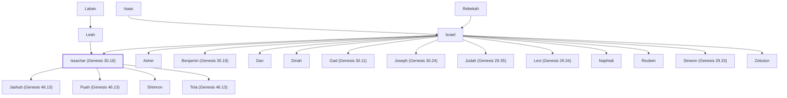

# Issachar (Genesis 30.18)

Son of Jacob and Leah, forefather of tribe

**Original-language names:** יִשָּׂשכָר (H3485) · Ἰσαχάρ (G2466)

## When

- **Lived:** [[connections/timeline/18th century BC|1752 BC]] – ? *(Jones)*
- **Placed around:** [[connections/timeline/15th century BC|1443 BC]] *(Ussher: the median date of the passages naming them)*

## Family

- **Father:** [[connections/people/Israel|Israel]]
- **Mother:** [[connections/people/Leah|Leah]]
- **Brothers and sisters:** [[connections/people/Asher|Asher]], [[connections/people/Benjamin (Genesis 35.18)|Benjamin (Genesis 35.18)]], [[connections/people/Dan|Dan]], [[connections/people/Dinah|Dinah]], [[connections/people/Gad (Genesis 30.11)|Gad (Genesis 30.11)]], [[connections/people/Joseph (Genesis 30.24)|Joseph (Genesis 30.24)]], [[connections/people/Judah (Genesis 29.35)|Judah (Genesis 29.35)]], [[connections/people/Levi (Genesis 29.34)|Levi (Genesis 29.34)]], [[connections/people/Naphtali|Naphtali]], [[connections/people/Reuben|Reuben]], [[connections/people/Simeon (Genesis 29.33)|Simeon (Genesis 29.33)]], [[connections/people/Zebulun|Zebulun]]
- **Children:** [[connections/people/Jashub (Genesis 46.13)|Jashub (Genesis 46.13)]], [[connections/people/Puah (Genesis 46.13)|Puah (Genesis 46.13)]], [[connections/people/Shimron|Shimron]], [[connections/people/Tola (Genesis 46.13)|Tola (Genesis 46.13)]]
- **Tribe or nation:** Tribe of Issachar

**Line of descent** (24 generations, father to son): [[connections/people/Adam|Adam]] → [[connections/people/Seth|Seth]] → [[connections/people/Enosh|Enosh]] → [[connections/people/Kenan|Kenan]] → [[connections/people/Mahalalel (Genesis 5.12)|Mahalalel (Genesis 5.12)]] → [[connections/people/Jared|Jared]] → [[connections/people/Enoch (Genesis 5.18)|Enoch (Genesis 5.18)]] → [[connections/people/Methuselah|Methuselah]] → [[connections/people/Lamech (Genesis 5.25)|Lamech (Genesis 5.25)]] → [[connections/people/Noah (Genesis 5.29)|Noah (Genesis 5.29)]] → [[connections/people/Shem|Shem]] → [[connections/people/Arpachshad|Arpachshad]] → [[connections/people/Cainan|Cainan]] → [[connections/people/Shelah (Genesis 10.24)|Shelah (Genesis 10.24)]] → [[connections/people/Eber (Genesis 10.21)|Eber (Genesis 10.21)]] → [[connections/people/Peleg|Peleg]] → [[connections/people/Reu|Reu]] → [[connections/people/Serug|Serug]] → [[connections/people/Nahor (Genesis 11.22)|Nahor (Genesis 11.22)]] → [[connections/people/Terah|Terah]] → [[connections/people/Abraham|Abraham]] → [[connections/people/Isaac|Isaac]] → [[connections/people/Israel|Israel]] → **Issachar (Genesis 30.18)**

**Family group:** [[connections/genealogy/Family of Adam|Family of Adam]], generation 24

## Events

- [[connections/timeline/18th century BC|1752 BC]] · [[connections/events/Birth of Issachar|Birth of Issachar]]
- [[connections/timeline/18th century BC|1728 BC]] · [[connections/events/Joseph sold to Egypt|Joseph sold to Egypt]]
- [[connections/timeline/18th century BC|1708 BC]] · [[connections/events/7 years of famine|7 years of famine]]
- [[connections/timeline/18th century BC|1706 BC]] · [[connections/events/Joseph's brothers return to Egypt|Joseph's brothers return to Egypt]]

## Appears in

[[connections/chapters/01-genesis/Genesis 30|Genesis 30]] · [[connections/chapters/01-genesis/Genesis 35|Genesis 35]] · [[connections/chapters/01-genesis/Genesis 46|Genesis 46]] · [[connections/chapters/01-genesis/Genesis 49|Genesis 49]] · [[connections/chapters/02-exodus/Exodus 1|Exodus 1]] · [[connections/chapters/04-numbers/Numbers 1|Numbers 1 (3)]] · [[connections/chapters/04-numbers/Numbers 2|Numbers 2]] · [[connections/chapters/04-numbers/Numbers 7|Numbers 7]] · [[connections/chapters/04-numbers/Numbers 10|Numbers 10]] · [[connections/chapters/04-numbers/Numbers 13|Numbers 13]] · [[connections/chapters/04-numbers/Numbers 26|Numbers 26 (2)]] · [[connections/chapters/04-numbers/Numbers 34|Numbers 34]] · [[connections/chapters/05-deuteronomy/Deuteronomy 27|Deuteronomy 27]] · [[connections/chapters/05-deuteronomy/Deuteronomy 33|Deuteronomy 33]] · [[connections/chapters/06-joshua/Joshua 17|Joshua 17 (2)]] · [[connections/chapters/06-joshua/Joshua 19|Joshua 19 (2)]] · [[connections/chapters/06-joshua/Joshua 21|Joshua 21 (2)]] · [[connections/chapters/07-judges/Judges 5|Judges 5]] · [[connections/chapters/07-judges/Judges 10|Judges 10]] · [[connections/chapters/11-1-kings/1 Kings 4|1 Kings 4]] · [[connections/chapters/11-1-kings/1 Kings 15|1 Kings 15]] · [[connections/chapters/13-1-chronicles/1 Chronicles 2|1 Chronicles 2]] · [[connections/chapters/13-1-chronicles/1 Chronicles 6|1 Chronicles 6 (2)]] · [[connections/chapters/13-1-chronicles/1 Chronicles 7|1 Chronicles 7 (2)]] · [[connections/chapters/13-1-chronicles/1 Chronicles 12|1 Chronicles 12 (2)]] · [[connections/chapters/13-1-chronicles/1 Chronicles 27|1 Chronicles 27]] · [[connections/chapters/14-2-chronicles/2 Chronicles 30|2 Chronicles 30]] · [[connections/chapters/26-ezekiel/Ezekiel 48|Ezekiel 48 (3)]] · [[connections/chapters/66-revelation/Revelation 7|Revelation 7]]

## Appears in the same verse as

[[connections/people/Zebulun|Zebulun (8)]] · [[connections/people/Israel|Israel (6)]] · [[connections/people/Simeon (Genesis 29.33)|Simeon (Genesis 29.33) (6)]] · [[connections/people/Manasseh (Genesis 41.51)|Manasseh (Genesis 41.51) (5)]] · [[connections/people/Asher|Asher (4)]] · [[connections/people/Judah (Genesis 29.35)|Judah (Genesis 29.35) (4)]] · [[connections/people/Levi (Genesis 29.34)|Levi (Genesis 29.34) (4)]] · [[connections/people/Nethanel (Numbers 1.8)|Nethanel (Numbers 1.8) (4)]] · [[connections/people/Zuar|Zuar (4)]] · [[connections/people/Ephraim|Ephraim (3)]] · [[connections/people/Naphtali|Naphtali (3)]] · [[connections/people/Puah (Genesis 46.13)|Puah (Genesis 46.13) (3)]] · [[connections/people/Reuben|Reuben (3)]] · [[connections/people/Tola (Genesis 46.13)|Tola (Genesis 46.13) (3)]] · [[connections/people/Benjamin (Genesis 35.18)|Benjamin (Genesis 35.18) (2)]] · [[connections/people/Gershon|Gershon (2)]] · [[connections/people/Jashub (Genesis 46.13)|Jashub (Genesis 46.13) (2)]] · [[connections/people/Leah|Leah (2)]] · [[connections/people/Shimron|Shimron (2)]] · [[connections/places/Bashan|Bashan (2)]] · [[connections/places/Daberath|Daberath (2)]] · [[connections/places/Kishion|Kishion (2)]] · [[connections/people/Abimelech (Judges 8.31)|Abimelech (Judges 8.31)]] · [[connections/people/Ahijah (1 Kings 15.27)|Ahijah (1 Kings 15.27)]] · [[connections/people/Azzan|Azzan]] · [[connections/people/Baasha|Baasha]] · [[connections/people/Barak|Barak]] · [[connections/people/David|David]] · [[connections/people/Deborah (Judges 4.4)|Deborah (Judges 4.4)]] · [[connections/people/Dodo (Judges 10.1)|Dodo (Judges 10.1)]] · [[connections/people/Elihu (1 Chronicles 27.18)|Elihu (1 Chronicles 27.18)]] · [[connections/people/Hezekiah (2 Kings 16.20)|Hezekiah (2 Kings 16.20)]] · [[connections/people/Igal (Numbers 13.7)|Igal (Numbers 13.7)]] · [[connections/people/Jehoshaphat (1 Kings 4.17)|Jehoshaphat (1 Kings 4.17)]] · [[connections/people/Joseph (Genesis 30.24)|Joseph (Genesis 30.24)]] · [[connections/people/Joseph (Numbers 13.7)|Joseph (Numbers 13.7)]] · [[connections/people/Michael (1 Chronicles 27.18)|Michael (1 Chronicles 27.18)]] · [[connections/people/Nadab (1 Kings 14.20)|Nadab (1 Kings 14.20)]] · [[connections/people/Omri (1 Chronicles 27.18)|Omri (1 Chronicles 27.18)]] · [[connections/people/Paltiel|Paltiel]] · [[connections/people/Paruah|Paruah]] · [[connections/people/Puah (Judges 10.1)|Puah (Judges 10.1)]] · [[connections/people/Tola (Judges 10.1)|Tola (Judges 10.1)]] · [[connections/places/Beth-shean|Beth-shean]] · [[connections/places/Dor|Dor]] · [[connections/places/En-dor|En-dor]] · [[connections/places/Gerizim Mount|Gerizim Mount]] · [[connections/places/Gibbethon|Gibbethon]] · [[connections/places/Ibleam|Ibleam]] · [[connections/places/Jordan|Jordan]] · [[connections/places/Megiddo|Megiddo]] · [[connections/places/Naphath|Naphath]] · [[connections/places/Shamir (Judges 10.1)|Shamir (Judges 10.1)]] · [[connections/places/Taanach|Taanach]]
