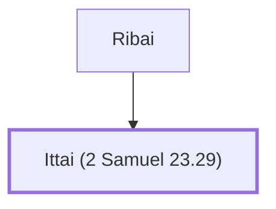

# Ittai (2 Samuel 23.29)

One of David's mighty men

**Also called:** Ithai

**Original-language names:** אִתַּי (H0863) · אִיתַי (H0863)

## When

- **Placed around:** [[connections/timeline/11th century BC|1055 BC]] *(Ussher: the median date of the passages naming them)*

## Family

- **Father:** [[connections/people/Ribai|Ribai]]

**Family group:** [[connections/genealogy/Family of Ribai|Family of Ribai]], generation 2

## Appears in

[[connections/chapters/10-2-samuel/2 Samuel 23|2 Samuel 23]] · [[connections/chapters/13-1-chronicles/1 Chronicles 11|1 Chronicles 11]]

## Appears in the same verse as

[[connections/people/Benjamin (Genesis 35.18)|Benjamin (Genesis 35.18) (2)]] · [[connections/people/Ribai|Ribai (2)]] · [[connections/places/Gibeah (Joshua 18.28)|Gibeah (Joshua 18.28) (2)]] · [[connections/people/Baanah (2 Samuel 23.29)|Baanah (2 Samuel 23.29)]] · [[connections/people/Benaiah (2 Samuel 23.30)|Benaiah (2 Samuel 23.30)]] · [[connections/people/Heleb|Heleb]]
