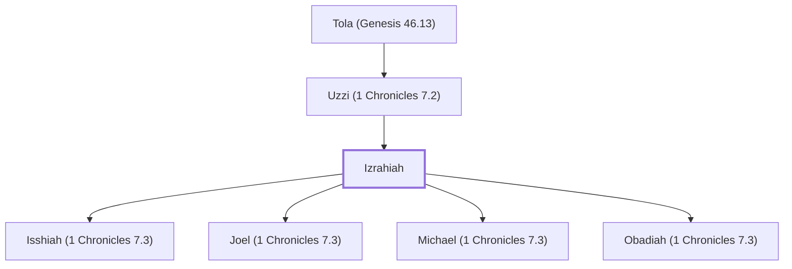

# Izrahiah

Son of Uzzi, an Issacharite

**Original-language names:** יִזְרַחְיָה (H3156)

## Family

- **Father:** [[connections/people/Uzzi (1 Chronicles 7.2)|Uzzi (1 Chronicles 7.2)]]
- **Children:** [[connections/people/Isshiah (1 Chronicles 7.3)|Isshiah (1 Chronicles 7.3)]], [[connections/people/Joel (1 Chronicles 7.3)|Joel (1 Chronicles 7.3)]], [[connections/people/Michael (1 Chronicles 7.3)|Michael (1 Chronicles 7.3)]], [[connections/people/Obadiah (1 Chronicles 7.3)|Obadiah (1 Chronicles 7.3)]]
- **Tribe or nation:** Tribe of Issachar

**Line of descent** (27 generations, father to son): [[connections/people/Adam|Adam]] → [[connections/people/Seth|Seth]] → [[connections/people/Enosh|Enosh]] → [[connections/people/Kenan|Kenan]] → [[connections/people/Mahalalel (Genesis 5.12)|Mahalalel (Genesis 5.12)]] → [[connections/people/Jared|Jared]] → [[connections/people/Enoch (Genesis 5.18)|Enoch (Genesis 5.18)]] → [[connections/people/Methuselah|Methuselah]] → [[connections/people/Lamech (Genesis 5.25)|Lamech (Genesis 5.25)]] → [[connections/people/Noah (Genesis 5.29)|Noah (Genesis 5.29)]] → [[connections/people/Shem|Shem]] → [[connections/people/Arpachshad|Arpachshad]] → [[connections/people/Cainan|Cainan]] → [[connections/people/Shelah (Genesis 10.24)|Shelah (Genesis 10.24)]] → [[connections/people/Eber (Genesis 10.21)|Eber (Genesis 10.21)]] → [[connections/people/Peleg|Peleg]] → [[connections/people/Reu|Reu]] → [[connections/people/Serug|Serug]] → [[connections/people/Nahor (Genesis 11.22)|Nahor (Genesis 11.22)]] → [[connections/people/Terah|Terah]] → [[connections/people/Abraham|Abraham]] → [[connections/people/Isaac|Isaac]] → [[connections/people/Israel|Israel]] → [[connections/people/Issachar (Genesis 30.18)|Issachar (Genesis 30.18)]] → [[connections/people/Tola (Genesis 46.13)|Tola (Genesis 46.13)]] → [[connections/people/Uzzi (1 Chronicles 7.2)|Uzzi (1 Chronicles 7.2)]] → **Izrahiah**

**Family group:** [[connections/genealogy/Family of Adam|Family of Adam]], generation 27

## Appears in

[[connections/chapters/13-1-chronicles/1 Chronicles 7|1 Chronicles 7]]

## Appears in the same verse as

[[connections/people/Isshiah (1 Chronicles 7.3)|Isshiah (1 Chronicles 7.3)]] · [[connections/people/Joel (1 Chronicles 7.3)|Joel (1 Chronicles 7.3)]] · [[connections/people/Michael (1 Chronicles 7.3)|Michael (1 Chronicles 7.3)]] · [[connections/people/Obadiah (1 Chronicles 7.3)|Obadiah (1 Chronicles 7.3)]] · [[connections/people/Uzzi (1 Chronicles 7.2)|Uzzi (1 Chronicles 7.2)]]
