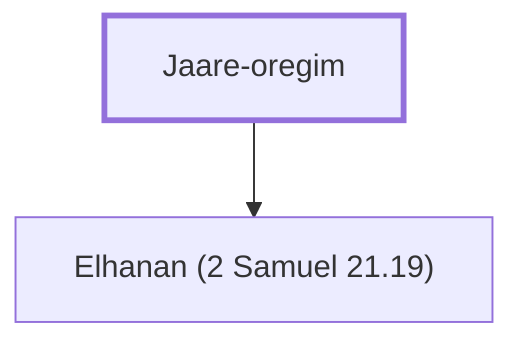

# Jaare-oregim

Father of Elhanan, who killed Goliath's brother.

**Also called:** Jair

**Original-language names:** יַעֲרֵי אֹרְגִים (H3296) · יָעִיר (H3265)

## When

- **Placed around:** [[connections/timeline/11th century BC|1018 BC]] *(Ussher: the median date of the passages naming them)*

## Family

- **Children:** [[connections/people/Elhanan (2 Samuel 21.19)|Elhanan (2 Samuel 21.19)]]

**Family group:** [[connections/genealogy/Family of Jaare-oregim|Family of Jaare-oregim]], generation 1

## Appears in

[[connections/chapters/10-2-samuel/2 Samuel 21|2 Samuel 21]] · [[connections/chapters/13-1-chronicles/1 Chronicles 20|1 Chronicles 20]]

## Appears in the same verse as

[[connections/people/Elhanan (2 Samuel 21.19)|Elhanan (2 Samuel 21.19) (2)]] · [[connections/people/Goliath|Goliath (2)]] · [[connections/people/Lahmi|Lahmi (2)]] · [[connections/places/Gezer|Gezer]]
