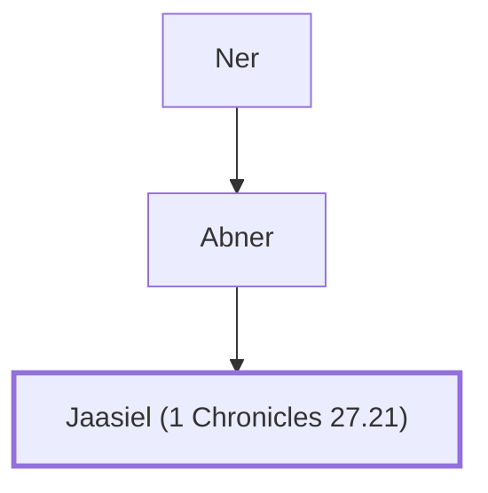

# Jaasiel (1 Chronicles 27.21)

Leader of the half-tribe of Manasseh during David's reign.

**Original-language names:** יַעֲשִׂיאֵל (H3300)

## When

- **Placed around:** [[connections/timeline/11th century BC|1015 BC]] *(Ussher: the median date of the passages naming them)*

## Family

- **Father:** [[connections/people/Abner|Abner]]
- **Tribe or nation:** Tribe of Benjamin

**Line of descent** (7 generations, father to son): [[connections/people/Aphiah|Aphiah]] → [[connections/people/Becorath|Becorath]] → [[connections/people/Zeror|Zeror]] → [[connections/people/Abiel|Abiel]] → [[connections/people/Ner|Ner]] → [[connections/people/Abner|Abner]] → **Jaasiel (1 Chronicles 27.21)**

**Family group:** [[connections/genealogy/Family of Aphiah|Family of Aphiah]], generation 7

## Appears in

[[connections/chapters/13-1-chronicles/1 Chronicles 27|1 Chronicles 27]]

## Appears in the same verse as

[[connections/people/Abner|Abner]] · [[connections/people/Benjamin (Genesis 35.18)|Benjamin (Genesis 35.18)]] · [[connections/people/Iddo (1 Chronicles 27.21)|Iddo (1 Chronicles 27.21)]] · [[connections/people/Manasseh (Genesis 41.51)|Manasseh (Genesis 41.51)]] · [[connections/people/Zechariah (1 Chronicles 27.21)|Zechariah (1 Chronicles 27.21)]] · [[connections/places/Gilead|Gilead]]
