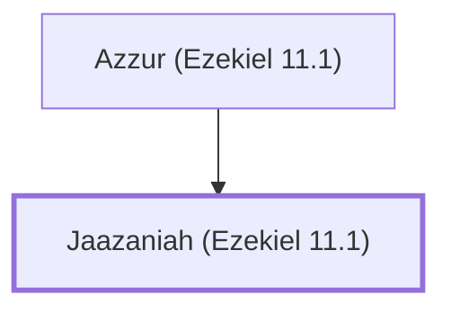

# Jaazaniah (Ezekiel 11.1)

Leader among the twenty-five men in Ezekiel's vision.

**Original-language names:** יַאֲזַנְיָ֫הוּ (H2970)

## When

- **Placed around:** [[connections/timeline/6th century BC|594 BC]] *(Ussher: the median date of the passages naming them)*

## Family

- **Father:** [[connections/people/Azzur (Ezekiel 11.1)|Azzur (Ezekiel 11.1)]]

**Family group:** [[connections/genealogy/Family of Azzur (Ezekiel 11.1)|Family of Azzur (Ezekiel 11.1)]], generation 2

## Appears in

[[connections/chapters/26-ezekiel/Ezekiel 11|Ezekiel 11]]

## Appears in the same verse as

[[connections/people/Azzur (Ezekiel 11.1)|Azzur (Ezekiel 11.1)]] · [[connections/people/Benaiah (Ezekiel 11.1)|Benaiah (Ezekiel 11.1)]] · [[connections/people/Pelatiah (Ezekiel 11.1)|Pelatiah (Ezekiel 11.1)]]
