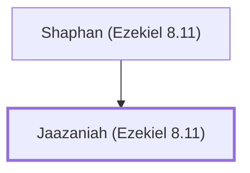

# Jaazaniah (Ezekiel 8.11)

Israelite elder; participated in idolatry in the temple.

**Original-language names:** יַאֲזַנְיָ֫הוּ (H2970)

## When

- **Placed around:** [[connections/timeline/6th century BC|594 BC]] *(Ussher: the median date of the passages naming them)*

## Family

- **Father:** [[connections/people/Shaphan (Ezekiel 8.11)|Shaphan (Ezekiel 8.11)]]

**Family group:** [[connections/genealogy/Family of Shaphan (Ezekiel 8.11)|Family of Shaphan (Ezekiel 8.11)]], generation 2

## Appears in

[[connections/chapters/26-ezekiel/Ezekiel 8|Ezekiel 8]]

## Appears in the same verse as

[[connections/people/Israel|Israel]] · [[connections/people/Shaphan (Ezekiel 8.11)|Shaphan (Ezekiel 8.11)]]
