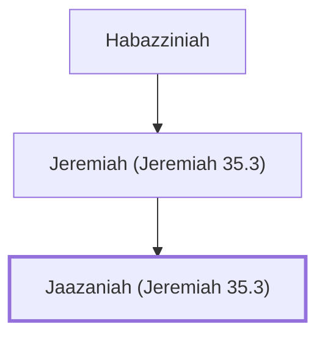

# Jaazaniah (Jeremiah 35.3)

Son of Jeremiah; a Rechabite during Jeremiah's time.

**Original-language names:** יַאֲזַנְיָ֫הוּ (H2970)

## When

- **Placed around:** [[connections/timeline/7th century BC|607 BC]] *(Ussher: the median date of the passages naming them)*

## Family

- **Father:** [[connections/people/Jeremiah (Jeremiah 35.3)|Jeremiah (Jeremiah 35.3)]]

**Line of descent** (3 generations, father to son): [[connections/people/Habazziniah|Habazziniah]] → [[connections/people/Jeremiah (Jeremiah 35.3)|Jeremiah (Jeremiah 35.3)]] → **Jaazaniah (Jeremiah 35.3)**

**Family group:** [[connections/genealogy/Family of Habazziniah|Family of Habazziniah]], generation 3

## Appears in

[[connections/chapters/24-jeremiah/Jeremiah 35|Jeremiah 35]]

## Appears in the same verse as

[[connections/people/Habazziniah|Habazziniah]] · [[connections/people/Jeremiah (Jeremiah 35.3)|Jeremiah (Jeremiah 35.3)]]
