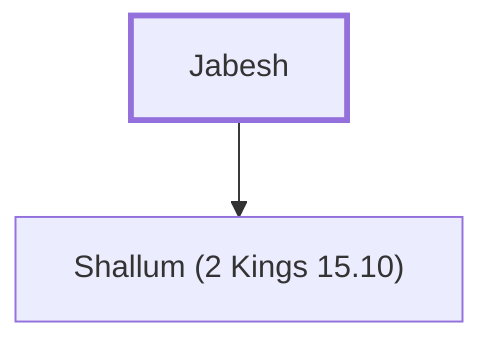

# Jabesh

Assassinated Zechariah; reigned as king of Israel for a month.

**Original-language names:** יָבֵשׁ (H3003)

## When

- **Placed around:** [[connections/timeline/8th century BC|772 BC]] *(Ussher: the median date of the passages naming them)*

## Family

- **Children:** [[connections/people/Shallum (2 Kings 15.10)|Shallum (2 Kings 15.10)]]

**Family group:** [[connections/genealogy/Family of Jabesh|Family of Jabesh]], generation 1

## Appears in

[[connections/chapters/12-2-kings/2 Kings 15|2 Kings 15 (3)]]

## Appears in the same verse as

[[connections/people/Shallum (2 Kings 15.10)|Shallum (2 Kings 15.10) (3)]] · [[connections/places/Samaria|Samaria (2)]] · [[connections/people/Gadi|Gadi]] · [[connections/people/Judah (Genesis 29.35)|Judah (Genesis 29.35)]] · [[connections/people/Menahem|Menahem]] · [[connections/people/Uzziah (2 Kings 14.21)|Uzziah (2 Kings 14.21)]] · [[connections/places/Ibleam|Ibleam]] · [[connections/places/Tirzah|Tirzah]]
