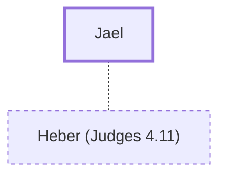

# Jael

Wife of Heber; killed Sisera, the Canaanite commander.

**Original-language names:** יָעֵל (H3278)

## When

- **Placed around:** [[connections/timeline/13th century BC|1285 BC]] *(Ussher: the median date of the passages naming them)*

## Family

- **Spouses:** [[connections/people/Heber (Judges 4.11)|Heber (Judges 4.11)]]

## Appears in

[[connections/chapters/07-judges/Judges 4|Judges 4 (4)]] · [[connections/chapters/07-judges/Judges 5|Judges 5 (2)]]

## Appears in the same verse as

[[connections/people/Heber (Judges 4.11)|Heber (Judges 4.11) (3)]] · [[connections/people/Sisera (Judges 4.2)|Sisera (Judges 4.2) (3)]] · [[connections/people/Anath|Anath]] · [[connections/people/Barak|Barak]] · [[connections/people/Jabin (Judges 4.2)|Jabin (Judges 4.2)]] · [[connections/people/Shamgar|Shamgar]] · [[connections/places/Hazor (Joshua 11.1)|Hazor (Joshua 11.1)]]
