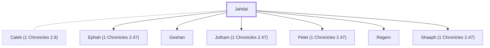

# Jahdai

Descendant of Caleb, son of Jephunneh.

**Original-language names:** יַהְדַּי (H3056)

## When

- **Placed around:** [[connections/timeline/15th century BC|1470 BC]] *(Ussher: the median date of the passages naming them)*

## Family

- **Spouses:** [[connections/people/Caleb (1 Chronicles 2.9)|Caleb (1 Chronicles 2.9) (uncertain)]]
- **Children:** [[connections/people/Ephah (1 Chronicles 2.47)|Ephah (1 Chronicles 2.47) (uncertain)]], [[connections/people/Geshan|Geshan (uncertain)]], [[connections/people/Jotham (1 Chronicles 2.47)|Jotham (1 Chronicles 2.47) (uncertain)]], [[connections/people/Pelet (1 Chronicles 2.47)|Pelet (1 Chronicles 2.47) (uncertain)]], [[connections/people/Regem|Regem (uncertain)]], [[connections/people/Shaaph (1 Chronicles 2.47)|Shaaph (1 Chronicles 2.47) (uncertain)]]
- **Tribe or nation:** Tribe of Judah

**Family group:** [[connections/genealogy/Family of Adam|Family of Adam]], generation 29

## Appears in

[[connections/chapters/13-1-chronicles/1 Chronicles 2|1 Chronicles 2]]

## Appears in the same verse as

[[connections/people/Ephah (1 Chronicles 2.47)|Ephah (1 Chronicles 2.47)]] · [[connections/people/Geshan|Geshan]] · [[connections/people/Jotham (1 Chronicles 2.47)|Jotham (1 Chronicles 2.47)]] · [[connections/people/Pelet (1 Chronicles 2.47)|Pelet (1 Chronicles 2.47)]] · [[connections/people/Regem|Regem]] · [[connections/people/Shaaph (1 Chronicles 2.47)|Shaaph (1 Chronicles 2.47)]]
