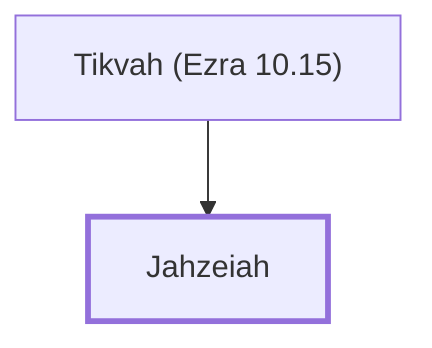

# Jahzeiah

Opposed Ezra's command for Israelites to divorce foreign wives.

**Original-language names:** יַחְזְיָה (H3167)

## Family

- **Father:** [[connections/people/Tikvah (Ezra 10.15)|Tikvah (Ezra 10.15)]]

**Family group:** [[connections/genealogy/Family of Tikvah (Ezra 10.15)|Family of Tikvah (Ezra 10.15)]], generation 2

## Appears in

[[connections/chapters/15-ezra/Ezra 10|Ezra 10]]

## Appears in the same verse as

[[connections/people/Asahel (Ezra 10.15)|Asahel (Ezra 10.15)]] · [[connections/people/Jonathan (Ezra 10.15)|Jonathan (Ezra 10.15)]] · [[connections/people/Meshullam (Ezra 10.15)|Meshullam (Ezra 10.15)]] · [[connections/people/Shabbethai (Ezra 10.15)|Shabbethai (Ezra 10.15)]] · [[connections/people/Tikvah (Ezra 10.15)|Tikvah (Ezra 10.15)]]
