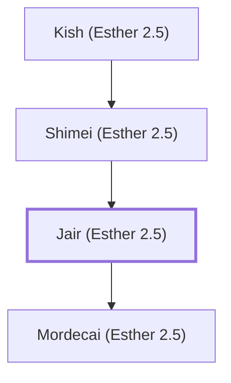

# Jair (Esther 2.5)

Mordecai's father, a Benjamite

**Original-language names:** יָאִיר (H2971)

## When

- **Placed around:** [[connections/timeline/5th century BC|461 BC]] *(Ussher: the median date of the passages naming them)*

## Family

- **Father:** [[connections/people/Shimei (Esther 2.5)|Shimei (Esther 2.5)]]
- **Children:** [[connections/people/Mordecai (Esther 2.5)|Mordecai (Esther 2.5)]]

**Line of descent** (3 generations, father to son): [[connections/people/Kish (Esther 2.5)|Kish (Esther 2.5)]] → [[connections/people/Shimei (Esther 2.5)|Shimei (Esther 2.5)]] → **Jair (Esther 2.5)**

**Family group:** [[connections/genealogy/Family of Kish (Esther 2.5)|Family of Kish (Esther 2.5)]], generation 3

## Appears in

[[connections/chapters/17-esther/Esther 2|Esther 2]]

## Appears in the same verse as

[[connections/people/Kish (Esther 2.5)|Kish (Esther 2.5)]] · [[connections/people/Mordecai (Esther 2.5)|Mordecai (Esther 2.5)]] · [[connections/people/Shimei (Esther 2.5)|Shimei (Esther 2.5)]] · [[connections/places/Susa|Susa]]
