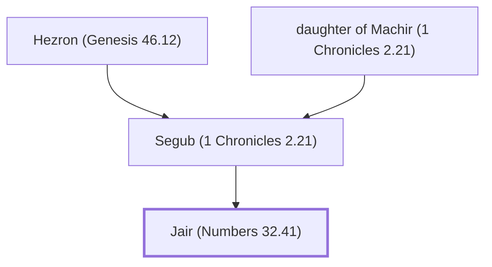

# Jair (Numbers 32.41)

Manassite leader who captured Gilead

**Original-language names:** יָאִיר (H2971)

## When

- **Placed around:** [[connections/timeline/15th century BC|1452 BC]] *(Ussher: the median date of the passages naming them)*

## Family

- **Father:** [[connections/people/Segub (1 Chronicles 2.21)|Segub (1 Chronicles 2.21)]]
- **Tribe or nation:** Tribe of Judah

**Line of descent** (28 generations, father to son): [[connections/people/Adam|Adam]] → [[connections/people/Seth|Seth]] → [[connections/people/Enosh|Enosh]] → [[connections/people/Kenan|Kenan]] → [[connections/people/Mahalalel (Genesis 5.12)|Mahalalel (Genesis 5.12)]] → [[connections/people/Jared|Jared]] → [[connections/people/Enoch (Genesis 5.18)|Enoch (Genesis 5.18)]] → [[connections/people/Methuselah|Methuselah]] → [[connections/people/Lamech (Genesis 5.25)|Lamech (Genesis 5.25)]] → [[connections/people/Noah (Genesis 5.29)|Noah (Genesis 5.29)]] → [[connections/people/Shem|Shem]] → [[connections/people/Arpachshad|Arpachshad]] → [[connections/people/Cainan|Cainan]] → [[connections/people/Shelah (Genesis 10.24)|Shelah (Genesis 10.24)]] → [[connections/people/Eber (Genesis 10.21)|Eber (Genesis 10.21)]] → [[connections/people/Peleg|Peleg]] → [[connections/people/Reu|Reu]] → [[connections/people/Serug|Serug]] → [[connections/people/Nahor (Genesis 11.22)|Nahor (Genesis 11.22)]] → [[connections/people/Terah|Terah]] → [[connections/people/Abraham|Abraham]] → [[connections/people/Isaac|Isaac]] → [[connections/people/Israel|Israel]] → [[connections/people/Judah (Genesis 29.35)|Judah (Genesis 29.35)]] → [[connections/people/Perez|Perez]] → [[connections/people/Hezron (Genesis 46.12)|Hezron (Genesis 46.12)]] → [[connections/people/Segub (1 Chronicles 2.21)|Segub (1 Chronicles 2.21)]] → **Jair (Numbers 32.41)**

**Family group:** [[connections/genealogy/Family of Adam|Family of Adam]], generation 28

## Appears in

[[connections/chapters/04-numbers/Numbers 32|Numbers 32]] · [[connections/chapters/05-deuteronomy/Deuteronomy 3|Deuteronomy 3]] · [[connections/chapters/11-1-kings/1 Kings 4|1 Kings 4]] · [[connections/chapters/13-1-chronicles/1 Chronicles 2|1 Chronicles 2]]

## Appears in the same verse as

[[connections/people/Manasseh (Genesis 41.51)|Manasseh (Genesis 41.51) (3)]] · [[connections/places/Argob|Argob (2)]] · [[connections/places/Bashan|Bashan (2)]] · [[connections/places/Gilead|Gilead (2)]] · [[connections/places/Havvoth-jair|Havvoth-jair (2)]] · [[connections/people/Ben-Geber|Ben-Geber]] · [[connections/people/Segub (1 Chronicles 2.21)|Segub (1 Chronicles 2.21)]] · [[connections/places/Ramoth|Ramoth]]
