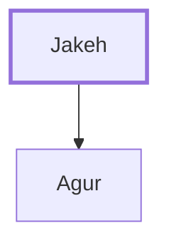

# Jakeh

Father of Agur, the author of Proverbs 30

**Original-language names:** יָקֶה (H3348)

## When

- **Placed around:** [[connections/timeline/7th century BC|700 BC]] *(Ussher: the median date of the passages naming them)*

## Family

- **Children:** [[connections/people/Agur|Agur]]

**Family group:** [[connections/genealogy/Family of Jakeh|Family of Jakeh]], generation 1

## Appears in

[[connections/chapters/20-proverbs/Proverbs 30|Proverbs 30]]

## Appears in the same verse as

[[connections/people/Agur|Agur]] · [[connections/people/Ithiel (Proverbs 30.1)|Ithiel (Proverbs 30.1)]] · [[connections/people/Ucal|Ucal]]
