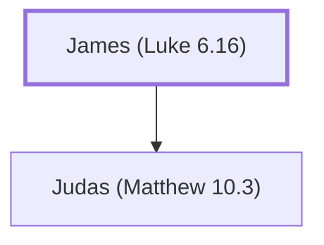

# James (Luke 6.16)

Father of Judas, an Apostles

**Original-language names:** Ἰάκωβος (G2385)

## When

- **Placed around:** [[connections/timeline/1st century AD|AD 33]] *(Ussher: the median date of the passages naming them)*

## Family

- **Children:** [[connections/people/Judas (Matthew 10.3)|Judas (Matthew 10.3)]]

**Family group:** [[connections/genealogy/Family of James (Luke 6.16)|Family of James (Luke 6.16)]], generation 1

## Appears in

[[connections/chapters/42-luke/Luke 6|Luke 6]] · [[connections/chapters/44-acts/Acts 1|Acts 1]]

## Appears in the same verse as

[[connections/people/Judas (Matthew 10.3)|Judas (Matthew 10.3) (2)]] · [[connections/people/Alphaeus|Alphaeus]] · [[connections/people/Andrew|Andrew]] · [[connections/people/Bartholomew|Bartholomew]] · [[connections/people/James (Matthew 10.3)|James (Matthew 10.3)]] · [[connections/people/James (Matthew 4.21)|James (Matthew 4.21)]] · [[connections/people/John (Matthew 4.21)|John (Matthew 4.21)]] · [[connections/people/Judas (Matthew 10.4)|Judas (Matthew 10.4)]] · [[connections/people/Matthew|Matthew]] · [[connections/people/Peter|Peter]] · [[connections/people/Philip (Matthew 10.3)|Philip (Matthew 10.3)]] · [[connections/people/Simon (Matthew 10.4)|Simon (Matthew 10.4)]] · [[connections/people/Thomas|Thomas]]
