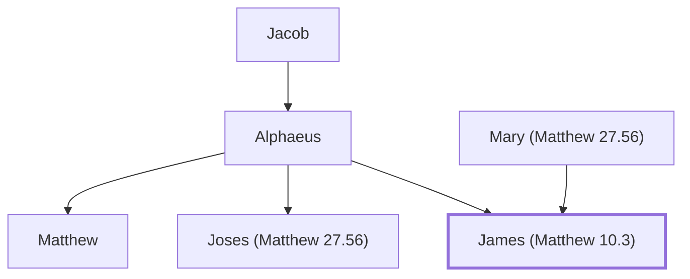

# James (Matthew 10.3)

James "the Less", son of Alphaeus

**Original-language names:** Ἰάκωβος (G2385)

## When

- **Placed around:** [[connections/timeline/1st century AD|AD 33]] *(Ussher: the median date of the passages naming them)*

## Family

- **Father:** [[connections/people/Alphaeus|Alphaeus]]
- **Mother:** [[connections/people/Mary (Matthew 27.56)|Mary (Matthew 27.56) (uncertain)]]
- **Brothers and sisters:** [[connections/people/Joses (Matthew 27.56)|Joses (Matthew 27.56)]], [[connections/people/Matthew|Matthew (uncertain)]]

**Line of descent** (75 generations, father to son): [[connections/people/Adam|Adam]] → [[connections/people/Seth|Seth]] → [[connections/people/Enosh|Enosh]] → [[connections/people/Kenan|Kenan]] → [[connections/people/Mahalalel (Genesis 5.12)|Mahalalel (Genesis 5.12)]] → [[connections/people/Jared|Jared]] → [[connections/people/Enoch (Genesis 5.18)|Enoch (Genesis 5.18)]] → [[connections/people/Methuselah|Methuselah]] → [[connections/people/Lamech (Genesis 5.25)|Lamech (Genesis 5.25)]] → [[connections/people/Noah (Genesis 5.29)|Noah (Genesis 5.29)]] → [[connections/people/Shem|Shem]] → [[connections/people/Arpachshad|Arpachshad]] → [[connections/people/Cainan|Cainan]] → [[connections/people/Shelah (Genesis 10.24)|Shelah (Genesis 10.24)]] → [[connections/people/Eber (Genesis 10.21)|Eber (Genesis 10.21)]] → [[connections/people/Peleg|Peleg]] → [[connections/people/Reu|Reu]] → [[connections/people/Serug|Serug]] → [[connections/people/Nahor (Genesis 11.22)|Nahor (Genesis 11.22)]] → [[connections/people/Terah|Terah]] → [[connections/people/Abraham|Abraham]] → [[connections/people/Isaac|Isaac]] → [[connections/people/Israel|Israel]] → [[connections/people/Judah (Genesis 29.35)|Judah (Genesis 29.35)]] → [[connections/people/Perez|Perez]] → [[connections/people/Hezron (Genesis 46.12)|Hezron (Genesis 46.12)]] → [[connections/people/Ram (Ruth 4.19)|Ram (Ruth 4.19)]] → [[connections/people/Amminadab (Exodus 6.23)|Amminadab (Exodus 6.23)]] → [[connections/people/Nahshon|Nahshon]] → [[connections/people/Salmon|Salmon]] → [[connections/people/Boaz|Boaz]] → [[connections/people/Obed (Ruth 4.17)|Obed (Ruth 4.17)]] → [[connections/people/Jesse|Jesse]] → [[connections/people/David|David]] → [[connections/people/Solomon|Solomon]] → [[connections/people/Rehoboam|Rehoboam]] → [[connections/people/Abijah (1 Kings 14.31)|Abijah (1 Kings 14.31)]] → [[connections/people/Asa (1 Kings 15.8)|Asa (1 Kings 15.8)]] → [[connections/people/Jehoshaphat (1 Kings 15.24)|Jehoshaphat (1 Kings 15.24)]] → [[connections/people/Jehoram (1 Kings 22.51)|Jehoram (1 Kings 22.51)]] → [[connections/people/Ahaziah (2 Kings 8.24)|Ahaziah (2 Kings 8.24)]] → [[connections/people/Joash (2 Kings 11.2)|Joash (2 Kings 11.2)]] → [[connections/people/Amaziah (2 Kings 12.22)|Amaziah (2 Kings 12.22)]] → [[connections/people/Uzziah (2 Kings 14.21)|Uzziah (2 Kings 14.21)]] → [[connections/people/Jotham (2 Kings 15.5)|Jotham (2 Kings 15.5)]] → [[connections/people/Ahaz (2 Kings 15.38)|Ahaz (2 Kings 15.38)]] → [[connections/people/Hezekiah (2 Kings 16.20)|Hezekiah (2 Kings 16.20)]] → [[connections/people/Manasseh (2 Kings 20.21)|Manasseh (2 Kings 20.21)]] → [[connections/people/Amon (2 Kings 21.18)|Amon (2 Kings 21.18)]] → [[connections/people/Josiah (1 Kings 13.2)|Josiah (1 Kings 13.2)]] → [[connections/people/Jehoiakim|Jehoiakim]] → [[connections/people/Jehoiachin|Jehoiachin]] → [[connections/people/Shealtiel (1 Chronicles 3.17)|Shealtiel (1 Chronicles 3.17)]] → [[connections/people/Pedaiah (1 Chronicles 3.18)|Pedaiah (1 Chronicles 3.18)]] → [[connections/people/Zerubbabel (1 Chronicles 3.19)|Zerubbabel (1 Chronicles 3.19)]] → [[connections/people/Abiud|Abiud]] → [[connections/people/Eliakim (Matthew 1.13)|Eliakim (Matthew 1.13)]] → [[connections/people/Azor|Azor]] → [[connections/people/Zadok (Matthew 1.14)|Zadok (Matthew 1.14)]] → [[connections/people/Achim|Achim]] → [[connections/people/Eliud|Eliud]] → [[connections/people/Eleazar (Matthew 1.15)|Eleazar (Matthew 1.15)]] → [[connections/people/Matthan|Matthan]] → [[connections/people/Unnamed 1 (Matthew 1.15)|Unnamed 1 (Matthew 1.15)]] → [[connections/people/Unnamed 2 (Matthew 1.15)|Unnamed 2 (Matthew 1.15)]] → [[connections/people/Unnamed 3 (Matthew 1.15)|Unnamed 3 (Matthew 1.15)]] → [[connections/people/Unnamed 4 (Matthew 1.15)|Unnamed 4 (Matthew 1.15)]] → [[connections/people/Unnamed 5 (Matthew 1.15)|Unnamed 5 (Matthew 1.15)]] → [[connections/people/Unnamed 6 (Matthew 1.15)|Unnamed 6 (Matthew 1.15)]] → [[connections/people/Unnamed 7 (Matthew 1.15)|Unnamed 7 (Matthew 1.15)]] → [[connections/people/Unnamed 8 (Matthew 1.15)|Unnamed 8 (Matthew 1.15)]] → [[connections/people/Unnamed 9 (Matthew 1.15)|Unnamed 9 (Matthew 1.15)]] → [[connections/people/Jacob|Jacob]] → [[connections/people/Alphaeus|Alphaeus]] → **James (Matthew 10.3)**

**Family group:** [[connections/genealogy/Family of Adam|Family of Adam]], generation 75

## Events

- [[connections/timeline/1st century AD|AD 28]] · [[connections/events/Apostles Chosen|Apostles Chosen]]
- [[connections/timeline/1st century AD|AD 30]] · [[connections/events/Matthias replaces Judas|Matthias replaces Judas]]

## Appears in

[[connections/chapters/40-matthew/Matthew 10|Matthew 10]] · [[connections/chapters/40-matthew/Matthew 27|Matthew 27]] · [[connections/chapters/41-mark/Mark 3|Mark 3]] · [[connections/chapters/41-mark/Mark 15|Mark 15]] · [[connections/chapters/41-mark/Mark 16|Mark 16]] · [[connections/chapters/42-luke/Luke 6|Luke 6]] · [[connections/chapters/42-luke/Luke 24|Luke 24]] · [[connections/chapters/44-acts/Acts 1|Acts 1]]

## Appears in the same verse as

[[connections/people/Alphaeus|Alphaeus (4)]] · [[connections/people/Mary (Matthew 27.56)|Mary (Matthew 27.56) (4)]] · [[connections/people/Mary Magdalene|Mary Magdalene (4)]] · [[connections/people/Matthew|Matthew (4)]] · [[connections/people/Thomas|Thomas (4)]] · [[connections/places/Magadan|Magadan (4)]] · [[connections/people/Bartholomew|Bartholomew (3)]] · [[connections/people/Judas (Matthew 10.3)|Judas (Matthew 10.3) (3)]] · [[connections/people/Philip (Matthew 10.3)|Philip (Matthew 10.3) (3)]] · [[connections/people/Simon (Matthew 10.4)|Simon (Matthew 10.4) (3)]] · [[connections/people/Andrew|Andrew (2)]] · [[connections/people/Joses (Matthew 27.56)|Joses (Matthew 27.56) (2)]] · [[connections/people/Salome (Mark 15.40)|Salome (Mark 15.40) (2)]] · [[connections/people/James (Luke 6.16)|James (Luke 6.16)]] · [[connections/people/James (Matthew 4.21)|James (Matthew 4.21)]] · [[connections/people/Joanna|Joanna]] · [[connections/people/John (Matthew 4.21)|John (Matthew 4.21)]] · [[connections/people/Peter|Peter]] · [[connections/people/Zebedee|Zebedee]]
