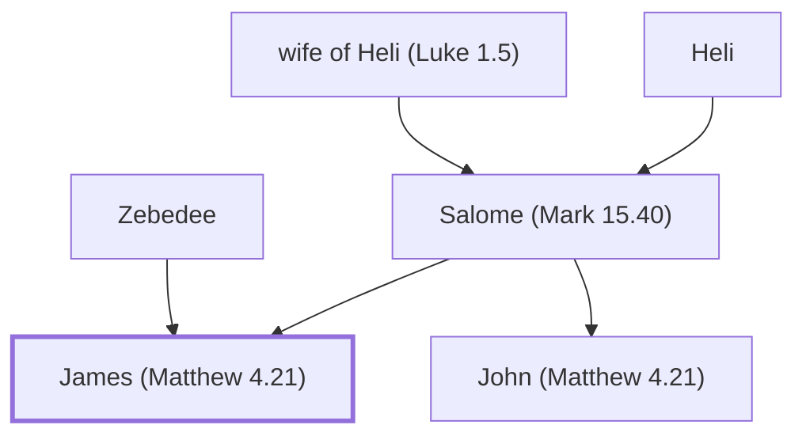

# James (Matthew 4.21)

Son of Zebedee, one of the Twelve Apostles

**Original-language names:** Ἰάκωβος (G2385)

## When

- **Placed around:** [[connections/timeline/1st century AD|AD 31]] *(Ussher: the median date of the passages naming them)*

## Family

- **Father:** [[connections/people/Zebedee|Zebedee]]
- **Mother:** [[connections/people/Salome (Mark 15.40)|Salome (Mark 15.40) (uncertain)]]
- **Brothers and sisters:** [[connections/people/John (Matthew 4.21)|John (Matthew 4.21)]]

**Family group:** [[connections/genealogy/Family of Adam|Family of Adam]], generation 78

## Events

- [[connections/timeline/1st century AD|AD 27]] · [[connections/events/Fishers of Men|Fishers of Men]]
- [[connections/timeline/1st century AD|AD 28]] · [[connections/events/Apostles Chosen|Apostles Chosen]]
- [[connections/timeline/1st century AD|AD 29]] · [[connections/events/The Transfiguation|The Transfiguation]]
- [[connections/timeline/1st century AD|AD 30]] · [[connections/events/Olivet Discourse|Olivet Discourse]]
- [[connections/timeline/1st century AD|AD 40]] · [[connections/events/Herod kills James|Herod kills James]]

## Appears in

[[connections/chapters/40-matthew/Matthew 4|Matthew 4]] · [[connections/chapters/40-matthew/Matthew 10|Matthew 10]] · [[connections/chapters/40-matthew/Matthew 17|Matthew 17]] · [[connections/chapters/41-mark/Mark 1|Mark 1 (2)]] · [[connections/chapters/41-mark/Mark 3|Mark 3]] · [[connections/chapters/41-mark/Mark 5|Mark 5]] · [[connections/chapters/41-mark/Mark 9|Mark 9]] · [[connections/chapters/41-mark/Mark 10|Mark 10 (2)]] · [[connections/chapters/41-mark/Mark 13|Mark 13]] · [[connections/chapters/41-mark/Mark 14|Mark 14]] · [[connections/chapters/42-luke/Luke 5|Luke 5]] · [[connections/chapters/42-luke/Luke 6|Luke 6]] · [[connections/chapters/42-luke/Luke 8|Luke 8]] · [[connections/chapters/42-luke/Luke 9|Luke 9 (2)]] · [[connections/chapters/44-acts/Acts 1|Acts 1]] · [[connections/chapters/44-acts/Acts 12|Acts 12]]

## Appears in the same verse as

[[connections/people/John (Matthew 4.21)|John (Matthew 4.21) (19)]] · [[connections/people/Peter|Peter (12)]] · [[connections/people/Zebedee|Zebedee (6)]] · [[connections/people/Andrew|Andrew (5)]] · [[connections/people/Jesus|Jesus (3)]] · [[connections/people/Bartholomew|Bartholomew (2)]] · [[connections/people/Philip (Matthew 10.3)|Philip (Matthew 10.3) (2)]] · [[connections/people/Alphaeus|Alphaeus]] · [[connections/people/Elijah (1 Kings 17.1)|Elijah (1 Kings 17.1)]] · [[connections/people/James (Luke 6.16)|James (Luke 6.16)]] · [[connections/people/James (Matthew 10.3)|James (Matthew 10.3)]] · [[connections/people/Judas (Matthew 10.3)|Judas (Matthew 10.3)]] · [[connections/people/Matthew|Matthew]] · [[connections/people/Simon (Matthew 10.4)|Simon (Matthew 10.4)]] · [[connections/people/Thomas|Thomas]] · [[connections/places/Olives Mount|Olives Mount]]
