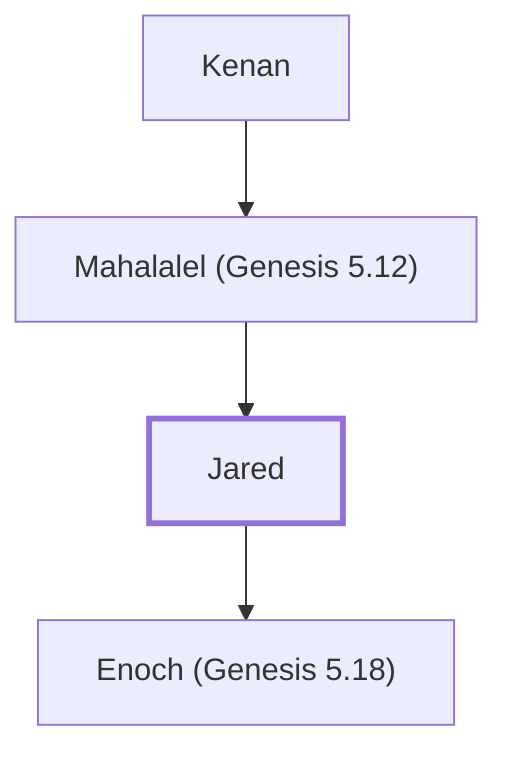

# Jared

Ancestor of Noah; father of Enoch

**Original-language names:** יָֽרֶד (H3382) · יֶ֫רֶד (H3382) · Ἰάρεδ (G2391)

## When

- **Lived:** [[connections/timeline/36th century BC|3544 BC]] – [[connections/timeline/26th century BC|2582 BC]] *(Jones)*
- **Placed around:** [[connections/timeline/34th century BC|3382 BC]] *(Ussher: the median date of the passages naming them)*

## Family

- **Father:** [[connections/people/Mahalalel (Genesis 5.12)|Mahalalel (Genesis 5.12)]]
- **Children:** [[connections/people/Enoch (Genesis 5.18)|Enoch (Genesis 5.18)]]
- **Tribe or nation:** Early Patriarch

**Line of descent** (6 generations, father to son): [[connections/people/Adam|Adam]] → [[connections/people/Seth|Seth]] → [[connections/people/Enosh|Enosh]] → [[connections/people/Kenan|Kenan]] → [[connections/people/Mahalalel (Genesis 5.12)|Mahalalel (Genesis 5.12)]] → **Jared**

**Family group:** [[connections/genealogy/Family of Adam|Family of Adam]], generation 6

## Events

- [[connections/timeline/36th century BC|3544 BC]] · [[connections/events/Birth of Jared|Birth of Jared]]
- [[connections/timeline/36th century BC|3544 BC]] · [[connections/events/Lifetime of Jared|Lifetime of Jared]]
- [[connections/timeline/34th century BC|3382 BC]] · [[connections/events/Birth of Enoch|Birth of Enoch]]
- [[connections/timeline/26th century BC|2582 BC]] · [[connections/events/Death of Jared|Death of Jared]]

## Appears in

[[connections/chapters/01-genesis/Genesis 5|Genesis 5 (5)]] · [[connections/chapters/13-1-chronicles/1 Chronicles 1|1 Chronicles 1]] · [[connections/chapters/42-luke/Luke 3|Luke 3]]

## Appears in the same verse as

[[connections/people/Mahalalel (Genesis 5.12)|Mahalalel (Genesis 5.12) (4)]] · [[connections/people/Enoch (Genesis 5.18)|Enoch (Genesis 5.18) (3)]] · [[connections/people/Kenan|Kenan (2)]] · [[connections/people/Methuselah|Methuselah]]
