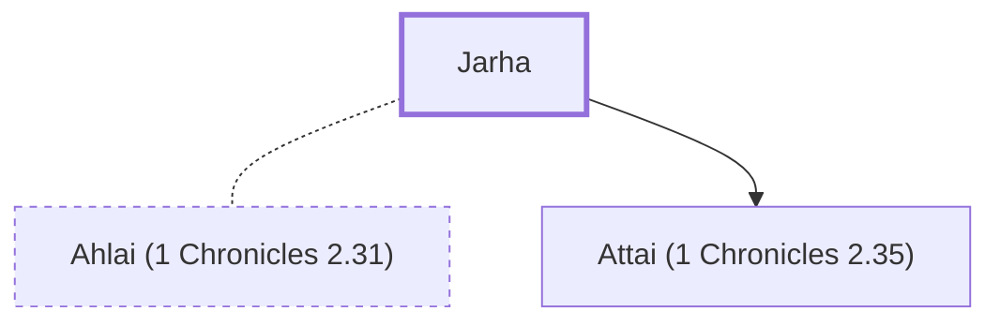

# Jarha

Egyptian servant who married Sheshan's daughter

**Original-language names:** יַרְחָע (H3398)

## When

- **Placed around:** [[connections/timeline/15th century BC|1470 BC]] *(Ussher: the median date of the passages naming them)*

## Family

- **Spouses:** [[connections/people/Ahlai (1 Chronicles 2.31)|Ahlai (1 Chronicles 2.31)]]
- **Children:** [[connections/people/Attai (1 Chronicles 2.35)|Attai (1 Chronicles 2.35)]]
- **Tribe or nation:** Egypt

**Family group:** [[connections/genealogy/Family of Ishi (1 Chronicles 2.31)|Family of Ishi (1 Chronicles 2.31)]], generation 3

## Appears in

[[connections/chapters/13-1-chronicles/1 Chronicles 2|1 Chronicles 2 (2)]]

## Appears in the same verse as

[[connections/people/Sheshan|Sheshan (2)]] · [[connections/people/Attai (1 Chronicles 2.35)|Attai (1 Chronicles 2.35)]]
