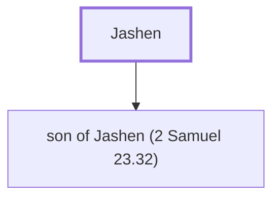

# Jashen

Father of some of David's mighty men

**Also called:** Hashem

**Original-language names:** יָשֵׁן (H3464) · הָשֵׁם (H2044)

## When

- **Placed around:** [[connections/timeline/11th century BC|1055 BC]] *(Ussher: the median date of the passages naming them)*

## Family

- **Children:** [[connections/people/son of Jashen (2 Samuel 23.32)|son of Jashen (2 Samuel 23.32)]]

**Family group:** [[connections/genealogy/Family of Jashen|Family of Jashen]], generation 1

## Appears in

[[connections/chapters/10-2-samuel/2 Samuel 23|2 Samuel 23]] · [[connections/chapters/13-1-chronicles/1 Chronicles 11|1 Chronicles 11]]

## Appears in the same verse as

[[connections/people/Jonathan (2 Samuel 23.32)|Jonathan (2 Samuel 23.32) (2)]] · [[connections/people/Eliahba|Eliahba]] · [[connections/people/Shammah (2 Samuel 23.33)|Shammah (2 Samuel 23.33)]]
