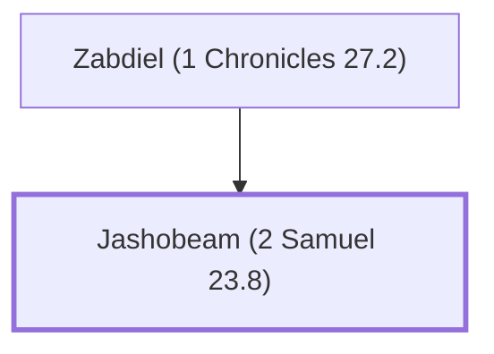

# Jashobeam (2 Samuel 23.8)

Chief of David's mighty men, Hachmoni's son

**Also called:** Josheb-basshebeth

**Original-language names:** יָשׇׁבְעָם (H3434) · יֹשֵׁב בַּשֶּׁ֫בֶת (H3429)

## When

- **Placed around:** [[connections/timeline/11th century BC|1055 BC]] *(Ussher: the median date of the passages naming them)*

## Family

- **Father:** [[connections/people/Zabdiel (1 Chronicles 27.2)|Zabdiel (1 Chronicles 27.2)]]

**Family group:** [[connections/genealogy/Family of Zabdiel (1 Chronicles 27.2)|Family of Zabdiel (1 Chronicles 27.2)]], generation 2

## Appears in

[[connections/chapters/10-2-samuel/2 Samuel 23|2 Samuel 23]] · [[connections/chapters/13-1-chronicles/1 Chronicles 11|1 Chronicles 11]] · [[connections/chapters/13-1-chronicles/1 Chronicles 27|1 Chronicles 27]]

## Appears in the same verse as

[[connections/people/David|David (2)]] · [[connections/people/Adino|Adino]] · [[connections/people/Zabdiel (1 Chronicles 27.2)|Zabdiel (1 Chronicles 27.2)]]
