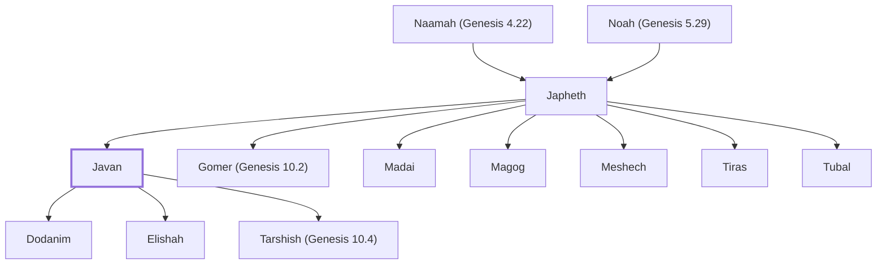

# Javan

Son of Japheth; ancestor of Greek people

**Also called:** Greek

**Original-language names:** יָוָן (H3120) · Ἕλλην=Ἕλλην (G1672)

## When

- **Placed around:** [[connections/timeline/1st century AD|AD 59]] *(Ussher: the median date of the passages naming them)*

## Family

- **Father:** [[connections/people/Japheth|Japheth]]
- **Brothers and sisters:** [[connections/people/Gomer (Genesis 10.2)|Gomer (Genesis 10.2)]], [[connections/people/Madai|Madai]], [[connections/people/Magog|Magog]], [[connections/people/Meshech|Meshech]], [[connections/people/Tiras|Tiras]], [[connections/people/Tubal|Tubal]]
- **Children:** [[connections/people/Dodanim|Dodanim (descendants)]], [[connections/people/Elishah|Elishah]], [[connections/people/Tarshish (Genesis 10.4)|Tarshish (Genesis 10.4)]]
- **Tribe or nation:** Early Patriarch

**Line of descent** (12 generations, father to son): [[connections/people/Adam|Adam]] → [[connections/people/Seth|Seth]] → [[connections/people/Enosh|Enosh]] → [[connections/people/Kenan|Kenan]] → [[connections/people/Mahalalel (Genesis 5.12)|Mahalalel (Genesis 5.12)]] → [[connections/people/Jared|Jared]] → [[connections/people/Enoch (Genesis 5.18)|Enoch (Genesis 5.18)]] → [[connections/people/Methuselah|Methuselah]] → [[connections/people/Lamech (Genesis 5.25)|Lamech (Genesis 5.25)]] → [[connections/people/Noah (Genesis 5.29)|Noah (Genesis 5.29)]] → [[connections/people/Japheth|Japheth]] → **Javan**

**Family group:** [[connections/genealogy/Family of Adam|Family of Adam]], generation 12

## Appears in

[[connections/chapters/01-genesis/Genesis 10|Genesis 10 (2)]] · [[connections/chapters/13-1-chronicles/1 Chronicles 1|1 Chronicles 1 (2)]] · [[connections/chapters/43-john/John 7|John 7]] · [[connections/chapters/43-john/John 12|John 12]] · [[connections/chapters/44-acts/Acts 14|Acts 14]] · [[connections/chapters/44-acts/Acts 16|Acts 16 (2)]] · [[connections/chapters/44-acts/Acts 17|Acts 17]] · [[connections/chapters/44-acts/Acts 18|Acts 18]] · [[connections/chapters/44-acts/Acts 19|Acts 19 (2)]] · [[connections/chapters/44-acts/Acts 20|Acts 20]] · [[connections/chapters/44-acts/Acts 21|Acts 21]] · [[connections/chapters/45-romans/Romans 1|Romans 1 (2)]] · [[connections/chapters/45-romans/Romans 2|Romans 2 (2)]] · [[connections/chapters/45-romans/Romans 3|Romans 3]] · [[connections/chapters/45-romans/Romans 10|Romans 10]] · [[connections/chapters/46-1-corinthians/1 Corinthians 1|1 Corinthians 1 (2)]] · [[connections/chapters/46-1-corinthians/1 Corinthians 10|1 Corinthians 10]] · [[connections/chapters/46-1-corinthians/1 Corinthians 12|1 Corinthians 12]] · [[connections/chapters/48-galatians/Galatians 2|Galatians 2]] · [[connections/chapters/48-galatians/Galatians 3|Galatians 3]] · [[connections/chapters/51-colossians/Colossians 3|Colossians 3]]

## Appears in the same verse as

[[connections/people/Jesus|Jesus (5)]] · [[connections/people/Elishah|Elishah (2)]] · [[connections/people/Gomer (Genesis 10.2)|Gomer (Genesis 10.2) (2)]] · [[connections/people/Japheth|Japheth (2)]] · [[connections/people/Madai|Madai (2)]] · [[connections/people/Magog|Magog (2)]] · [[connections/people/Meshech|Meshech (2)]] · [[connections/people/Paul|Paul (2)]] · [[connections/people/Tarshish (Genesis 10.4)|Tarshish (Genesis 10.4) (2)]] · [[connections/people/Tiras|Tiras (2)]] · [[connections/people/Tubal|Tubal (2)]] · [[connections/people/Dodanim|Dodanim]] · [[connections/people/Silas|Silas]] · [[connections/people/Timothy|Timothy]] · [[connections/people/Titus|Titus]] · [[connections/places/Asia|Asia]] · [[connections/places/Derbe|Derbe]] · [[connections/places/Ephesus|Ephesus]] · [[connections/places/Iconium|Iconium]] · [[connections/places/Lystra|Lystra]]
