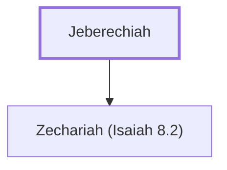

# Jeberechiah

Witness to Isaiah's prophecy about Maher-shalal-hash-baz

**Original-language names:** יְבֶרֶכְיָ֫הוּ (H3000)

## Family

- **Children:** [[connections/people/Zechariah (Isaiah 8.2)|Zechariah (Isaiah 8.2)]]

**Family group:** [[connections/genealogy/Family of Jeberechiah|Family of Jeberechiah]], generation 1

## Appears in

[[connections/chapters/23-isaiah/Isaiah 8|Isaiah 8]]

## Appears in the same verse as

[[connections/people/Uriah (2 Kings 16.10)|Uriah (2 Kings 16.10)]] · [[connections/people/Zechariah (Isaiah 8.2)|Zechariah (Isaiah 8.2)]]
