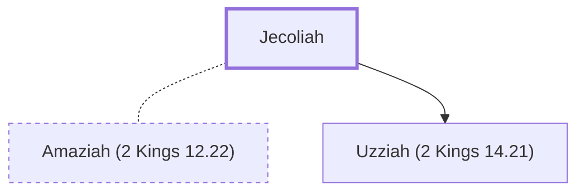

# Jecoliah

Mother of King Uzziah (Azariah) of Judah

**Original-language names:** יְכָלְיָהוּ (H3203)

## When

- **Placed around:** [[connections/timeline/9th century BC|810 BC]] *(Ussher: the median date of the passages naming them)*

## Family

- **Spouses:** [[connections/people/Amaziah (2 Kings 12.22)|Amaziah (2 Kings 12.22)]]
- **Children:** [[connections/people/Uzziah (2 Kings 14.21)|Uzziah (2 Kings 14.21)]]

**Family group:** [[connections/genealogy/Family of Adam|Family of Adam]], generation 46

## Appears in

[[connections/chapters/12-2-kings/2 Kings 15|2 Kings 15]] · [[connections/chapters/14-2-chronicles/2 Chronicles 26|2 Chronicles 26]]

## Appears in the same verse as

[[connections/places/Jerusalem|Jerusalem (2)]] · [[connections/people/Uzziah (2 Kings 14.21)|Uzziah (2 Kings 14.21)]]
