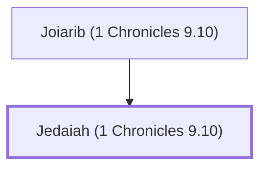

# Jedaiah (1 Chronicles 9.10)

Priest who settled in Jerusalem after the exile

**Original-language names:** יְדַעְיָה (H3048)

## When

- **Placed around:** [[connections/timeline/5th century BC|445 BC]] *(Ussher: the median date of the passages naming them)*

## Family

- **Father:** [[connections/people/Joiarib (1 Chronicles 9.10)|Joiarib (1 Chronicles 9.10)]]
- **Tribe or nation:** Tribe of Levi

**Family group:** [[connections/genealogy/Family of Joiarib (1 Chronicles 9.10)|Family of Joiarib (1 Chronicles 9.10)]], generation 2

## Appears in

[[connections/chapters/13-1-chronicles/1 Chronicles 9|1 Chronicles 9]] · [[connections/chapters/16-nehemiah/Nehemiah 11|Nehemiah 11]] · [[connections/chapters/16-nehemiah/Nehemiah 12|Nehemiah 12 (2)]]

## Appears in the same verse as

[[connections/people/Joiarib (1 Chronicles 9.10)|Joiarib (1 Chronicles 9.10) (4)]] · [[connections/people/Jachin (1 Chronicles 9.10)|Jachin (1 Chronicles 9.10) (2)]] · [[connections/people/Mattenai (Nehemiah 12.19)|Mattenai (Nehemiah 12.19)]] · [[connections/people/Shemaiah (Nehemiah 10.9)|Shemaiah (Nehemiah 10.9)]] · [[connections/people/Uzzi (Nehemiah 12.19)|Uzzi (Nehemiah 12.19)]]
