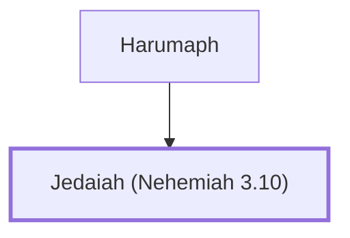

# Jedaiah (Nehemiah 3.10)

Repaired a section of Jerusalem's wall

**Original-language names:** יְדָיָה (H3042)

## When

- **Placed around:** [[connections/timeline/5th century BC|445 BC]] *(Ussher: the median date of the passages naming them)*

## Family

- **Father:** [[connections/people/Harumaph|Harumaph]]

**Family group:** [[connections/genealogy/Family of Harumaph|Family of Harumaph]], generation 2

## Appears in

[[connections/chapters/16-nehemiah/Nehemiah 3|Nehemiah 3]]

## Appears in the same verse as

[[connections/people/Harumaph|Harumaph]] · [[connections/people/Hashabneiah (Nehemiah 3.10)|Hashabneiah (Nehemiah 3.10)]] · [[connections/people/Hattush (Nehemiah 3.10)|Hattush (Nehemiah 3.10)]]
