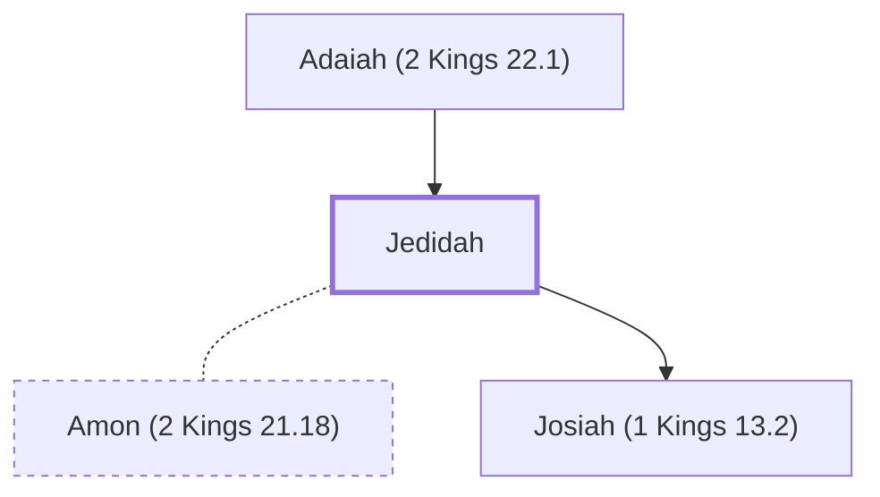

# Jedidah

Mother of King Josiah of Judah

**Original-language names:** יְדִידָה (H3040)

## When

- **Placed around:** [[connections/timeline/7th century BC|641 BC]] *(Ussher: the median date of the passages naming them)*

## Family

- **Father:** [[connections/people/Adaiah (2 Kings 22.1)|Adaiah (2 Kings 22.1)]]
- **Spouses:** [[connections/people/Amon (2 Kings 21.18)|Amon (2 Kings 21.18)]]
- **Children:** [[connections/people/Josiah (1 Kings 13.2)|Josiah (1 Kings 13.2)]]

**Family group:** [[connections/genealogy/Family of Adam|Family of Adam]], generation 2

## Appears in

[[connections/chapters/12-2-kings/2 Kings 22|2 Kings 22]]

## Appears in the same verse as

[[connections/people/Adaiah (2 Kings 22.1)|Adaiah (2 Kings 22.1)]] · [[connections/people/Josiah (1 Kings 13.2)|Josiah (1 Kings 13.2)]] · [[connections/places/Bozkath|Bozkath]] · [[connections/places/Jerusalem|Jerusalem]]
