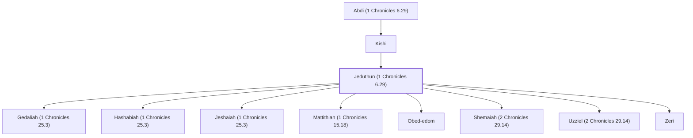

# Jeduthun (1 Chronicles 6.29)

Levitical musician and singer during David's reign

**Also called:** Ethan

**Original-language names:** יְדוּתוּן (H3038) · אֵיתָן (H0387)

## When

- **Placed around:** [[connections/timeline/11th century BC|1042 BC]] *(Ussher: the median date of the passages naming them)*

## Family

- **Father:** [[connections/people/Kishi|Kishi]]
- **Children:** [[connections/people/Gedaliah (1 Chronicles 25.3)|Gedaliah (1 Chronicles 25.3)]], [[connections/people/Hashabiah (1 Chronicles 25.3)|Hashabiah (1 Chronicles 25.3)]], [[connections/people/Jeshaiah (1 Chronicles 25.3)|Jeshaiah (1 Chronicles 25.3)]], [[connections/people/Mattithiah (1 Chronicles 15.18)|Mattithiah (1 Chronicles 15.18)]], [[connections/people/Obed-edom|Obed-edom]], [[connections/people/Shemaiah (2 Chronicles 29.14)|Shemaiah (2 Chronicles 29.14)]], [[connections/people/Uzziel (2 Chronicles 29.14)|Uzziel (2 Chronicles 29.14)]], [[connections/people/Zeri|Zeri]]
- **Tribe or nation:** Tribe of Levi

**Line of descent** (37 generations, father to son): [[connections/people/Adam|Adam]] → [[connections/people/Seth|Seth]] → [[connections/people/Enosh|Enosh]] → [[connections/people/Kenan|Kenan]] → [[connections/people/Mahalalel (Genesis 5.12)|Mahalalel (Genesis 5.12)]] → [[connections/people/Jared|Jared]] → [[connections/people/Enoch (Genesis 5.18)|Enoch (Genesis 5.18)]] → [[connections/people/Methuselah|Methuselah]] → [[connections/people/Lamech (Genesis 5.25)|Lamech (Genesis 5.25)]] → [[connections/people/Noah (Genesis 5.29)|Noah (Genesis 5.29)]] → [[connections/people/Shem|Shem]] → [[connections/people/Arpachshad|Arpachshad]] → [[connections/people/Cainan|Cainan]] → [[connections/people/Shelah (Genesis 10.24)|Shelah (Genesis 10.24)]] → [[connections/people/Eber (Genesis 10.21)|Eber (Genesis 10.21)]] → [[connections/people/Peleg|Peleg]] → [[connections/people/Reu|Reu]] → [[connections/people/Serug|Serug]] → [[connections/people/Nahor (Genesis 11.22)|Nahor (Genesis 11.22)]] → [[connections/people/Terah|Terah]] → [[connections/people/Abraham|Abraham]] → [[connections/people/Isaac|Isaac]] → [[connections/people/Israel|Israel]] → [[connections/people/Levi (Genesis 29.34)|Levi (Genesis 29.34)]] → [[connections/people/Merari|Merari]] → [[connections/people/Mushi|Mushi]] → [[connections/people/Mahli (1 Chronicles 6.32)|Mahli (1 Chronicles 6.32)]] → [[connections/people/Shemer (1 Chronicles 6.31)|Shemer (1 Chronicles 6.31)]] → [[connections/people/Bani (1 Chronicles 6.31)|Bani (1 Chronicles 6.31)]] → [[connections/people/Amzi (1 Chronicles 6.31)|Amzi (1 Chronicles 6.31)]] → [[connections/people/Hilkiah (1 Chronicles 6.30)|Hilkiah (1 Chronicles 6.30)]] → [[connections/people/Amaziah (1 Chronicles 6.30)|Amaziah (1 Chronicles 6.30)]] → [[connections/people/Hashabiah (1 Chronicles 6.30)|Hashabiah (1 Chronicles 6.30)]] → [[connections/people/Malluch (1 Chronicles 6.29)|Malluch (1 Chronicles 6.29)]] → [[connections/people/Abdi (1 Chronicles 6.29)|Abdi (1 Chronicles 6.29)]] → [[connections/people/Kishi|Kishi]] → **Jeduthun (1 Chronicles 6.29)**

**Family group:** [[connections/genealogy/Family of Adam|Family of Adam]], generation 37

## Appears in

[[connections/chapters/13-1-chronicles/1 Chronicles 6|1 Chronicles 6]] · [[connections/chapters/13-1-chronicles/1 Chronicles 15|1 Chronicles 15 (2)]] · [[connections/chapters/13-1-chronicles/1 Chronicles 16|1 Chronicles 16 (3)]] · [[connections/chapters/13-1-chronicles/1 Chronicles 25|1 Chronicles 25 (3)]] · [[connections/chapters/14-2-chronicles/2 Chronicles 5|2 Chronicles 5]] · [[connections/chapters/14-2-chronicles/2 Chronicles 29|2 Chronicles 29]] · [[connections/chapters/14-2-chronicles/2 Chronicles 35|2 Chronicles 35]] · [[connections/chapters/19-psalms/Psalms 39|Psalms 39]] · [[connections/chapters/19-psalms/Psalms 62|Psalms 62]] · [[connections/chapters/19-psalms/Psalms 77|Psalms 77]]

## Appears in the same verse as

[[connections/people/Heman (1 Chronicles 6.18)|Heman (1 Chronicles 6.18) (9)]] · [[connections/people/Asaph (1 Chronicles 6.24)|Asaph (1 Chronicles 6.24) (7)]] · [[connections/people/David|David (4)]] · [[connections/people/Kishi|Kishi (2)]] · [[connections/people/Merari|Merari (2)]] · [[connections/people/Abdi (1 Chronicles 6.29)|Abdi (1 Chronicles 6.29)]] · [[connections/people/Berechiah (1 Chronicles 6.24)|Berechiah (1 Chronicles 6.24)]] · [[connections/people/Gedaliah (1 Chronicles 25.3)|Gedaliah (1 Chronicles 25.3)]] · [[connections/people/Hashabiah (1 Chronicles 25.3)|Hashabiah (1 Chronicles 25.3)]] · [[connections/people/Hosah|Hosah]] · [[connections/people/Jehuel|Jehuel]] · [[connections/people/Jeshaiah (1 Chronicles 25.3)|Jeshaiah (1 Chronicles 25.3)]] · [[connections/people/Joel (1 Samuel 8.2)|Joel (1 Samuel 8.2)]] · [[connections/people/Malluch (1 Chronicles 6.29)|Malluch (1 Chronicles 6.29)]] · [[connections/people/Mattithiah (1 Chronicles 15.18)|Mattithiah (1 Chronicles 15.18)]] · [[connections/people/Obed-edom|Obed-edom]] · [[connections/people/Shemaiah (2 Chronicles 29.14)|Shemaiah (2 Chronicles 29.14)]] · [[connections/people/Shimei (2 Chronicles 29.14)|Shimei (2 Chronicles 29.14)]] · [[connections/people/Uzziel (2 Chronicles 29.14)|Uzziel (2 Chronicles 29.14)]] · [[connections/people/Zeri|Zeri]]
