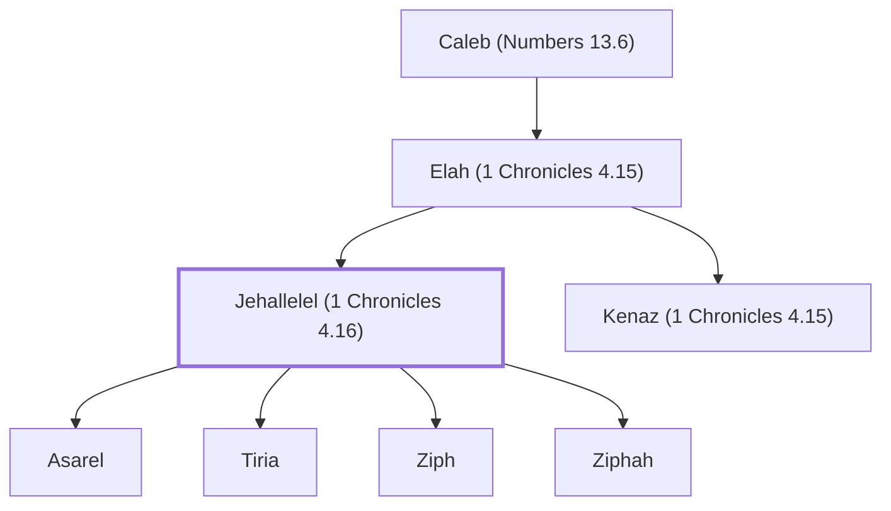

# Jehallelel (1 Chronicles 4.16)

Son of Elah, descendant of Judah

**Original-language names:** יְהַלֶּלְאֵל (H3094)

## When

- **Placed around:** [[connections/timeline/18th century BC|1721 BC]] *(Ussher: the median date of the passages naming them)*

## Family

- **Father:** [[connections/people/Elah (1 Chronicles 4.15)|Elah (1 Chronicles 4.15) (uncertain)]]
- **Brothers and sisters:** [[connections/people/Kenaz (1 Chronicles 4.15)|Kenaz (1 Chronicles 4.15) (uncertain)]]
- **Children:** [[connections/people/Asarel|Asarel]], [[connections/people/Tiria|Tiria]], [[connections/people/Ziph|Ziph]], [[connections/people/Ziphah|Ziphah]]
- **Tribe or nation:** Tribe of Judah

**Line of descent** (4 generations, father to son): [[connections/people/Jephunneh (Numbers 13.6)|Jephunneh (Numbers 13.6)]] → [[connections/people/Caleb (Numbers 13.6)|Caleb (Numbers 13.6)]] → [[connections/people/Elah (1 Chronicles 4.15)|Elah (1 Chronicles 4.15)]] → **Jehallelel (1 Chronicles 4.16)**

**Family group:** [[connections/genealogy/Family of Jephunneh (Numbers 13.6)|Family of Jephunneh (Numbers 13.6)]], generation 4

## Appears in

[[connections/chapters/13-1-chronicles/1 Chronicles 4|1 Chronicles 4]]

## Appears in the same verse as

[[connections/people/Asarel|Asarel]] · [[connections/people/Tiria|Tiria]] · [[connections/people/Ziph|Ziph]] · [[connections/people/Ziphah|Ziphah]]
