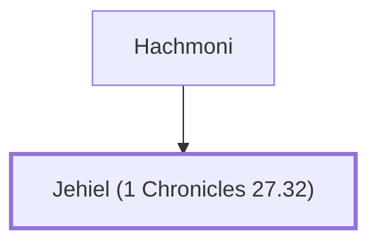

# Jehiel (1 Chronicles 27.32)

King David's uncle and counselor

**Original-language names:** יְחִיאֵל (H3171)

## When

- **Placed around:** [[connections/timeline/11th century BC|1015 BC]] *(Ussher: the median date of the passages naming them)*

## Family

- **Father:** [[connections/people/Hachmoni|Hachmoni]]

**Family group:** [[connections/genealogy/Family of Hachmoni|Family of Hachmoni]], generation 2

## Appears in

[[connections/chapters/13-1-chronicles/1 Chronicles 27|1 Chronicles 27]]

## Appears in the same verse as

[[connections/people/David|David]] · [[connections/people/Hachmoni|Hachmoni]] · [[connections/people/Jonadab (2 Samuel 13.3)|Jonadab (2 Samuel 13.3)]]
