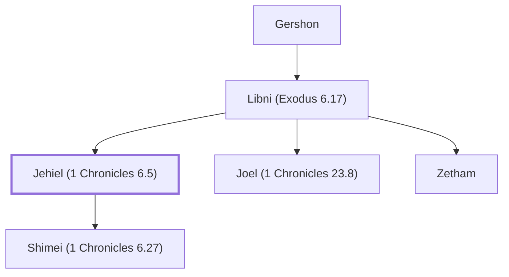

# Jehiel (1 Chronicles 6.5)

Levite leader during the reign of King David

**Also called:** Jehieli, Jahath

**Original-language names:** יְחִיאֵל (H3171) · יְחִיאֵלִי (H3172) · יַ֫חַת (H3189)

## When

- **Placed around:** [[connections/timeline/11th century BC|1015 BC]] *(Ussher: the median date of the passages naming them)*

## Family

- **Father:** [[connections/people/Libni (Exodus 6.17)|Libni (Exodus 6.17) (uncertain)]]
- **Brothers and sisters:** [[connections/people/Joel (1 Chronicles 23.8)|Joel (1 Chronicles 23.8)]], [[connections/people/Zetham|Zetham]]
- **Children:** [[connections/people/Shimei (1 Chronicles 6.27)|Shimei (1 Chronicles 6.27)]]
- **Tribe or nation:** Tribe of Levi

**Line of descent** (27 generations, father to son): [[connections/people/Adam|Adam]] → [[connections/people/Seth|Seth]] → [[connections/people/Enosh|Enosh]] → [[connections/people/Kenan|Kenan]] → [[connections/people/Mahalalel (Genesis 5.12)|Mahalalel (Genesis 5.12)]] → [[connections/people/Jared|Jared]] → [[connections/people/Enoch (Genesis 5.18)|Enoch (Genesis 5.18)]] → [[connections/people/Methuselah|Methuselah]] → [[connections/people/Lamech (Genesis 5.25)|Lamech (Genesis 5.25)]] → [[connections/people/Noah (Genesis 5.29)|Noah (Genesis 5.29)]] → [[connections/people/Shem|Shem]] → [[connections/people/Arpachshad|Arpachshad]] → [[connections/people/Cainan|Cainan]] → [[connections/people/Shelah (Genesis 10.24)|Shelah (Genesis 10.24)]] → [[connections/people/Eber (Genesis 10.21)|Eber (Genesis 10.21)]] → [[connections/people/Peleg|Peleg]] → [[connections/people/Reu|Reu]] → [[connections/people/Serug|Serug]] → [[connections/people/Nahor (Genesis 11.22)|Nahor (Genesis 11.22)]] → [[connections/people/Terah|Terah]] → [[connections/people/Abraham|Abraham]] → [[connections/people/Isaac|Isaac]] → [[connections/people/Israel|Israel]] → [[connections/people/Levi (Genesis 29.34)|Levi (Genesis 29.34)]] → [[connections/people/Gershon|Gershon]] → [[connections/people/Libni (Exodus 6.17)|Libni (Exodus 6.17)]] → **Jehiel (1 Chronicles 6.5)**

**Family group:** [[connections/genealogy/Family of Adam|Family of Adam]], generation 27

## Appears in

[[connections/chapters/13-1-chronicles/1 Chronicles 6|1 Chronicles 6 (2)]] · [[connections/chapters/13-1-chronicles/1 Chronicles 23|1 Chronicles 23]] · [[connections/chapters/13-1-chronicles/1 Chronicles 26|1 Chronicles 26 (2)]] · [[connections/chapters/13-1-chronicles/1 Chronicles 29|1 Chronicles 29]]

## Appears in the same verse as

[[connections/people/Libni (Exodus 6.17)|Libni (Exodus 6.17) (3)]] · [[connections/people/Gershon|Gershon (2)]] · [[connections/people/Joel (1 Chronicles 23.8)|Joel (1 Chronicles 23.8) (2)]] · [[connections/people/Zetham|Zetham (2)]] · [[connections/people/Levi (Genesis 29.34)|Levi (Genesis 29.34)]] · [[connections/people/Zimmah (1 Chronicles 6.5)|Zimmah (1 Chronicles 6.5)]]
