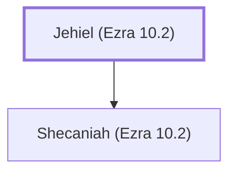

# Jehiel (Ezra 10.2)

A leader who married a foreign wife

**Original-language names:** יְחִיאֵל (H3171)

## Family

- **Children:** [[connections/people/Shecaniah (Ezra 10.2)|Shecaniah (Ezra 10.2)]]

**Family group:** [[connections/genealogy/Family of Jehiel (Ezra 10.2)|Family of Jehiel (Ezra 10.2)]], generation 1

## Appears in

[[connections/chapters/15-ezra/Ezra 10|Ezra 10]]

## Appears in the same verse as

[[connections/people/Elam (Ezra 2.7)|Elam (Ezra 2.7)]] · [[connections/people/Ezra (Ezra 7.1)|Ezra (Ezra 7.1)]] · [[connections/people/Israel|Israel]] · [[connections/people/Shecaniah (Ezra 10.2)|Shecaniah (Ezra 10.2)]]
