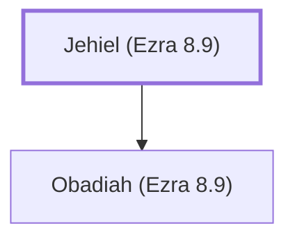

# Jehiel (Ezra 8.9)

Leader who returned to Jerusalem with Ezra

**Original-language names:** יְחִיאֵל (H3171)

## When

- **Placed around:** [[connections/timeline/5th century BC|457 BC]] *(Ussher: the median date of the passages naming them)*

## Family

- **Children:** [[connections/people/Obadiah (Ezra 8.9)|Obadiah (Ezra 8.9)]]

**Family group:** [[connections/genealogy/Family of Jehiel (Ezra 8.9)|Family of Jehiel (Ezra 8.9)]], generation 1

## Appears in

[[connections/chapters/15-ezra/Ezra 8|Ezra 8]]

## Appears in the same verse as

[[connections/people/Joab (Ezra 8.9)|Joab (Ezra 8.9)]] · [[connections/people/Obadiah (Ezra 8.9)|Obadiah (Ezra 8.9)]]
