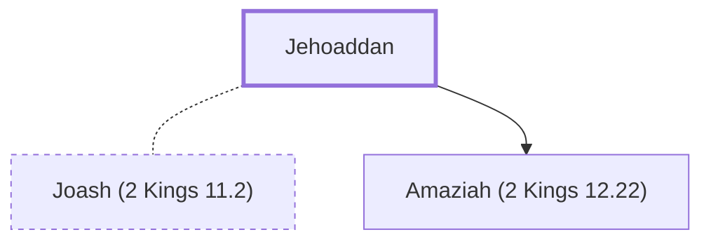

# Jehoaddan

Mother of King Amaziah of Judah

**Original-language names:** יְהוֹעַדָּן (H3086) · יְהוֹעַדִּין (H3086)

## When

- **Placed around:** [[connections/timeline/9th century BC|839 BC]] *(Ussher: the median date of the passages naming them)*

## Family

- **Spouses:** [[connections/people/Joash (2 Kings 11.2)|Joash (2 Kings 11.2)]]
- **Children:** [[connections/people/Amaziah (2 Kings 12.22)|Amaziah (2 Kings 12.22)]]

**Family group:** [[connections/genealogy/Family of Adam|Family of Adam]], generation 45

## Appears in

[[connections/chapters/12-2-kings/2 Kings 14|2 Kings 14]] · [[connections/chapters/14-2-chronicles/2 Chronicles 25|2 Chronicles 25]]

## Appears in the same verse as

[[connections/places/Jerusalem|Jerusalem (2)]] · [[connections/people/Amaziah (2 Kings 12.22)|Amaziah (2 Kings 12.22)]]
