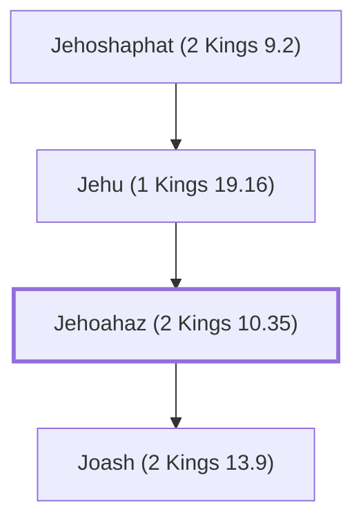

# Jehoahaz (2 Kings 10.35)

King of Israel, son of Jehu

**Also called:** Joahaz

**Original-language names:** יְהוֹאָחָז (H3059) · יוֹאָחָז (H3099)

## When

- **Placed around:** [[connections/timeline/9th century BC|839 BC]] *(Ussher: the median date of the passages naming them)*

## Family

- **Father:** [[connections/people/Jehu (1 Kings 19.16)|Jehu (1 Kings 19.16)]]
- **Children:** [[connections/people/Joash (2 Kings 13.9)|Joash (2 Kings 13.9)]]
- **Tribe or nation:** Israel

**Line of descent** (4 generations, father to son): [[connections/people/Nimshi|Nimshi]] → [[connections/people/Jehoshaphat (2 Kings 9.2)|Jehoshaphat (2 Kings 9.2)]] → [[connections/people/Jehu (1 Kings 19.16)|Jehu (1 Kings 19.16)]] → **Jehoahaz (2 Kings 10.35)**

**Family group:** [[connections/genealogy/Family of Nimshi|Family of Nimshi]], generation 4

## Events

- [[connections/timeline/9th century BC|857 BC]] · [[connections/events/Reign of Jehoahaz|Reign of Jehoahaz]]
- [[connections/timeline/9th century BC|840 BC]] · [[connections/events/Death of Jehoahaz|Death of Jehoahaz]]

## Appears in

[[connections/chapters/12-2-kings/2 Kings 10|2 Kings 10]] · [[connections/chapters/12-2-kings/2 Kings 13|2 Kings 13 (8)]] · [[connections/chapters/12-2-kings/2 Kings 14|2 Kings 14 (3)]] · [[connections/chapters/14-2-chronicles/2 Chronicles 25|2 Chronicles 25 (2)]]

## Appears in the same verse as

[[connections/people/Israel|Israel (11)]] · [[connections/people/Joash (2 Kings 13.9)|Joash (2 Kings 13.9) (8)]] · [[connections/people/Judah (Genesis 29.35)|Judah (Genesis 29.35) (6)]] · [[connections/people/Amaziah (2 Kings 12.22)|Amaziah (2 Kings 12.22) (5)]] · [[connections/people/Joash (2 Kings 11.2)|Joash (2 Kings 11.2) (5)]] · [[connections/people/Jehu (1 Kings 19.16)|Jehu (1 Kings 19.16) (4)]] · [[connections/places/Samaria|Samaria (4)]] · [[connections/places/Syria|Syria (3)]] · [[connections/people/Hazael|Hazael (2)]] · [[connections/people/Ahaziah (2 Kings 8.24)|Ahaziah (2 Kings 8.24)]] · [[connections/people/Ben-hadad (2 Kings 13.3)|Ben-hadad (2 Kings 13.3)]]
