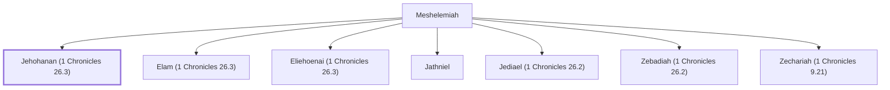

# Jehohanan (1 Chronicles 26.3)

Levite gatekeeper during the reign of David

**Original-language names:** יְהוֹחָנָן (H3076)

## When

- **Placed around:** [[connections/timeline/11th century BC|1015 BC]] *(Ussher: the median date of the passages naming them)*

## Family

- **Father:** [[connections/people/Meshelemiah|Meshelemiah]]
- **Brothers and sisters:** [[connections/people/Elam (1 Chronicles 26.3)|Elam (1 Chronicles 26.3)]], [[connections/people/Eliehoenai (1 Chronicles 26.3)|Eliehoenai (1 Chronicles 26.3)]], [[connections/people/Jathniel|Jathniel]], [[connections/people/Jediael (1 Chronicles 26.2)|Jediael (1 Chronicles 26.2)]], [[connections/people/Zebadiah (1 Chronicles 26.2)|Zebadiah (1 Chronicles 26.2)]], [[connections/people/Zechariah (1 Chronicles 9.21)|Zechariah (1 Chronicles 9.21)]]
- **Tribe or nation:** Tribe of Levi

**Family group:** [[connections/genealogy/Family of Meshelemiah|Family of Meshelemiah]], generation 2

## Appears in

[[connections/chapters/13-1-chronicles/1 Chronicles 26|1 Chronicles 26]]

## Appears in the same verse as

[[connections/people/Elam (1 Chronicles 26.3)|Elam (1 Chronicles 26.3)]] · [[connections/people/Eliehoenai (1 Chronicles 26.3)|Eliehoenai (1 Chronicles 26.3)]]
